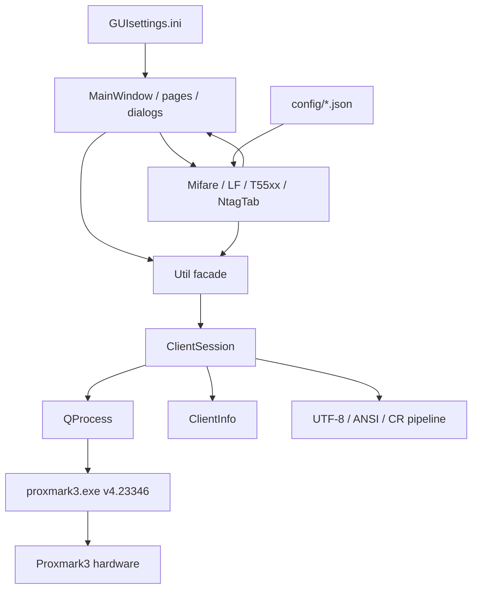
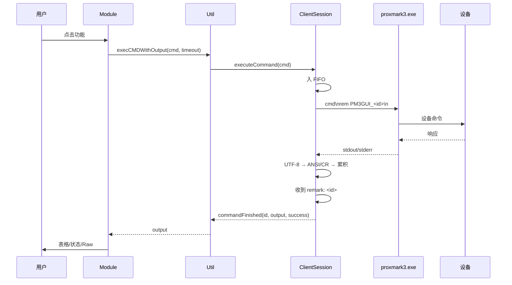

# ARCHITECTURE_UPGRADE.md

**项目：** Proxmark3GUI  
**升级版本：** v0.3.0  
**目标 Client：** Iceman v4.23346  
**技术栈：** C++11 / Qt 5.15.x / Qt Widgets / qmake / Windows  
**分支：** `upgrade/iceman-v4.23346`

---

## 1. 升级目标与约束

本次升级不是重写，而是在保留原 Qt Widgets GUI、布局、MIFARE/LF 业务和文件格式的前提下：

1. 建立独立 Core 通信层；
2. 修复与 v4.23346 的命令/输出差异；
3. 保留 Raw 终端和现有操作流程；
4. 恢复 T55xx 原 UI；
5. 新增 NTAG/Ultralight 页面；
6. 增加可选 LF 原始采样波形；
7. 明确区分“已实现 / 已编译 / Client 集成验证 / 真实硬件验证 / Experimental”。

约束：

- 固定 Qt 5.15.x、qmake、Qt Widgets；
- 不迁移 Qt6/CMake；
- 只适配 v4.23346，不建立多版本兼容框架或动态命令发现系统；
- 不自行实现 USB/串口协议，继续通过官方 Client 子进程；
- 不删除原有可用功能；
- 不伪造命令、参数、输出或硬件能力。

---

## 2. 原架构问题

```text
MainWindow / Mifare / LF / T55xx
        │ 直接调用
        ▼
      Util
        │ 信号/槽
        ▼
  PM3Process (QProcess in QThread)
        │
        ▼
   proxmark3.exe
```

问题：

1. 命令完成依赖固定文本/超时；
2. `Util::execCMDWithOutput()` 在 GUI 线程 `processEvents()` 忙等，存在重入；
3. 断开检测使用 `QSerialPortInfo::isBusy()`，对 TCP/BT/崩溃不可靠；
4. 输出无 ANSI/UTF-8/CR 处理；
5. 连接判定依赖 `os:` 文本，无版本/固件结构；
6. 各模块直接操作 `Ui::MainWindow`，通信逻辑分散；
7. 无测试、无 Mock。

---

## 3. 新架构



### 3.1 Core 层：`ClientSession`

文件：

- `src/core/clientinfo.h`
- `src/core/clientsession.h`
- `src/core/clientsession.cpp`

职责：

- 唯一 `QProcess` 实例；
- 启动/停止/重启；
- 连接握手、版本解析；
- 命令 FIFO；
- 完成哨兵；
- 超时与忙碌状态；
- stdout/stderr；
- UTF-8/ANSI/CR；
- 进程退出/错误；
- 版本信息 `ClientInfo`。

不依赖任何 Widget，不直接操作 UI。

### 3.2 兼容层：`Util`

保留：

```cpp
void execCMD(const QString& cmd);
QString execCMDWithOutput(const QString& cmd, ReturnTrigger trigger = 10000, bool rawOutput = false);
```

内部变化：

- `execCMDWithOutput` 调用 `ClientSession::executeCommand()`；
- 用 `QEventLoop` + `QTimer` 等待 `commandFinished`；
- `QEventLoop::ExcludeUserInputEvents`，避免按钮重入；
- 不再使用 `QApplication::processEvents()` 忙等；
- 不再依赖 `QTime`/固定文本触发。

旧模块（MIFARE/LF/T55xx）不需要一次性改成异步，降低迁移风险。

### 3.3 业务模块

| 模块 | 职责 | 变化 |
|---|---|---|
| `Mifare` | MF Classic 读写/攻击/仿真/文件 | 修复 UID 解析、超时、Trace、文件 IO、安全确认 |
| `LF` | LF 配置/操作/波形入口 | 新增 `Show Waveform`；保留原文本路径 |
| `T55xx` | T55xx 配置页/EM410x | 新增，恢复原 UI；未验证字段禁用 |
| `NtagTab` | NTAG/UL 识别/读写 | 新增独立页面 |
| `WaveformWidget/Dialog` | 原始采样绘制 | 新增，Qt5 QPainter |

---

## 4. 命令执行流程



### 4.1 为什么使用 `rem` 哨兵

v4.23346 在管道模式下没有可用提示符；`rem <token>` 是 Client 本地命令，执行后输出：

```text
[+] <timestamp> remark: <token>
```

它不访问设备，且紧跟在命令之后，能可靠表示“上一条命令已返回”。  
交互式/长时间命令（sniff/tune/sim）仍使用 fire-and-forget，不附加哨兵。

### 4.2 超时

- 普通命令：`max(waitTime + 5000, 15000)`；
- `hf mf chk`：60 s；实测 27 s；
- Nested：60 s；
- 超时后调用者收到失败，但 ClientSession 保持 active 等待迟到哨兵，避免在上一条命令仍在运行时写入下一条；
- 用户可 Stop 强制恢复。

---

## 5. 输出处理

`ClientSession`：

1. `readAllStandardOutput/Error()`；
2. 增量 UTF-8 解码（保留跨块不完整序列）；
3. ANSI CSI/OSC 清理；
4. `\r\n` / `\r` → `\n`；
5. 累积到 active command；
6. 过滤内部 `rem` 哨兵行；
7. `newOutput` → `Util::processOutput` → Raw；
8. `commandFinished` → 调用者解析。

---

## 6. 连接/状态

`ClientSession` 状态：

```text
Disconnected → Connecting → Connected → Busy → Connected
                         ↘ Error / Disconnected
```

- 连接成功条件：`hw version` 输出中存在 firmware 版本（`OS.........`）；
- 版本字段：client / firmware / bootrom / model / hardware；
- 退出：`finished` / `errorOccurred`；不再轮询串口占用；
- 手动断开：发送 `quit`，最多等 800 ms，再 `kill`；
- 重启：Stop 按钮调用 `restartClient()`。

---

## 7. 安全设计

- 危险操作二次确认：
  - MF Restore / Wipe / Lock UFUID / Set Parameter；
  - T55xx EM410x clone；
  - NTAG/UL 写页/批量写。
- NTAG/UL 页面保护：
  - 0–3 只读；
  - config/OTP 区只读；
  - 未知型号禁写；
  - 写入后复读验证。
- 不提供固件刷写/擦除。
- 不修改 Client 目录或设备固件。

---

## 8. 新增页面

### 8.1 T55xx

- 原 `mainwindow.ui` 配置页保留；
- 追加 EM410x 克隆；
- Block 0 本地 hex/bin + 已验证 bit 字段；
- `lf t55xx detect/info/config`；
- 未验证字段禁用，不伪造。

### 8.2 NTAG/Ultralight

- 独立 QWidget 页；
- `hf mfu info/rdbl/wrbl`；
- 页数来自 v4.23346 源码常量，`cfg0` 可覆盖；
- 读全部/选中/单页，编辑、写、复读。

### 8.3 LF 波形

- LF 页 `Show Waveform`；
- `data save -f` 导出 `.pm3` 文本；
- QPainter 绘制原始采样；
- 无采样率时不伪造时间轴；
- 文本输出仍在 RawCommand。

---

## 9. 与旧架构的兼容

保留：

- Qt Widgets 页面/布局/按钮；
- MIFARE 表格编辑/Access Bits；
- LF 配置/操作；
- Raw 终端；
- Settings；
- CLI 配置 JSON；
- 中英文资源。

移除/替换：

- `PM3Process` 不再编译（文件保留在 Git 历史）；
- `T55xxTab` 动态页不再编译（由原页面 + `T55xx` 替代）；
- `QSerialPortInfo::isBusy()` 断开检测。

---

## 10. 已知架构限制

1. 普通命令仍是同步 facade；UI 在等待时用本地事件循环（排除用户输入），不是全异步命令总线。
2. Raw/fire-and-forget 命令不进入 FIFO；切换长命令时仍需用户 Stop。
3. 未实现持久化日志文件。
4. 未实现动态命令发现/多版本框架（按项目约束）。
5. 真实硬件验证受当前 256K 无 LF 固件限制。
6. 页面几何沿用原固定坐标，窄窗口可能裁切右侧分组。

---

## 11. 后续扩展建议

- 将 MIFARE/LF/T55xx 的同步调用逐步改为 `commandFinished` 异步回调；
- 增加持久日志与诊断导出；
- 用真实 NTAG/UL 标签完善 `hf mfu info` 解析；
- 换用含 LF 的固件/设备后验证 T55xx/LF；
- 为配置 JSON 增加 schema 校验与命令预览；
- 最终迁移到 Qt6 时再处理 `QTextCodec`、`setIniCodec` 等 API（本次不迁移）。
