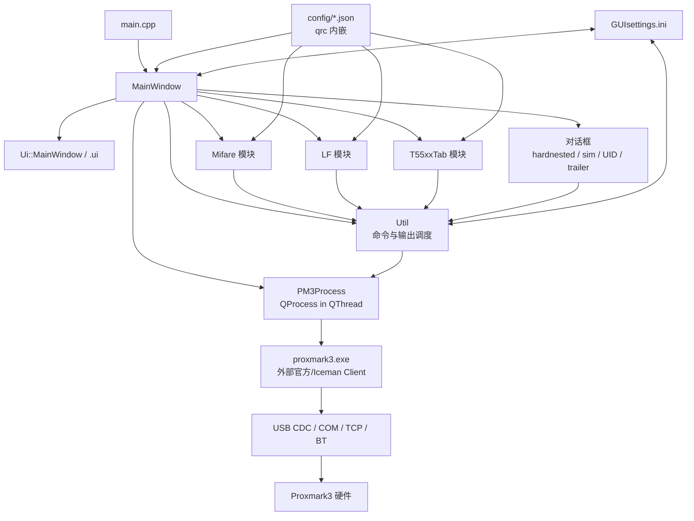
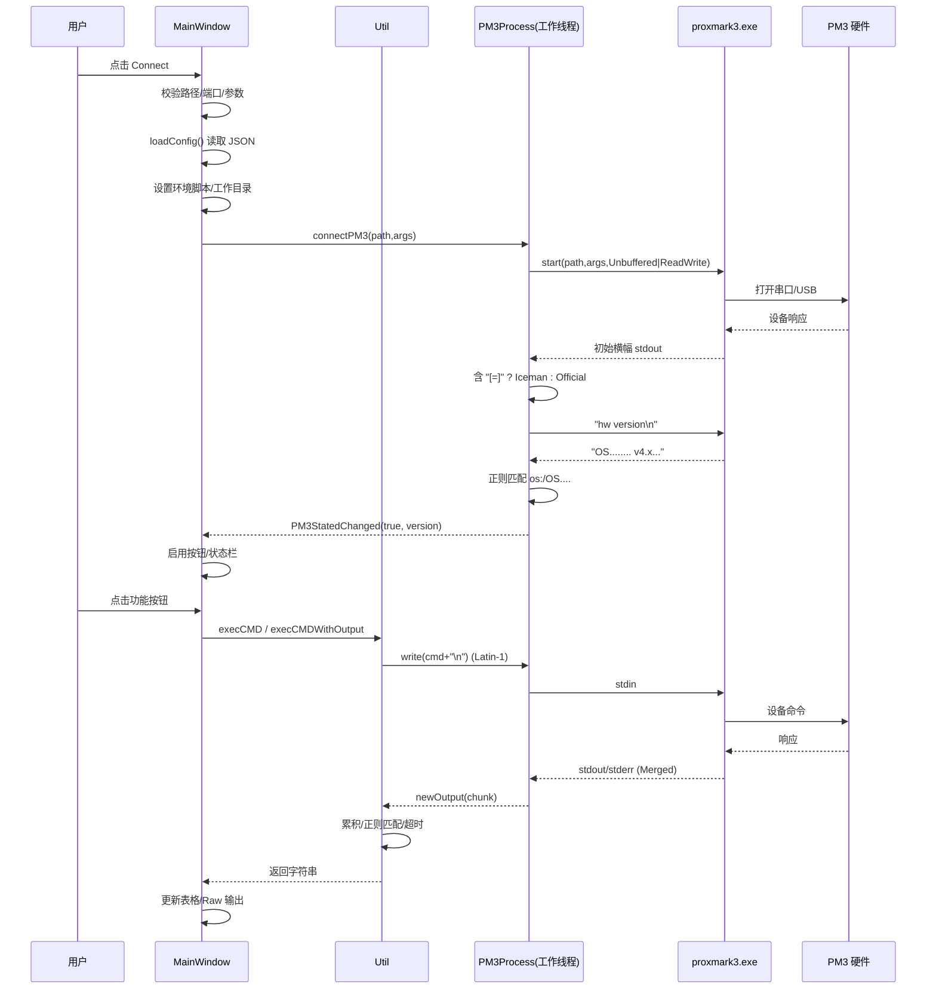

# AUDIT_STAGE1.md

**项目：** Proxmark3GUI（wh201906）  
**审计对象：** `E:\Opencode_project\Proxmark3GUI-master`  
**审计阶段：** Stage 1 — 旧项目全面审计（只读）  
**审计日期：** 2026-11-10  
**上游基准：** RfidResearchGroup/proxmark3（Iceman Fork）  
**本地基准客户端：** `E:\Opencode_project\pm3-256-iceman-v4.23346\proxmark3.exe`  
**结论等级：** 架构可修复 / 不建议重写 / 存在必须先处理的兼容性与安全问题

---

## 0. 审计声明与限制

### 0.1 本次实际执行的操作

- 只读检查全部源码、UI、资源、配置、文档与工程文件。
- 检查 Git 状态；原目录**不是 Git 仓库**，无分支、无提交历史、无远程。
- 为建立可回滚点，新增了 Git 元数据（未修改任何源码）：
  - 基线提交：`964c60b`
  - 基线标签：`baseline-v0.2.8`
  - 工作分支：`upgrade/iceman-v4.23346`
- 通过公开 GitHub API 检查了上游最新 Release、Tag 与 master HEAD。
- 运行了本地 `proxmark3.exe --help`、`--incognito -c "hw version"`、`--incognito -c "hf mf help"` 等**离线**命令，未连接、未写入任何设备。
- 未执行任何固件刷写、擦除、写卡、模拟、解锁或恢复操作。
- 未修改任何原有功能代码。

### 0.2 未完成/不能声称完成的事项

- **未完成实际编译。** 当前机器没有 qmake、Qt5 Core/Widgets/SerialPort、MSVC 或 MinGW Qt 工具链；因此“源码可编译”仅为工程结构判断，不是构建验证。
- **未连接真实 Proxmark3 硬件。** 所有涉及设备行为、输出格式、时序的结论均来自源码、上游源码和离线客户端，需 Stage 2/Stage 5 验证。
- **未验证 GUI 运行时界面。** 未启动旧版 GUI 二进制（仓库未附带可执行文件，且本机无 Qt 运行库）。
- 本文中“兼容/不兼容”均标注证据强度；无法确认的项目明确写为 **UNKNOWN**，不做猜测。

---

## 1. 项目概览

### 1.1 基本信息

| 项目 | 内容 |
|---|---|
| 名称 | Proxmark3GUI |
| 作者/维护 | wh201906 |
| 版本 | `VERSION = 0.2.8`（`src/Proxmark3GUI.pro`） |
| 语言 | C++11 |
| UI 框架 | Qt 5（QtWidgets） |
| 构建系统 | qmake（`.pro`） |
| 平台 | Windows / Linux / macOS |
| 许可证 | GNU LGPL v2.1（仓库根 `LICENSE`） |
| 代码规模 | C++/头文件约 4,393 行；`mainwindow.ui` 约 3,300 行 |
| 资源 | 4 个内嵌 JSON 配置、2 种语言、QDarkStyle 深/浅色主题 |
| 测试 | **无测试代码、无 CI、无 Mock** |
| Git | 原目录无 Git；现已建立基线仓库与独立分支 |

### 1.2 目录结构

```text
Proxmark3GUI-master/
├─ .gitignore
├─ CHANGELOG.md
├─ LICENSE                       # LGPL-2.1
├─ README.md
├─ config/
│  ├─ config.qrc
│  ├─ config_official.json       # Proxmark3 official v3.1.0
│  ├─ config_rrgv4.13441.json
│  ├─ config_rrgv4.15864.json
│  └─ config_rrgv4.16717.json    # 当前默认（字典序最后）
├─ deploy/
│  ├─ deploy.py                  # 发布打包辅助，依赖 pywin32
│  ├─ .gitignore
│  └─ README.md
├─ doc/
│  ├─ CHANGELOG/                 # 中文更新日志
│  ├─ README/                    # 中英文说明与截图
│  ├─ preview/                   # 功能预览 GIF/PNG
│  └─ tutorial/
│     ├─ Quickstart/
│     ├─ Work_With_ProxSpace/
│     └─ Edit_Mifare_Classic_data/
├─ i18n/
│  ├─ en_US.ts / en_US.qm
│  ├─ zh_CN.ts / zh_CN.qm
│  ├─ language.qrc
│  └─ languages.ini
└─ src/
   ├─ Proxmark3GUI.pro
   ├─ main.cpp
   ├─ common/
   │  ├─ pm3process.h/.cpp       # 外部客户端进程封装
   │  ├─ util.h/.cpp             # 命令发送/输出收集/超时
   │  └─ myeventfilter.h/.cpp
   ├─ module/
   │  ├─ mifare.h/.cpp           # MIFARE Classic 业务逻辑（最大模块）
   │  ├─ lf.h/.cpp               # LF 配置与操作
   │  └─ t55xxtab.h/.cpp         # T55xx 页（实际仅 EM410x 克隆）
   ├─ ui/
   │  ├─ mainwindow.h/.cpp/.ui
   │  ├─ mf_attack_hardnesteddialog.*
   │  ├─ mf_sim_simdialog.*
   │  ├─ mf_trailerdecoderdialog.*
   │  ├─ mf_uid_parameterdialog.*
   │  └─ t55xxtab.ui
   └─ qdarkstyle/
      ├─ dark/
      └─ light/
```

### 1.3 入口、主窗口与页面

- 入口：`src/main.cpp:10`。
- 主窗口：`MainWindow`（`src/ui/mainwindow.*`），由 `MainWindow::initUI()` 在 `main()` 中初始化。
- 功能区使用 `QDockWidget` 拆分/停靠（`mainwindow.cpp:1606`）。
- 实际可见页面：
  1. **Mifare**
  2. **LF**
  3. **T55xx**（运行时插入的动态页）
  4. **RawCommand**
  5. **Settings**

`mainwindow.ui` 中原有一个占位的 `t55xxTab` 页面（含大量 T55xx 配置控件），但构造时先插入真正的 `T55xxTab`，再 `removeTab(3)` 删除占位页（`mainwindow.cpp:48,55`）。因此：

> **T55xx 的 “Basic Configuration(Page 0 Block 0)” 和 “T55xx Read Config” 界面在运行时被移除，且 `t55xxtab.cpp` 中没有任何对应逻辑。**

### 1.4 构建与运行环境

`src/Proxmark3GUI.pro` 关键内容：

```qmake
QT += core gui serialport
greaterThan(QT_MAJOR_VERSION, 4): QT += widgets
CONFIG += c++11
VERSION = 0.2.8
```

- README 给出的 Linux 构建：`qmake ../src && make -j4`。
- 未提供 CMake、Visual Studio 工程、CI 配置或 Windows 一键构建脚本。
- `deploy/deploy.py`：
  - 使用 `win32api.GetFileVersionInfo`（pywin32）。
  - 假定存在 `../build*32_bit-Release`、`../build*64_bit-Release`。
  - 依赖 `deploy/32`、`deploy/64`、`deploy/client` 模板目录；这些目录被 `.gitignore` 忽略，仓库中不存在。
  - 结论：**从仓库本身无法完整复现官方 Release 打包流程**。

本机实际检测：

| 工具 | 状态 |
|---|---|
| Git | `C:\msys64\usr\bin\git.exe` 2.56.0（已用于建立基线） |
| CMake | 4.4.4（MSYS2） |
| MSYS2 g++ | 存在（`/usr/bin/g++`） |
| Qt5 / qmake | **不存在** |
| Qt5SerialPort | **不存在** |
| MSVC `cl` | **不存在** |
| Python | WindowsApps 别名存在（未用于本项目） |

**构建结论：当前环境无法编译本项目。** Stage 2/4 前必须先建立 Qt5 构建环境（建议 Qt 5.15.x + 对应编译器 + QtSerialPort），并锁定版本。

### 1.5 依赖分析

| 依赖 | 版本/来源 | 用途 | 风险 |
|---|---|---|---|
| Qt Core/Gui/Widgets | 未锁定，代码面向 Qt5 | 全部 UI、进程、JSON、设置 | Qt5 已 EOL；Qt6 有多处 API 不兼容 |
| Qt SerialPort | Qt5 模块 | COM 枚举、`QSerialPortInfo::isBusy()` | 仅用于枚举/占用检测，不实现底层协议 |
| QDarkStyleSheet | commit `6ff5fdf` | 深/浅色 QSS 与图标 | 上游为 MIT（已核对该 commit 的 `LICENSE.rst`），但仓库内未附许可证文本 |
| C++ 标准库 | C++11 | 基础 | 无 |
| Proxmark3 Client | 外部进程 | 唯一设备通信通道 | 版本/命令/输出格式强耦合；当前仅配置到 v4.16717 |
| pywin32 | 仅 `deploy.py` | 读取 EXE 版本 | 不参与 GUI 运行 |
| Python | 仅发布脚本 | 打包 | 与运行无关 |

**结论：** 没有隐藏的第三方通信库，没有自实现 USB/串口协议栈，也没有 Web/网络依赖。技术栈简单，这是可修复性的有利条件。

### 1.6 配置持久化、国际化、日志

| 能力 | 实现 | 评价 |
|---|---|---|
| 配置持久化 | `QSettings("GUIsettings.ini", IniFormat)`，相对当前工作目录 | 路径不可写时静默失败；无 schema/版本 |
| 客户端路径历史 | `QSettings` 数组，最多 32 条 | 可用 |
| 页面折叠状态 | `UI_grpbox_preference` 按 objectName 保存 | 可用；依赖控件名 |
| Dock 布局 | 未保存/恢复 | 用户自定义布局重启丢失 |
| 主题/字体/透明度 | QSettings | 可用 |
| 国际化 | `en_US`、`zh_CN` 的 `.ts/.qm`；`QTranslator` | 可用；`zh_CN.ts` 仍有 22 条 unfinished；`en_US.ts` 262 条均为 unfinished（英语为源语言） |
| 日志 | 仅 Raw 输出窗口；`qDebug()` 输出到调试器/控制台 | **无文件日志、无时间戳、无轮转、无持久化** |
| 崩溃诊断 | 无 | 无全局异常捕获/崩溃报告 |

---

## 2. 技术架构

### 2.1 架构总览



### 2.2 模块职责与依赖

| 模块 | 职责 | 依赖 | 耦合问题 |
|---|---|---|---|
| `main.cpp` | QApplication、翻译、主题、插件路径 | MainWindow | 直接持有全局设置 |
| `MainWindow` | 主窗口、连接管理、所有按钮槽、设置、Dock、卡片表格 | Ui、PM3Process、Util、Mifare、LF、T55xxTab、对话框 | 职责过多；UI 与业务/通信混合 |
| `PM3Process` | 启动/杀死客户端、stdin 写入、stdout 读取、端口占用轮询 | QProcess、QSerialPortInfo | 仅有一个 `QProcess`；无命令队列；错误处理不完整 |
| `Util` | `execCMD` / `execCMDWithOutput`、输出累积、超时、语言选择 | QApplication、PM3Process 信号 | 阻塞式等待 + `processEvents()`；`isRunning` 未初始化 |
| `Mifare` | MIFARE Classic 读写、密钥、攻击、仿真、Trace、文件格式、访问位 | Util、Ui、配置 JSON、对话框 | 直接操作 UI；输出解析脆弱；危险操作无确认 |
| `LF` | LF 配置读取/设置、read/sniff/search/tune | Util、Ui、配置 JSON | 依赖客户端 `hw status` 文本；`data plot` 依赖客户端 QT GUI |
| `T55xxTab` | 仅 EM410x 读取/克隆 | Util、配置 JSON | 大量 UI 无逻辑 |
| 对话框 | 构造 hardnested/sim/UID raw 命令 | Util | 命令格式硬编码在 C++ 中，未进配置 |
| 配置 JSON | 命令模板、参数映射、输出正则 | qrc | 无版本自动选择、无 schema、无运行时发现 |

**总体评价：** 典型“UI 直接调用工具类”的 Qt 小工具架构。没有 Client Adapter，没有命令注册表，没有服务层，也没有测试边界。模块之间通过 `Ui::MainWindow*` 和 `Util*` 直接耦合，导致任何客户端命令变化都可能扩散到多个窗口/模块。

### 2.3 线程模型

```text
GUI 主线程
├─ MainWindow / 所有窗口 / 所有模块（Mifare、LF、T55xx）
├─ Util（生活在主线程）
│   └─ execCMDWithOutput(): 在主线程内循环 + QApplication::processEvents()
└─ 信号/槽

PM3 工作线程（QThread）
└─ PM3Process（QProcess）
    ├─ start/kill/waitForStarted/waitForReadyRead
    ├─ readyRead -> onReadyRead -> newOutput
    └─ QTimer serialListener（1s，检测端口 isBusy）
```

关键问题：

1. `Util::execCMDWithOutput()` 在 GUI 线程中用 `processEvents()` 忙等（`util.cpp:53-79`），造成：
   - 重入风险：等待期间仍可处理点击/定时器/信号；
   - UI 卡顿；
   - 与 `setState(false)` 的“禁用按钮”策略竞争。
2. 所有命令共用同一个 `QProcess`，没有队列/互斥；长命令（sniff/tune/hardnested/sim）与后续命令可能交错。
3. `PM3Process` 的 `serialListener` 定时器无父对象且未释放（`pm3process.cpp:9`），存在小泄漏。
4. `MainWindow` 析构顺序可疑：先 `delete ui`，再 `emit killPM3()`，最后 `delete pm3`；同时 `QThread::finished` 又连接了 `deleteLater`（`mainwindow.cpp:72-80`，`36`），存在跨线程删除/重复删除风险。

### 2.4 事件处理

- 大量使用 Qt 自动连接命名槽：`on_<Object>_<signal>`。
- 自定义事件过滤器：Raw 命令框上下键历史、表格 resize。
- 拖放：文件拖入数据/密钥表格（`eventFilter`，`mainwindow.cpp:1322`）。
- 没有全局快捷键/命令面板；命令历史不持久化。

---

## 3. Proxmark3 通信实现（重点审计）

### 3.1 结论：通信模式判定

**判定：B —— 通过官方 Proxmark3 Client 执行命令。**

证据：

- `PM3Process` 继承 `QProcess`，`start(path, args, ...)` 启动外部客户端（`pm3process.cpp:33`）。
- 命令通过客户端 stdin 写入：`QProcess::write(data.toLatin1())`（`pm3process.cpp:141-144`）。
- 输出通过客户端 stdout/stderr 合并读取：`MergedChannels`（`pm3process.cpp:6`）。
- `QSerialPort` 仅用于：
  - `QSerialPortInfo::availablePorts()` 枚举端口（`mainwindow.cpp:119`）；
  - `QSerialPortInfo::isBusy()` 轮询端口是否被占用（`pm3process.cpp:130`）。
- 没有任何 USB 控制传输、CDC 协议、PM3 NG 帧、命令 CRC、固件协议实现。

因此：

- **不是** A（直接操作串口和底层协议）。
- **不是** C（混合通信）。
- 仅存在“A 的非协议边缘”：用 `QSerialPortInfo::isBusy()` 做设备存在性/断开检测。这不构成第二套通信机制，但它是当前断开检测的唯一手段，也是主要缺陷之一。

### 3.2 COM 端口枚举与设备识别

位置：`mainwindow.cpp:113-156`。

- 每 2 秒刷新 `QSerialPortInfo::availablePorts()`。
- 通过 VID/PID 标记疑似 Proxmark3：
  - `0x9AC4:0x4B8F`
  - `0x2D2D:0x504D`
- 否则按描述/序列号/厂商字符串包含 `proxmark` 或 `iceman` 标记。
- 只是标记 `" *"`，不强制过滤；用户可手输端口（`PM3_portBox` 可编辑）。
- 端口列表变化时重填下拉框；若当前有标记端口则自动选中。

风险：

- VID/PID 是硬编码；新硬件（如 PM5、不同克隆板、BT 模块）可能不匹配。
- 字符串匹配依赖驱动提供的描述，跨平台不稳定。
- 没有“设备能力/型号”识别，只有“像不像 PM3”。

### 3.3 Client 启动参数与路径

位置：`mainwindow.cpp:158-271`。

- 客户端路径来自可编辑 `PM3_pathBox`，历史保存在 `QSettings`。
- 校验：在 Windows 上按 `PATHEXT` 尝试补全扩展名；其他平台只检查文件存在。
- 启动参数模板默认 `"<port> -f"`（`Set_Client_startArgsEdit`）。
- 端口替换：`startArgs.replace("<port>", port).split(' ')`（`mainwindow.cpp:212`）。
- 若参数中没有 `<port>`，则端口置空（依赖客户端自动搜索/离线模式）。
- 若参数包含 `<port>` 但用户未选端口，弹出提示。
- 通过 `QProcessEnvironment`/预加载脚本设置环境变量（见 3.4）。
- 工作目录：GUI 目录 + 设置中的相对目录（默认 `../data`），再 `mkpath`/`cd`。

问题：

1. **参数按单个空格拆分**：不支持带空格的参数、引号、连续空格；会生成空参数。
2. **端口/文件名未做客户端命令转义**：trace 文件名直接拼进 `trace save -f <filename>`，含空格会拆成多个参数。
3. **未校验 `-f`**：`-f` 是 GUI 实时处理输出的前提（注释也如此说）。用户删除后，输出缓冲会导致超时/解析失败，但 GUI 不提示。
4. **未使用 `-p` 强制端口**：默认位置参数在多数客户端可用，但不同版本/平台行为不完全一致；文档也承认某些情况要改成 `-p`。
5. **启动后未读取/记录客户端版本**（只有类型判断）。

### 3.4 连接握手与“连接成功”判定

位置：`pm3process.cpp:20-79`。

流程：

1. `start(path, args, QProcess::Unbuffered | QProcess::ReadWrite)`。
2. `waitForStarted(10000)`。
3. `waitForReadyRead(10000)` 读取初始横幅。
4. 若初始输出包含 `"[=]"` → 判定为 **Iceman**；否则为 **Official**。
5. 若为 Iceman：
   - 写入 `hw version\n`；
   - 最多 50 次 × 200ms（约 10s）等待输出中出现：
     ```cpp
     QRegularExpression osPattern("(os:\\s+|OS\\.+\\s+)");
     ```
   - 匹配到后，从匹配位置截取一行，再截取版本片段；
   - `emit changeClientType(clientType)`；
   - `emit PM3StatedChanged(true, result)`；
   - 否则 `emit HWConnectFailed()` 并 `kill()`。
6. 若为 Official：不发送 `hw version`，直接进入同样的 `os:` 匹配分支。由于 Official 客户端输出格式不同，该分支很可能失败（官方仓库已停止维护）。

评价：

- **当前 Iceman v4.23346 的 `hw version` 仍会打印 `OS........ <version>`**，因此 `OS\.+` 分支理论上仍能匹配；连接检测不是“已死”，但极度脆弱。
- 该逻辑把“连接成功”等同于“输出里出现某个字符串”，没有：
  - 客户端退出码检查；
  - 设备型号/固件版本校验；
  - Client/Firmware 兼容性校验；
  - 明确的连接状态机（Connecting / Connected / Error）。
- 无法区分：
  - 客户端启动失败；
  - 客户端进入 OFFLINE 模式；
  - 设备未插入；
  - 端口被占用；
  - 客户端崩溃；
  - 客户端正常退出。
- 初始 `waitForStarted` 失败时只依赖 `errorOccurred` 弹窗（`mainwindow.cpp:273-278`），没有状态清理。
- 多次点击 Connect 没有防重入，可能在同一个 `QProcess` 上重复 `start()`。

### 3.5 环境变量预加载脚本

位置：`mainwindow.cpp:215-253`。

- 若配置了脚本路径：
  - Windows：启动 `cmd`，写入 `"<script>">>nul`，再 `set`，读取环境变量；
  - Linux/macOS：`sh -c ' . "<script>">>/dev/null && env'`（代码中未完整测试）。
- 读取结果按行拆分，去掉首尾，`emit setProcEnv(&clientEnv)`。

问题：

- `waitForReadyRead(10000)` + `readAll()` 可能读到不完整的 `set` 输出（管道缓冲/时序）。
- 写入使用 `toLatin1()`（与 3.6 相同），非 ASCII 环境变量会损坏。
- 脚本是用户配置的任意可执行文件；这是设计功能，但属于高权限入口，需要信任提示/路径校验。
- 失败时静默回退为空环境，客户端可能因缺少 DLL 路径而启动失败，错误信息不明确。

### 3.6 命令发送

位置：`util.cpp:30-35`，`pm3process.cpp:141-144`。

```cpp
void Util::execCMD(const QString& cmd) {
    if(isRunning)
        emit write(cmd + "\n");
}

qint64 PM3Process::write(QString data) {
    return QProcess::write(data.toLatin1());
}
```

问题：

1. **`toLatin1()` 是明确缺陷。** 客户端/文件系统使用 UTF-8 或本地代码页；任何非 Latin-1 字符（中文路径、中文文件名、非 ASCII UID 注释等）都会变成 `?`。CHANGELOG 声称“Try to support Non-ASCII path”，但命令通道并未使用 UTF-8。
2. `Util::isRunning` 在 `Util` 构造函数中**未初始化**（`util.h:71`），只在之后收到 `PM3StatedChanged` 时设置。启动早期存在未定义行为：可能错误地允许/拒绝写命令。
3. 没有写入失败检查：`QProcess::write()` 返回值被忽略；管道关闭/进程退出时命令静默丢失。
4. 没有命令 ID、队列、序号；无法把输出与命令一一对应。

### 3.7 命令完成检测与超时

位置：`util.cpp:37-88`。

核心机制：

```cpp
QString Util::execCMDWithOutput(const QString& cmd, ReturnTrigger trigger, bool rawOutput)
{
    isRequiringOutput = true;
    requiredOutput->clear();
    execCMD(cmd);
    while (QTime::currentTime() < targetTime) {
        QApplication::processEvents();
        for (QString otpt : trigger.expectedOutputs) {
            if (QRegularExpression(otpt).match(*requiredOutput).hasMatch()) {
                isResultFound = true;
                break;
            }
        }
        if (isResultFound) { delay(200); break; }
        if (timeStamp > currTime) { // 有新输出则刷新超时
            currTime = timeStamp;
            targetTime = timeStamp.addMSecs(trigger.waitTime);
        }
    }
    ...
}
```

特征：

- 完成条件 = 输出中出现某个正则/字符串，**或** 固定“空闲超时”。
- 没有任何提示符、哨兵、命令 ID、结束标记。
- 超时被“新输出”刷新：只要客户端持续输出，就永不超时；若客户端卡死且无输出，等固定时间。
- 使用 `QTime`（毫秒、24 小时制），跨午夜会出错。
- `QApplication::processEvents()` 允许重入。
- `rawOutput` 语义复杂：有 expectedOutputs 且未匹配时返回空串（失败标志），否则返回原始输出。
- 没有区分 stdout/stderr；`MergedChannels` 把错误混入正常输出。

**这是整个项目最脆弱的核心。** 任何客户端输出文案变化、颜色码、进度条、空行、警告，都可能导致误判/超时/截断。

### 3.8 输出读取、编码、ANSI、缓冲

位置：`pm3process.cpp:146-157`，`mainwindow.cpp:309-315`。

```cpp
void PM3Process::onReadyRead() {
    QString out = readAll();          // QByteArray -> QString（隐式 UTF-8）
    if(isRequiringOutput) requiredOutput->append(out);
    if(out != "") emit newOutput(out);
}
```

问题：

- **没有 ANSI 转义序列清理。** 客户端可能输出颜色控制码；Raw 窗口会显示 `ESC[...m`，解析正则也可能被颜色码打断。
- **没有增量 UTF-8 解码器。** 多字节字符可能被 `readAll()` 在中间截断，产生替换字符。
- **没有 `\r` 处理。** 客户端进度条使用 `\r`；`QPlainTextEdit::insertPlainText` 对 `\r` 的行为不适合终端式刷新。
- **没有输出上限/滚动缓冲。** 长时间 sniff/trace/大 dump 会持续增长内存。
- **无时间戳**，无法判断命令耗时/超时点。
- **Raw 输出永久只增不减**，`clearOutput` 只是用户手动清空。

### 3.9 断开、异常、重连

位置：`pm3process.cpp:98-134, 172-177`，`mainwindow.cpp:273-333`。

当前机制：

- 连接成功后，若端口非空且未勾选 “Keep the client active”，启动 1 秒定时器：
  ```cpp
  if(!portInfo->isBusy()) killPM3();
  ```
- `killPM3()`：
  - `kill()`（硬杀）；
  - `emit PM3StatedChanged(false)`；
  - 停止端口监听。
- `Stop` 按钮：先断开，再最多等 2 秒，然后 `reconnectPM3()`。
- **没有连接 `QProcess::finished` / `QProcess::errorOccurred` 的完整处理。**
- **没有自动重连**（只有 Stop 按钮内部的“断开再连”）。

问题：

1. `isBusy()` 是平台相关、已废弃的启发式：
   - Linux/macOS 上不可靠（项目因此在非 Windows 默认禁用）；
   - TCP/BT 连接没有串口占用状态；
   - 端口被其他程序占用/驱动异常时误判；
   - 打开端口做检测本身可能干扰客户端。
2. 若启用 “Keep the client active” 或使用 TCP/BT，客户端崩溃/退出后 GUI **完全不知道**，状态栏仍显示 Connected。
3. 客户端异常退出时，若没有端口监听，`execCMDWithOutput` 会一直等到超时（或永远被输出刷新）。
4. `kill()` 是硬终止，可能留下设备忙、临时文件、未完成的写操作。
5. 重连只重建进程，不重新验证固件/型号/配置；旧命令状态可能残留。
6. `onPM3ErrorOccurred` 只处理 `FailedToStart`；`Crashed`、`ReadError`、`WriteError`、`Timedout` 等没有用户反馈或状态迁移。

### 3.10 通信时序（当前实现）



---

## 4. 现有功能盘点

### 4.1 功能矩阵

状态说明：

- **可用**：代码路径完整，静态看可工作；未做硬件验证。
- **有问题**：功能存在，但存在兼容性、健壮性、安全或体验缺陷。
- **仅 UI**：界面存在，没有实际业务逻辑。
- **未实现**：项目没有该功能。
- **不兼容**：已用上游源码/当前客户端确认命令/输出不再匹配。

| # | 功能 | 实现位置 | 状态 | 说明/证据 |
|---|---|---|---|---|
| 1 | 设备连接（串口） | `mainwindow.cpp:158` | 可用（未硬件验证） | 启动外部客户端，读取 `OS....` |
| 2 | 蓝牙 / TCP 连接 | 启动参数 + 端口框 | 有问题 | 无专门 UI；`isBusy` 监听对非串口无意义；可能 1 秒内被杀 |
| 3 | COM 端口枚举/识别 | `mainwindow.cpp:113` | 可用 | VID/PID + 字符串启发式 |
| 4 | 硬件信息 | `pm3process.cpp:43-67` | 有问题 | 只截取 OS 版本；无型号/固件/天线/内存 |
| 5 | Client 版本检测 | 无 | 未实现 | 只判断 Official/Iceman，不解析 v4.x |
| 6 | Client/Firmware 兼容检查 | 无 | 未实现 | 不检查版本关系/构建配置 |
| 7 | HF 14A 卡片信息 | `mifare.cpp:99` | 可用（未验证） | `hf 14a info` / `-nsv`；解析 UID/ATQA/SAK |
| 8 | HF 通用搜索 | 无 | 未实现 | 无 `hf search` 页面 |
| 9 | LF 搜索 | `lf.cpp:32` | 可用（未验证） | `lf search -u` |
| 10 | MIFARE Classic 读块/读扇区 | `mifare.cpp:296-462` | 有问题 | `rdbl`/`rdsc`；固定 300ms 空闲超时 |
| 11 | MIFARE Classic 写块/写选中 | `mifare.cpp:580-753` | 有问题 | `wrbl --force`；失败判定仅看 “fail/error” |
| 12 | MIFARE Classic Dump | `mifare.cpp:755` | 有问题 | 无文件选择；依赖客户端默认命名 |
| 13 | MIFARE Classic Restore | `mifare.cpp:765` | **高风险** | 无文件选择；`--force`；按当前 UID 找默认 dump，可能恢复错误文件 |
| 14 | 密钥检查 | `mifare.cpp:131` | 有问题 | `hf mf chk`；固定超时 1s+200ms×扇区；输出表格依赖固定正则 |
| 15 | Nested / StaticNested | `mifare.cpp:170` | 有问题 | 固定 15s；用 `result.contains("static")` 回退，脆弱 |
| 16 | Hardnested | `mifare.cpp:255` + 对话框 | 可用（未验证） | 命令模板在 JSON；参数由对话框拼接 |
| 17 | Darkside | `mifare.cpp:264` | 有问题 | 命令存在；但该攻击对现代卡常无效，且无结果解析 |
| 18 | 中文 Magic Card 读/写 | `mifare.cpp:343-371,611-628` | 有问题 | `cgetblk/csetblk`；无确认 |
| 19 | Magic Card 擦除 | `mifare.cpp:775` | **高风险** | `cwipe` 无确认 |
| 20 | Magic Card 锁卡（UFUID） | `mifare.cpp:803` | **高风险** | 连续 6 条 `hf 14a raw`；无确认；可能不可逆 |
| 21 | Magic Card 设置 UID/ATQA/SAK | `mifare.cpp:785` + 对话框 | 有问题 | `csetuid`；无写前确认 |
| 22 | 模拟器内存读/写/清空 | `mifare.cpp:359-368,629-638,815` | 可用（未验证） | `egetblk/esetblk/eclr` |
| 23 | MIFARE 仿真 | `mf_sim_simdialog.cpp` | **不兼容** | 新客户端已无 `--crack`；见 5.2 |
| 24 | HF Sniff | `mifare.cpp:272` | 可用（未验证） | `hf sniff`、`hf 14a sniff` |
| 25 | LF Read / Sniff | `lf.cpp:16,24` | 有问题 | `lf read -v` / `lf sniff -v` + `data plot`；绘图依赖客户端 QT GUI，而当前 Windows 客户端 `QT GUI support... absent` |
| 26 | LF Tune | `lf.cpp:39` | 可用（未验证） | `lf tune --divisor` |
| 27 | LF Config 读取/设置/重置 | `lf.cpp:74-134` | 可用（未验证） | `hw status` 文本解析 + `lf config` + `hw setlfdivisor` |
| 28 | Trace 列表 | `mifare.cpp:288` | 可用（未验证） | `trace list -t mf` |
| 29 | Trace 保存 | `mifare.cpp:847` | **不兼容/有问题** | 新客户端 `trace save` 默认从设备下载；保存已加载 buffer 需 `-1`；GUI 未传 |
| 30 | Trace 加载 | `mifare.cpp:829` | **不兼容** | 触发字符串 `"loaded"` 在当前客户端不存在；实际输出 `Recorded Activity ...` |
| 31 | 二进制/文本 dump 文件 | `mifare.cpp:1030-1075` | 有问题 | 行数/长度越界；无格式校验 |
| 32 | 密钥文件读写 | `mifare.cpp:1077-1226` | 有问题 | 空 key/短文件会读出全 0；无校验 |
| 33 | Access Bits 解码器 | `mf_trailerdecoderdialog.cpp` | 可用 | 纯本地计算，无设备依赖 |
| 34 | T55xx EM410x 读取 | `t55xxtab.cpp:28` | 可用（未验证） | `lf em 410x reader` |
| 35 | T55xx EM410x 克隆 | `t55xxtab.cpp:50` | 可用（未验证） | `lf em 410x clone --id <id> --q5` |
| 36 | T55xx 配置页 | `mainwindow.ui` 的 t55xxTab | **仅 UI/已移除** | 运行时 `removeTab(3)`；无逻辑 |
| 37 | T5577/T5555 直接读写配置 | 无 | 未实现 | 无 `lf t55xx` 配置 GUI |
| 38 | Raw 命令终端 | `mainwindow.cpp:343` | 可用 | 单行命令、历史、清空 |
| 39 | 命令历史持久化 | 无 | 未实现 | 仅内存 QListWidget |
| 40 | 日志文件 | 无 | 未实现 | 只有 Raw 窗口 |
| 41 | 国际化 | `i18n/*` | 可用 | 中/英；22 条中文未完成 |
| 42 | 主题/字体/透明度 | `mainwindow.cpp:1138-1263` | 可用 | QDarkStyle + QSettings |
| 43 | Dock 布局自定义 | `mainwindow.cpp:1606` | 可用 | 但不保存布局 |
| 44 | 脚本管理 | 无 | 未实现 | 不暴露客户端 Lua/Python 脚本 |
| 45 | Ultralight / NTAG | 无 | 未实现 | 无 `hf mfu` 页面 |
| 46 | ISO14443B | 无 | 未实现 | 无 `hf 14b` |
| 47 | ISO15693 | 无 | 未实现 | 无 `hf 15` |
| 48 | HID Prox | 无 | 未实现 | 无 `lf hid` |
| 49 | iCLASS | 无 | 未实现 | 无 `hf iclass` |
| 50 | DESFire | 无 | 未实现 | 无 `hf mfdes` |
| 51 | FeliCa | 无 | 未实现 | 无 `hf felica` |
| 52 | Smart Card | 无 | 未实现 | 无 `smart` |
| 53 | 固件升级/刷写 | 无 | 未实现（设计上安全） | GUI 不提供 flash，符合“不擅自刷写” |
| 54 | HF 天线调谐 | 无 | 未实现 | 仅 LF `lf tune` |
| 55 | 自动重连 | 仅 Stop 按钮 | 有问题 | 无崩溃/拔出后自动恢复 |
| 56 | 错误分类/诊断 | 部分 | 有问题 | 只弹窗；无错误码/日志 |
| 57 | 非 ASCII 路径 | 声称支持 | 有问题 | 命令写入 `toLatin1()`，中文文件名会损坏 |
| 58 | 命令队列/取消 | 无 | 未实现 | 单进程、无队列、硬杀取消 |
| 59 | ANSI/UTF-8/CR 处理 | 无 | 未实现 | 直接 `insertPlainText` |
| 60 | 单元测试/Client Mock | 无 | 未实现 | 无测试目录 |

### 4.2 项目实际使用的客户端命令清单

> 以下命令来自 4 个 JSON 配置和 C++ 硬编码，属于“GUI 当前会发送的命令全集”。Stage 2 将逐条对照 v4.23346。

**MIFARE / HF：**

- `hf 14a info`
- `hf 14a info -nsv`
- `hf 14a sniff`
- `hf 14a raw ...`
- `hf sniff`
- `hf mf chk --mini|--1k|--2k|--4k`
- `hf mf nested ...`
- `hf mf staticnested ...`
- `hf mf hardnested ...`
- `hf mf darkside`
- `hf mf rdbl --blk ... -a|-b -k ...`
- `hf mf rdsc --sec ... -a|-b -k ...`
- `hf mf wrbl --blk ... -a|-b -k ... -d ... --force`
- `hf mf dump --mini|--1k|--2k|--4k`
- `hf mf restore --mini|--1k|--2k|--4k --force`
- `hf mf eclr`
- `hf mf egetblk --blk ...`
- `hf mf esetblk --blk ... -d ...`
- `hf mf cgetblk --blk ...`
- `hf mf cgetsc --sec ...`
- `hf mf csetblk --blk ... -d ...`
- `hf mf cwipe`
- `hf mf csetuid --uid ... --atqa ... --sak ...`
- `hf mf sim --mini|--1k|--2k|--4k ...`
- `trace list -t mf`
- `trace list --buffer -t mf`
- `trace save -f <filename>`
- `trace load -f <filename>`

**LF / T55xx：**

- `lf read -v`
- `lf sniff -v`
- `lf search -u`
- `lf tune --divisor <divisor>`
- `lf config --divisor ... --bps ... --dec ... --avg ... --trig ... --skip ...`
- `hw status`
- `hw setlfdivisor -d <divisor>`
- `data plot`
- `lf em 410x reader`
- `lf em 410x clone --id <id> [--q5]`
- `prefs show`

**连接/版本：**

- `hw version`

**没有使用的危险命令（good）：**

- 没有任何 `--flash`、`--unlock-bootloader`、`--erase`、`fw` 相关调用。

### 4.3 明确的“假 UI / 死代码”

1. **T55xx 配置页**
   - `mainwindow.ui` 中存在：
     - `Basic Configuration(Page 0 Block 0)`
     - `Analog Front-End Option(Page 1 Block 3)`
     - `T55xx Read Config`
     - `Get from Data` / `Set to Data` 等按钮
   - 但 `t55xxtab.cpp` 只引用：
     - `cloneGroupBox`
     - `Clone_EM410xIDEdit`
     - `Clone_T5555Button`
     - `Clone_T55x7Button`
   - 且该页面在运行时被 `removeTab(3)` 删除。
   - 结论：**大量 UI 是死代码，不应在文档/发布说明中宣称已支持 T55xx 配置。**

2. **Official Client 分支**
   - `Util::ClientType`、`MF_Sim_simDialog` 中存在 Official 专用命令格式。
   - 但官方仓库 `Proxmark/proxmark3` 已停止维护多年，当前 GUI 也没有 Official 客户端的验证路径。
   - 结论：代码保留可以，但应标记“遗留/不保证”，不能作为主要兼容目标。

3. **LF “绘图”**
   - GUI 发送 `data plot`，但当前 Windows 客户端构建显示 `QT GUI support............ absent`。
   - GUI 自身没有波形控件；Raw 窗口只显示文本。
   - 结论：LF Read/Sniff 的“图形化”能力实际上不成立，需要 Stage 3/4 决定是自绘波形还是调用外部工具。

---

## 5. 与最新版 Iceman 的初步兼容性（Stage 2 预告）

### 5.1 上游基线（本次实际核对）

| 项目 | 值 | 来源 |
|---|---|---|
| 最新 Release | `v4.23346`（2026-09-17） | GitHub Releases API |
| Release 名称 | `proxmark3-v4.23346` / “Frosty Lemon” | API |
| Tag commit | `dc0110c29d320e04b37ea436ee2924901407ae72` | Git tag API（annotated tag `e7e65a1`） |
| master HEAD（审计日） | `1bd629931acb193aa2592d355f5ce6f20f354803`（2026-11-10） | GitHub Commits API |
| 本地客户端 | `Iceman/master/v4.23346-suspect 2026-09-18 ... 9ce8a4b6c` | `proxmark3.exe --incognito -c "hw version"` |
| 本地客户端 GUI 支持 | `QT GUI support............ absent` | 同上 |

**重要：** 本审计使用 **tag `v4.23346` 的源码** 做命令对照，而不是仅看 master；master 在该 tag 之后仍有提交。

### 5.2 已确认的差异（有源码证据）

| GUI 功能 | 旧命令/假设 | v4.23346 实际 | 影响 | 证据 |
|---|---|---|---|---|
| MIFARE 仿真 | `hf mf sim ... --crack` | `--crack` **不存在**；使用 `-x` / `-y` / `-e` 等 | 勾选 “x” 后命令解析失败 | tag `v4.23346` `client/src/cmdhfmf.c` 的 `hf mf sim` argtable 无 `crack`；GUI `mf_sim_simdialog.cpp:98` 写入 `--crack` |
| Trace 加载 | 等待输出包含 `"loaded"` 再执行 `trace list` | `trace load` 输出 `Recorded Activity (TraceLen = ...)`，无 `"loaded"` | 加载后不会刷新列表；等待 10 秒后静默失败 | `mifare.cpp:836`；tag `cmdtrace.c` `CmdTraceLoad` |
| Trace 保存（加载后保存） | `trace save -f <file>` 默认保存客户端 buffer | 默认从设备下载；保存 buffer 需 `-1`/`--buffer` | “Load → Save”会保存设备当前 trace，而不是刚加载的文件 | tag `cmdtrace.c` `CmdTraceSave` 帮助与实现 |
| Trace 列表 | `trace list --buffer -t mf` | 仍支持 `-1`/`--buffer` 与 `-t` | 兼容 | tag `cmdtrace.c` argtable |
| MIFARE 恢复 | `hf mf restore --1k --force`（无文件） | 仍支持；无 `-f` 时按当前卡 UID 生成 `hf-mf-<UID>-dump.bin` | 可能恢复当前 UID 对应的旧 dump；无文件选择 | tag `cmdhfmf.c` `CmdHF14AMfRestore` |
| MIFARE 检查 | `hf mf chk --1k` | 仍支持 `--1k` | 兼容（输出格式待运行验证） | tag `cmdhfmf.c` `CmdHF14AMfChk` |
| MIFARE Nested | `hf mf nested --1k --blk ... -a -k ...` | 仍支持 | 兼容（输出格式待运行验证） | tag `cmdhfmf.c` `CmdHF14AMfNested` |
| MIFARE 写块 | `hf mf wrbl ... --force` | 仍支持 `--force` | 兼容 | tag `cmdhfmf.c` `CmdHF14AMfWrBl` |
| 14A 信息 | `hf 14a info -nsv` | 仍支持；但 `-n` 现在是 `nacktest`，`-s` 是 `aidsearch` | 命令可执行，语义/耗时可能变化 | tag `cmdhf14a.c` `CmdHF14AInfo` |
| 14A Raw 锁卡序列 | `hf 14a raw -ak ...` | 仍支持 `-a`/`-k`/`-b` | 兼容（危险操作） | tag `cmdhf14a.c` `CmdHF14ARaw` |
| LF Tune | `lf tune --divisor N` | 仍支持 `--divisor` | 兼容 | tag `cmdlf.c` `CmdLFTune` |
| LF Config | `lf config --divisor --bps --dec --avg --trig --skip` | 仍支持这些长参数 | 兼容 | tag `cmdlf.c` `CmdLFConfig` |
| LF 搜索 | `lf search -u` | 仍支持 `-u` | 兼容 | tag `cmdlf.c` |
| EM410x 克隆 | `lf em 410x clone --id ... --q5` | 仍支持 `--id`、`--q5` | 兼容 | tag `cmdlfem410x.c` |
| Trace 路径 | `prefs show` 中 `trace save path.........` | 仍存在 | 兼容 | tag `preferences.c` |
| LF 配置读取 | `hw status` 的 `LF Sampling config` 字段 | 仍使用 `divisor` / `bits per sample` / `decimation` / `averaging` / `trigger threshold` / `samples to skip` | 兼容 | tag `armsrc/lfsampling.c` `printLFConfig()` |

> 以上“兼容”仅表示命令/参数在源码中存在，**不代表输出解析、时序和文件格式已通过运行验证**。Stage 2 必须用 mock/真实设备逐项确认。

### 5.3 动态命令发现的可行性

当前客户端支持：

- `-h/--help`
- `-t/--text`：一次性输出交互命令列表
- `--fulltext`：输出所有命令帮助
- `-m/--markdown`：Markdown 形式的命令列表
- `help` / `<command> help`

但实测发现：

```text
proxmark3.exe --incognito -c "hf mf help"
→ 只列出 list / hardnested / decrypt / keygen / acl / mad / value / view / ginfo / gdmparsecfg
   （设备相关命令被隐藏）

proxmark3.exe --incognito -c "hf mf chk help"
→ [!] This command is not available in this mode
```

**结论：** 当前离线/无设备模式下，help 输出是**按可用性过滤**的，不能作为完整命令清单。Stage 2/3 必须：

1. 有设备连接时抓取 `-t` / `-m` / `--fulltext` / `help <cmd>`；
2. 无设备时使用上游 tag 的 `cmdparser.c` 命令表 + 各 `cmdhf*/cmdlf*.c` 的 argtable 作为回退；
3. 永远保留原始 help 文本与解析失败回退，不可把旧配置当作唯一事实来源。

### 5.4 版本/固件关系

当前 GUI **完全没有**：

- Client 版本号解析（`v4.23346`）；
- Firmware 版本/构建配置（`OS........` 只显示但不结构化）；
- 硬件型号（RDV4 / PM3 Easy / PM5 / GENERIC）；
- Client/Firmware 是否成对；
- 命令可用性矩阵；
- 配置版本自动选择。

目前唯一的“版本相关”逻辑是：

- 用 `[=]` 判断 Iceman；
- 用 `OS....` 截取显示字符串；
- 用 4 个手写 JSON 配置，默认选字典序最后的 `config_rrgv4.16717.json`。

因此当前默认配置**落后于**最新客户端 4 个大版本（16717 → 23346），且用户必须手动选/写 JSON。

---

## 6. 技术风险登记

严重度：**S1 阻断/高**，**S2 高**，**S3 中**，**S4 低**。

| ID | 风险 | 严重度 | 影响 | 证据/位置 | 建议 |
|---|---|---|---|---|---|
| R01 | 项目无 Git 基线 | S1 | 不可回滚 | 原目录无 `.git` | 已建立 `baseline-v0.2.8` / `upgrade/iceman-v4.23346` |
| R02 | 无 Qt 构建环境，未验证编译 | S1 | 无法交付可运行版本 | 本机无 qmake/Qt | Stage 2 先搭 Qt 5.15 + SerialPort |
| R03 | 默认配置停在 v4.16717 | S1 | 与 v4.23346 命令/输出不匹配 | `config/*.json`；`mainwindow.cpp:1190` | 版本检测 + 自动选择/动态发现 |
| R04 | 连接判定依赖 `os:`/`OS....` 文本 | S1 | 客户端文案变化即连接失败 | `pm3process.cpp:25,59` | 结构化握手 + 版本/设备状态 |
| R05 | Trace 加载触发串 `"loaded"` 已不存在 | S1 | Trace 加载功能失效 | `mifare.cpp:836`；tag `cmdtrace.c` | 改用 `Recorded Activity|TraceLen` 或哨兵 |
| R06 | `hf mf sim --crack` 已不存在 | S1 | 仿真“reader attack”失败 | `mf_sim_simdialog.cpp:98`；tag `cmdhfmf.c` | 改为 `-x`/`-y`，并做能力检测 |
| R07 | Trace 保存默认改为设备下载 | S2 | Load→Save 保存错误数据 | tag `cmdtrace.c` | 保存 buffer 时加 `-1` |
| R08 | Restore 无文件选择 + `--force` | S1 | 可能把错误 dump 写入卡 | `mifare.cpp:765` | 强制选择文件/确认/默认去 `--force` |
| R09 | Lock/Wipe/SetUID 无确认 | S1 | 误点可不可逆损坏卡 | `mainwindow.cpp:893-929`；`mifare.cpp:775,803` | 二次确认 + 风险提示 + 审计日志 |
| R10 | 断开检测仅靠 `isBusy()` | S1 | 崩溃/拔出后状态错误；TCP/BT 失效 | `pm3process.cpp:130` | `QProcess::finished/errorOccurred` + 心跳 |
| R11 | `Util::isRunning` 未初始化 | S2 | 启动期命令可能静默丢失/误发 | `util.h:71`；`util.cpp:33` | 构造函数初始化 + 状态机 |
| R12 | `write()` 使用 Latin-1 | S2 | 中文路径/文件名损坏 | `pm3process.cpp:143` | UTF-8 编码 + 明确协议 |
| R13 | 固定超时/文本触发 | S1 | 误判成功/失败/截断 | `util.cpp:37-88`；各模块 waitTime | 命令 ID/哨兵 + 可配置超时 |
| R14 | 无命令队列/取消 | S2 | 长命令与后续命令交错 | `Util::execCMD` | FIFO 队列 + 取消语义 |
| R15 | 输出无 ANSI/UTF-8/CR 处理 | S2 | 乱码/正则失效/Raw 污染 | `pm3process.cpp:148`；`mainwindow.cpp:313` | 增量解码 + ANSI 清理 |
| R16 | 无日志文件 | S2 | 无法诊断现场问题 | 无 | 结构化日志/原始日志双写 |
| R17 | `ACBits[3]` 未判空 | S1 | 非法访问位时越界/崩溃 | `mifare.cpp:328,447` | 校验长度后使用 |
| R18 | 文件加载/保存越界 | S1 | 短文件/空行导致崩溃或写 0 | `mifare.cpp:1059-1065,1148,1192` | 严格长度/行数/hex 校验 |
| R19 | `QProcess` 生命周期/析构 | S2 | 退出崩溃/重复删除 | `mainwindow.cpp:72-80`；`36` | 显式 stop/wait，单一所有权 |
| R20 | `QSettings` 相对 CWD | S3 | 安装目录不可写时配置丢失 | `main.cpp:27`；`mainwindow.cpp:30` | 使用 `QStandardPaths::AppConfigLocation` |
| R21 | 无 Dock/窗口布局持久化 | S3 | 用户自定义丢失 | 无 saveState | 保存 `saveState()` |
| R22 | 端口 VID/PID 硬编码 | S3 | 新硬件不识别 | `mainwindow.cpp:132-135` | 可配置 + 描述匹配 + 手动 |
| R23 | 非串口连接（BT/TCP）不健壮 | S3 | 连接后被监听器误杀 | `mainwindow.cpp:265-268` | 连接类型抽象 |
| R24 | LF 绘图依赖客户端 QT GUI | S2 | Windows 标准客户端无图 | 客户端输出 `QT GUI support absent` | 自绘/外部工具/明确提示 |
| R25 | T55xx 配置 UI 死代码 | S2 | 用户误以为支持 | `mainwindow.cpp:48,55`；`t55xxtab.cpp` | 实现或移除并文档说明 |
| R26 | 无测试/Mock/CI | S1 | 无法回归 | 无 tests | Stage 5 建设 |
| R27 | Qt5 EOL；Qt6 API 不兼容 | S2 | 长期维护风险 | `QTextCodec`、`setIniCodec`、`toTime_t`、`midRef` | 锁定 Qt5.15 或迁移 Qt6 |
| R28 | 错误处理只覆盖 FailedToStart | S2 | 崩溃无提示 | `mainwindow.cpp:273` | 完整 `ProcessError` 映射 |
| R29 | 外部配置可注入任意命令 | S3 | 恶意/错误配置执行危险命令 | `loadConfig()` + `execCMD` | schema 校验 + 命令预览 + 签名/信任 |
| R30 | 无许可证/NOTICE 完整清单 | S4 | 发布合规风险 | 根 LICENSE；qdarkstyle README | 补 NOTICE/第三方许可证 |
| R31 | `QTime` 跨午夜 | S4 | 超时计时异常 | `util.cpp:48-53` | 使用 `QElapsedTimer` |
| R32 | 端口检测可能干扰客户端 | S3 | 误杀/占用 | `isBusy()` | 移除/替换 |

---

## 7. 安全与许可证审计

### 7.1 安全

**未发现：**

- 硬编码密码/令牌/私钥；
- 远程代码执行后门；
- 自动下载/执行更新；
- 自动刷写固件；
- 网络监听/上传用户数据。

**发现：**

1. **危险操作缺少确认**
   - `Lock UFUID Card`：直接发送 6 条 raw 命令（`mifare.cpp:803-813`）；
   - `Wipe`（cwipe）：直接发送（`mifare.cpp:775`）；
   - `Restore`：直接发送 `--force`（`mifare.cpp:765`）；
   - `Set Parameter`（csetuid）：直接发送（`mf_uid_parameterdialog.cpp:20`）；
   - 以上均无“二次确认/输入卡 UID/风险说明”。
2. **Restore 目标不明确**
   - 无文件选择；客户端按当前卡 UID 自动找 `hf-mf-<UID>-dump.bin`；
   - 若目录中有旧 dump，可能写入非预期数据。
3. **预加载脚本**
   - 用户可配置任意 `.bat`/`.sh` 并被执行；这是功能，但应提示“仅使用可信脚本”。
4. **外部 JSON 配置**
   - 配置中的 `cmd` 会直接发送给客户端；恶意配置可在用户点击按钮时执行任意客户端命令（包括写卡/锁卡）。
   - 建议：配置 schema 校验、显示将发送的命令、对危险命令二次确认。
5. **Raw 终端**
   - 用户可以发送任意客户端命令；这是预期能力，但应在文档中明确风险。
6. **密钥/数据明文**
   - 密钥在内存/表格/文件中明文；Raw 输出可能包含密钥；无日志文件反而降低了泄漏面，但也没有审计能力。
7. **无签名/完整性校验**
   - 客户端路径、配置、更新均无校验；`Check Update` 只打开浏览器。

### 7.2 许可证

| 组件 | 许可证 | 结论 |
|---|---|---|
| Proxmark3GUI | LGPL-2.1（根 `LICENSE`） | 需保留许可证与修改声明 |
| QDarkStyleSheet | MIT（已核对 commit `6ff5fdf` 的 `LICENSE.rst`） | 与 LGPL 兼容；但仓库内未附 MIT 文本 |
| Qt | LGPLv3 / 商业（取决于构建） | 动态链接 + 提供替换方式；发布需合规 |
| Proxmark3 Client（外部） | GPLv3 | 独立进程；若随 Release 分发客户端二进制，需同时满足 GPLv3（源码提供/书面报价） |
| 本项目 JSON/文档/图片 | 随项目 LICENSE | 需确认图片/预览素材版权 |

**结论：未发现许可证冲突。** 但发布包缺少 `NOTICE`/第三方许可证文本，Stage 6 应补齐。

---

## 8. 构建、运行与测试现状

### 8.1 构建

- 工程文件：`src/Proxmark3GUI.pro`。
- 依赖：Qt Core/Gui/Widgets/SerialPort。
- 未锁定 Qt 小版本；未提供 `CMakeLists.txt`、`.sln`、CI。
- 未提供 Windows 下 `windeployqt` 步骤；`deploy.py` 只做打包目录复制/压缩。
- `.qm` 已提交，但 `.pro` 没有 `lrelease` 构建步骤；修改 `.ts` 后需手动生成 `.qm`。

### 8.2 运行

- 需要外部 `proxmark3` 客户端；GUI 不包含客户端。
- 官方 Release 将 GUI 与客户端放在同一压缩包，但仓库不包含客户端二进制。
- GUI 的默认工作目录 `../data` 需要手动创建/存在；代码会 `mkpath`。
- 默认配置为 `config_rrgv4.16717.json`（字典序最后）。
- 默认启动参数 `<port> -f`；Windows Iceman 客户端通常需要预加载脚本设置 DLL 路径。

### 8.3 测试

- **无单元测试、无集成测试、无 Mock、无 CI。**
- 没有任何自动化验证“命令构建/输出解析/版本识别/文件格式”。
- 因此当前所有兼容性结论只能来自静态分析 + 上游源码 + 离线客户端，不能视为设备验证。

---

## 9. 初步升级建议（Stage 3 方向，不在本阶段实施）

> 以下是基于审计结果的方向性建议，具体设计在 Stage 3 输出。Stage 1 不修改源码。

### 9.1 保留什么

- 保留 Qt Widgets + qmake 工程（可逐步迁移 CMake）。
- 保留现有 UI 布局、Dock、MIFARE 表格编辑、Access Bits 解码器、Trailer 解码器、文件拖放、主题/语言。
- 保留“通过官方 Client 子进程通信”的总体模式，不自行实现 USB 协议。
- 保留 Official Client 代码路径，但标记为 legacy/不保证。

### 9.2 必须新增的层

1. **ClientAdapter**
   - 路径/工作目录/环境管理；
   - 启动/停止/重启/退出码；
   - Client 版本、Firmware 版本、硬件型号；
   - 命令执行、stdout/stderr、超时、取消；
   - 连接状态机；
   - 单一 `QProcess` 所有权；
   - 命令队列 + 命令 ID。
2. **CommandRegistry**
   - 命令名、类别、参数 schema、适用硬件、最低版本、是否需要设备、危险等级、帮助文本；
   - 动态发现结果与手写配置合并；
   - 未适配的新命令仍可在 Raw 终端使用，不能隐藏。
3. **OutputPipeline**
   - 增量 UTF-8 解码；
   - ANSI/CR 清理；
   - 原始输出保留；
   - 结构化解析器（优先 JSON/表格，回退文本）；
   - 解析失败回退原始文本；
   - 日志文件 + 时间戳 + 轮转。
4. **VersionService**
   - 解析客户端 `-v` / `hw version`；
   - 解析固件 `OS........`、型号、构建配置；
   - Client/Firmware 配对检查；
   - 选择配置/功能可用性；
   - 不因版本号直接断定能力，需结合命令发现。
5. **SafetyService**
   - 写卡/锁卡/擦除/恢复/仿真前确认；
   - 危险命令分类；
   - 操作审计日志；
   - 默认不使用 `--force`；
   - Restore 必须显式选文件。

### 9.3 兼容性修复优先级（初步）

**P0（必须先做）**

- 建立 Qt5 构建环境，复现 v0.2.8 可运行版本；
- ClientAdapter + 连接状态机 + 版本检测；
- 替换 `os:`/`isBusy` 脆弱逻辑；
- Trace Load/Save 修复；
- `hf mf sim --crack` 修复；
- 原始终端 + 日志；
- 异常退出/重连；
- 危险操作确认。

**P1**

- MIFARE Classic 读/写/检查/攻击的解析与超时；
- 文件格式（bin/eml/key）严格校验；
- Restore 文件选择；
- LF 配置/读取；
- 常见卡片识别（14A/LF）；
- Trace 列表。

**P2**

- Ultralight/NTAG、ISO15693、iCLASS、DESFire、FeliCa、Smart Card、HID；
- T55xx 配置（实现或移除假 UI）；
- 脚本管理；
- 更多 LF 协议。

**P3**

- 新命令 GUI 封装；
- 输出可视化（波形/表格/图表）；
- 插件/扩展接口。

### 9.4 不建议的做法

- 不要直接把 GUI 重写成全新项目；现有 MIFARE 业务逻辑/表格/文件格式仍有价值。
- 不要把所有命令继续硬编码进 C++ 对话框；应进注册表/配置。
- 不要用“删除旧功能”制造兼容性；应保留并标注 legacy。
- 不要仅凭编译成功宣称兼容；必须 mock + 真实硬件只读测试。
- 不要让 GUI 直接写 USB/串口协议；继续使用官方 Client。

---

## 10. Stage 1 结论与进入 Stage 2 的条件

### 10.1 结论

1. **项目不是“无法挽救”的旧架构。** 代码量小、Qt 结构清晰、通信模式正确（外部 Client），MIFARE 业务逻辑较完整。
2. **核心通信机制没有完全失效，但非常脆弱。** 当前 `OS....` 正则仍可能匹配 v4.23346；但连接、完成检测、断开检测都依赖文本/端口启发式，不能长期演进。
3. **已确认至少 3 个与 v4.23346 不兼容的功能点：**
   - Trace 加载（`"loaded"` 触发串不存在）；
   - Trace 保存语义（默认改为设备下载）；
   - MIFARE 仿真 `--crack` 参数已移除。
4. **存在高危安全/数据风险：**
   - Restore 无文件选择 + `--force`；
   - Lock/Wipe/SetUID 无确认；
   - 非法 Access Bits 可能导致越界崩溃；
   - 文件加载/保存越界。
5. **存在明显功能缺口：**
   - 无版本检测、无动态命令发现、无日志、无测试；
   - T55xx 配置页是死 UI；
   - 大量协议（UL/NTAG、ISO15693、iCLASS、DESFire、FeliCa、Smart Card、HID）未实现；
   - LF 绘图依赖客户端 QT GUI，而当前 Windows 客户端未编译该 GUI。
6. **未发现许可证冲突。** 但发布合规材料不完整。
7. **未完成编译与硬件验证。** 这是 Stage 1 的明确限制，不是“已验证兼容”。

### 10.2 是否进入 Stage 2

**建议：进入 Stage 2，但先确认以下前置条件。**

- [ ] 确认本次审计结论与优先级；
- [ ] 确认允许安装/配置 Qt 5.15 + QtSerialPort 构建环境；
- [ ] 确认 Stage 2 可以拉取上游 `v4.23346` 源码/文档（只读）；
- [ ] 确认硬件测试默认只做只读（识别、版本、状态、天线），写卡/锁卡/恢复需单独授权；
- [ ] 确认保留 `main` 基线分支与 `upgrade/iceman-v4.23346` 工作分支；
- [ ] 确认 T55xx 死 UI 的处理方向（实现 vs 移除并文档说明）。

### 10.3 Stage 2 将做什么（预告）

1. 固定上游 tag `v4.23346`，建立源码快照/证据索引。
2. 提取客户端命令注册表（`cmdparser.c` + 各 `cmdhf*/cmdlf*.c` argtable）。
3. 用本地客户端离线 help / 连接设备后的 `-t`、`-m`、`--fulltext` 做动态发现验证。
4. 建立 `ICEMAN_COMPATIBILITY_MATRIX.md`：
   - 每条旧命令 → 新命令/参数/默认值/输出/状态/证据；
   - 无法确认的标 UNKNOWN；
   - 区分 Firmware 命令、Client 本地命令、脚本命令、GUI 功能。
5. 建立最小 Mock Client 原型，为 Stage 5 测试做准备（不在 Stage 2 大规模改 GUI）。

---

## 附录 A：本次审计的关键证据

### A.1 本地客户端版本

```text
> proxmark3.exe --incognito -c "hw version"
[=] No preferences file will be loaded
[+] execute command from commandline: hw version
[=] OFFLINE mode. Check "proxmark3.exe -h" if it's not what you want.
[=] No history will be recorded
[offline|script] pm3 --> hw version

 [ Proxmark3 ]
 [ Client ]
  Iceman/master/v4.23346-suspect 2026-09-18 00:22:18 9ce8a4b6c
  Compiler.................. MinGW-w64 16.2.0
  Platform.................. Windows (64b) / x86_64
  Readline support.......... present
  QT GUI support............ absent
  Native BT support......... absent
  Python script support..... present ( 3.14.10 )
  Python SWIG support....... present
  Lua script support........ present ( 5.4.7 )
  Lua SWIG support.......... present
```

### A.2 离线 help 过滤

```text
> proxmark3.exe --incognito -c "hf mf help"
...
help             This help
list             List MIFARE history
hardnested       Nested attack for hardened MIFARE Classic cards
decrypt          Decrypt Crypto1 data from sniff or trace
keygen           Generate key table for some known KDFs
acl              Decode and print MIFARE Classic access rights bytes
mad              Checks and prints MAD
value            Value blocks
view             Display content from tag dump file
ginfo            Info about configuration of the card
gdmparsecfg      Parse configuration data for GDM card

> proxmark3.exe --incognito -c "hf mf chk help"
[!] This command is not available in this mode
```

**含义：** 无设备时不能依赖 help 获取完整命令树；Stage 2 必须结合上游源码。

### A.3 上游源码证据（tag v4.23346）

- `client/src/cmdhfmf.c`：`hf mf sim` argtable 无 `--crack`。
- `client/src/cmdtrace.c`：`CmdTraceLoad` 输出 `Recorded Activity (TraceLen = ...)`，无 `"loaded"`；`CmdTraceSave` 默认 `download_trace_ex()`，`-1/--buffer` 才保存 buffer。
- `client/src/cmdhfmf.c`：`CmdHF14AMfRestore` 无 `-f` 时按当前 UID 生成 `hf-mf-<UID>-dump.bin`，并使用 `--force`。
- `client/src/cmdhf14a.c`：`hf 14a info` 的 `-n` 为 `nacktest`，`-s` 为 `aidsearch`；`hf 14a raw` 支持 `-a/-k/-b`。
- `client/src/cmdlf.c`：`lf tune --divisor`、`lf config` 长参数仍存在。
- `client/src/cmdlfem410x.c`：`lf em 410x clone --id --q5` 仍存在。
- `client/src/preferences.c`：`trace save path` 仍存在。
- `armsrc/lfsampling.c`：`printLFConfig()` 字段名未变。

### A.4 项目源码证据索引

| 主题 | 文件:行 |
|---|---|
| 入口 | `src/main.cpp:10` |
| 主窗口初始化 | `src/ui/mainwindow.cpp:102` |
| 端口枚举 | `src/ui/mainwindow.cpp:113` |
| 连接流程 | `src/ui/mainwindow.cpp:158` |
| 参数拆分 | `src/ui/mainwindow.cpp:212` |
| 环境脚本 | `src/ui/mainwindow.cpp:215` |
| 错误处理 | `src/ui/mainwindow.cpp:273` |
| 状态切换 | `src/ui/mainwindow.cpp:285` |
| Stop/重连 | `src/ui/mainwindow.cpp:317` |
| Raw 发送 | `src/ui/mainwindow.cpp:343` |
| 信号连接 | `src/ui/mainwindow.cpp:1272` |
| 设置持久化 | `src/ui/mainwindow.cpp:1481` |
| Dock | `src/ui/mainwindow.cpp:1606` |
| 进程启动 | `src/common/pm3process.cpp:33` |
| 连接握手 | `src/common/pm3process.cpp:39-75` |
| 端口监听 | `src/common/pm3process.cpp:130` |
| Latin-1 写入 | `src/common/pm3process.cpp:143` |
| 输出读取 | `src/common/pm3process.cpp:148` |
| 命令执行 | `src/common/util.cpp:30` |
| 阻塞等待 | `src/common/util.cpp:37-88` |
| `isRunning` 未初始化 | `src/common/util.h:71` |
| Info 解析 | `src/module/mifare.cpp:99` |
| Chk | `src/module/mifare.cpp:131` |
| Nested | `src/module/mifare.cpp:170` |
| Rdbl/Rdsc | `src/module/mifare.cpp:296-462` |
| Wrbl | `src/module/mifare.cpp:580` |
| Restore | `src/module/mifare.cpp:765` |
| Lock/Wipe | `src/module/mifare.cpp:775-813` |
| Trace Load | `src/module/mifare.cpp:829` |
| Trace Save | `src/module/mifare.cpp:847` |
| 文件加载 | `src/module/mifare.cpp:1030` |
| 文件保存 | `src/module/mifare.cpp:1132` |
| ACBits 越界 | `src/module/mifare.cpp:328,447` |
| LF 配置 | `src/module/lf.cpp:74` |
| T55xx 仅克隆 | `src/module/t55xxtab.cpp:28-67` |
| 动态页/删占位页 | `src/ui/mainwindow.cpp:48,55` |
| 仿真 `--crack` | `src/ui/mf_sim_simdialog.cpp:98` |
| Qt5 API | `src/main.cpp:23-28`；`mainwindow.cpp:978,1015`；`mifare.cpp:868` |

---

## 附录 B：Stage 1 交付物状态

| 交付物 | 状态 |
|---|---|
| `AUDIT_STAGE1.md` | 本文件 |
| 目录结构 | 已完成 |
| 架构图 | 已完成（Mermaid + 文本） |
| 模块清单 | 已完成 |
| 通信流程 | 已完成 |
| 依赖分析 | 已完成 |
| 技术风险 | 已完成（32 项） |
| 初步升级建议 | 已完成 |
| 构建验证 | **未完成（环境缺失）** |
| 硬件验证 | **未执行（无设备/按纪律）** |
| 代码修改 | **无** |
| Git 基线 | 已建立（`964c60b` / `baseline-v0.2.8`） |

---

**Stage 1 结束。等待确认后再进入 Stage 2。**
