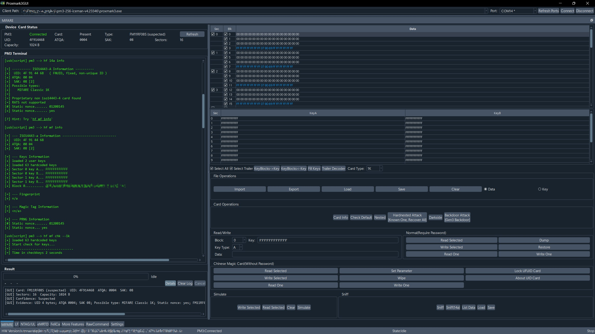
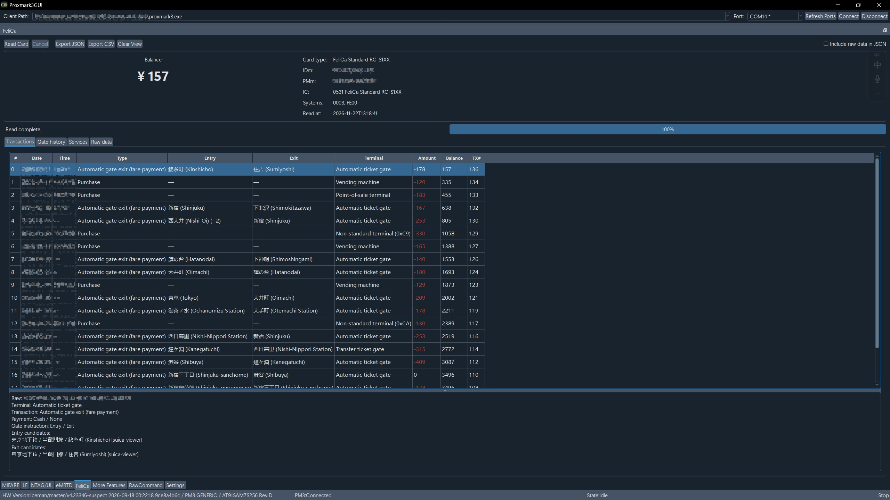
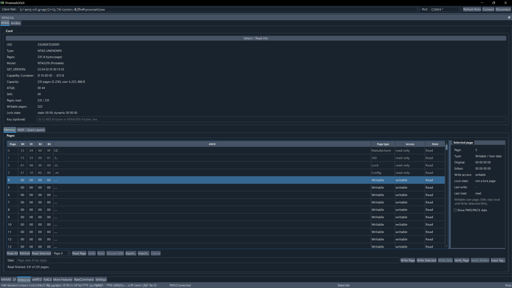
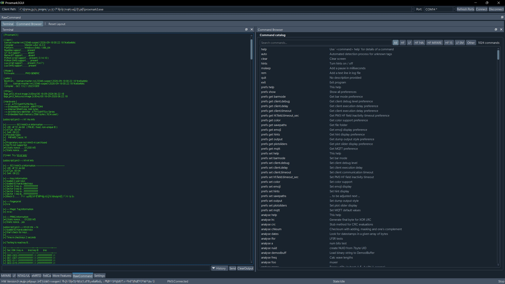

# Proxmark3GUI

**A desktop GUI for Proxmark3, maintained for the new Iceman/RRG client.**

**为Proxmark3设计的桌面图形用户界面，维护自最新的冰人RRG固件。**

[](LICENSE) [](BUILD_GUIDE.md)

Proxmark3GUI is a Windows-oriented desktop application for practical Proxmark3 workflows. It is a maintained fork of [wh201906/Proxmark3GUI](https://github.com/wh201906/Proxmark3GUI), extended for the **Iceman/RRG client v4.23346**.

Proxmark3GUI是一款面向Windows的桌面应用程序，专为Proxmark3的实际工作流程设计。它是[wh201906/Proxmark3GUI](https://github.com/wh201906/Proxmark3GUI)的维护分支，针对**Iceman/RRG v4.23346固件客户端**进行了扩展。

The GUI does not implement USB or serial protocol itself. Every device operation is performed by a separate `proxmark3.exe` client process. The GUI owns the client process, serializes commands, and parses its text output.

软件本身不实现USB或串行协议。所有设备操作均由单独的`proxmark3.exe`客户端进程执行。GUI拥有该客户端进程，负责序列化命令并解析其文本输出。

> This project has been verified on RDV2 and RDV3/Easy.

> 本项目在RDV2与RDV3/Easy上验证通过

---

## Screenshots / 软件界面
| MIFARE / M1卡 | FeliCa / 交通卡 |
|---|---|
|  |  |
| NTAG / Ultralight | RawCommand / 原始命令 |
|  |  |

---

# Features / 功能
## MIFARE
- MIFARE Classic 1K/2K/4K sector and block tables.  
  MIFARE Classic 1K/2K/4K 扇区与数据块表格。
- Read/write selected blocks or single blocks, dump and restore.  
  支持读取和写入指定数据块或单个数据块，以及 Dump 和 Restore。
- Default-key check, Nested, StaticNested, Hardnested and Darkside workflows.  
  支持默认密钥检查，以及 Nested、StaticNested、Hardnested 和 Darkside 工作流程。
- Chinese Magic Card read/write/wipe/lock/set-parameter tools.  
  支持国产 Magic Card 的读取、写入、清空、锁定和参数设置。
- MIFARE simulation and Trailer/Access Bits decoder.  
  支持 MIFARE 仿真以及 Trailer / Access Bits 解码。
- Trace Load/Save/List with v4.23346 buffer semantics; a GUI round-trip preserved the trace byte-for-byte.  
  支持 Trace 加载、保存和列表管理，遵循 v4.23346 的缓冲区语义；GUI 往返测试确认 Trace 数据逐字节保持一致。

## LF
- **LF Functions** — config, search, read, tune, sniff and optional waveform viewer. Requires LF-capable firmware.  
  **LF Functions** — 配置、搜索、读取、调谐、嗅探和可选波形查看器，需要固件支持 LF 功能。
- **LF Parser** — parses Proxmark3 LF text output without RF hardware. Supports EM4100, HID Prox, Indala, AWID, FDX-B, T55XX and other registered formats.  
  **LF Parser** — 无需射频硬件，直接解析 Proxmark3 的 LF 文本输出，支持 EM4100、HID Prox、Indala、AWID、FDX-B、T55XX 等已注册格式。
- **T55XX** — Block 0 / option-block editor, detect/info/config, EM410x reader and clone. Marked Experimental; requires LF-capable firmware.  
  **T55XX** — Block 0 / 选项块编辑器，以及检测、信息读取、配置、EM410x 读取和克隆功能。标记为实验性功能，需要固件支持 LF。

## NTAG / Ultralight
- **Memory** — detect/read info, read all/selected/single page, editable page table, write selected/dirty/single page, read-back verification, erase and verify.  
  **Memory** — 卡片检测与信息读取、全片/选中/单页读取、可编辑页面表格、选中页/修改页/单页写入、写后复读校验、清空和校验。
- Async read and write jobs keep the GUI responsive; cancel completes the current page operation before stopping.  
  异步读写任务保持 GUI 响应；取消操作时会先完成当前页面的必要操作，再停止后续任务。
- UID/vendor, static lock, CC, OTP, configuration and PWD/PACK pages are protected from normal writes.  
  UID / 厂商信息、静态锁定位、CC、OTP、配置以及 PWD / PACK 页面受到常规写入保护。
- Unknown layouts are read-only.  
  未知卡片布局仅允许读取。

- **NDEF / Quick Launch** — NDEF parsing/display and an experimental NDEF URI writer (phone compatibility not fully verified).  
  **NDEF / Quick Launch** — NDEF 解析与显示，以及实验性的 NDEF URI 写入功能（手机兼容性尚未完全验证）。

- **Amiibo** — import/save 540-byte NTAG215 images, library view, optional metadata catalog, write/read-back verification and emulation.  
  **Amiibo** — 导入和保存 540 字节 NTAG215 镜像、资源库管理、可选元数据目录、写入与复读校验与模拟。

## eMRTD
- MRZ input and validation for TD1/TD2/TD3 documents.  
  支持 TD1 / TD2 / TD3 证件的 MRZ 输入与校验。
- BAC, secure messaging, EF.COM and DG1/DG2/DG11/DG12 parsing.  
  支持 BAC、Secure Messaging、EF.COM 以及 DG1 / DG2 / DG11 / DG12 数据解析。
- Portrait display, zoom/fit, PNG/JPEG save and field/MRZ copy.  
  支持人像显示、缩放与适应窗口、PNG / JPEG 保存，以及字段和 MRZ 复制。
- Explicit serial-port hand-over between the GUI client and the Python reader.  
  GUI 客户端与 Python 读取程序之间采用明确的串口控制权交接机制。
- The eMRTD reader is a separate Python component; source builds require the runtime packaging step documented in [BUILD_GUIDE.md](BUILD_GUIDE.md).  
  eMRTD 读取器是独立的 Python 组件；源码构建时需要执行 [BUILD_GUIDE.md](BUILD_GUIDE.md) 中说明的运行时打包步骤。

## FeliCa
- **Transit Card Reader** — read FeliCa card information, balance, transaction records, gate history and supported public services.  
  **Transit Card Reader** — 读取 FeliCa 卡片信息、余额、交易记录、闸机记录及已验证支持的公开服务数据。
- **PASMO / Suica** — parse balance, transaction details and gate records, with station mapping and transaction detail views.  
  **PASMO / Suica** — 解析余额、交易明细和闸机记录，支持站点信息映射及交易详情查看。
- **Octopus** — identify Octopus cards and read the verified public balance data, displaying available balance, deposit and total including deposit.  
  **Octopus** — 识别八达通卡片，读取已验证的公开余额数据，并显示可用余额、押金及含押金总额。
- **Data Export** — export JSON / CSV while preserving raw data and parsed results.  
  **数据导出** — 支持 JSON / CSV 导出，并保留原始数据与解析结果。

## HID SEOS
- **T-money** — read card information, balance and transaction records through the ISO14443-A / ISO-DEP / JavaCard workflow, with transaction details and export.  
  **T-money** — 通过 ISO14443-A / ISO-DEP / JavaCard 流程读取卡片信息、余额和消费记录，支持交易详情查看与导出。
- **Climate Card** — read card information, issue and expiry dates, pass information and transaction records.  
  **Climate Card** — 读取卡片信息、发行及有效期、定期券信息和刷卡记录。
- **Transaction Records** — display raw transactions separately from grouped trips, with transfer grouping, date calibration and detail views.  
  **交易记录** — 分别展示原始交易记录与合并后的行程，支持换乘记录整理、日期校准及详情查看。
- **Data Export** — export JSON / CSV.  
  **数据导出** — 支持 JSON / CSV 导出。

## RawCommand
- Raw client terminal with history, clear and UTF-8 command input.  
  原始客户端命令终端，支持命令历史、清空和 UTF-8 命令输入。
- Normal commands share the same FIFO queue and completion sentinel as module commands.  
  普通命令与各功能模块共用同一 FIFO 命令队列和完成标记机制。
- Long/interactive commands can run detached and block the queue until stopped.  
  长时间运行或交互式命令可以脱离常规执行流程运行，并在停止前阻塞命令队列。

---

## Download and installation / 下载与安装
### Windows x64 — v0.5.0
- [GitHub New Release / GitHub 新版本发布](https://github.com/VANsMAN-BBS/Proxmark3-GUI-NEW/releases/tag/v0.5.1)
```text
SHA-256  1E1CB2FC8C944F02004AC4063EDC7B29046DEF94CDB2D686C5EF06021F1DA005
Size     52,851,489 bytes
大小     52,851,489 字节
```
The ZIP contains the GUI, Qt 5.15 runtime, MinGW/MSYS2 runtime and the eMRTD Python runtime. It does not contain the Proxmark3 client or firmware.  
ZIP 包含 GUI、Qt 5.15 运行时、MinGW/MSYS2 运行时和 eMRTD Python 运行时，但不包含 Proxmark3 客户端或固件。

A complete setup has four separate parts:  
完整运行环境由以下四个独立部分组成：
1. **Proxmark3GUI** — this Qt desktop application.  
   **Proxmark3GUI** — 本 Qt 桌面图形界面程序。
2. **Proxmark3 client** — a compatible `proxmark3.exe` (Iceman/RRG v4.23346 baseline).  
   **Proxmark3 客户端** — 兼容的 `proxmark3.exe`（以 Iceman/RRG v4.23346 为基准）。
3. **Proxmark3 firmware** — installed on the device; features depend on the firmware build.  
   **Proxmark3 固件** — 安装在设备中，实际功能取决于固件构建版本。
4. **eMRTD Python runtime** — bundled in the release ZIP; source builds use `scripts/package-emrtd-runtime.ps1`.  
   **eMRTD Python 运行时** — 已包含在发行 ZIP 中；源码构建时使用 `scripts/package-emrtd-runtime.ps1`。

The GUI does not contain the Proxmark3 firmware or a complete client distribution.  
GUI 不包含 Proxmark3 固件，也不包含完整的客户端发行包。

---

## Quick start / 快速开始
1. Install a compatible Iceman/RRG `proxmark3.exe` and connect the Proxmark3 device.  
   安装兼容的 Iceman/RRG `proxmark3.exe`，并连接 Proxmark3 设备。
2. Start Proxmark3GUI.  
   启动 Proxmark3GUI。
3. Set **Client Path** to your `proxmark3.exe`.  
   将 **Client Path** 设置为 `proxmark3.exe` 的实际路径。
4. Select the device **Port**.  
   选择设备对应的 **Port**。
5. In **Settings → Client**, confirm:  
   在 **Settings → Client** 中确认以下设置：
   - Start arguments: `<port> -f`  
     启动参数：`<port> -f`
   - Config file: `config_rrgv4.23346.json`  
     配置文件：`config_rrgv4.23346.json`
   - Working directory: your Proxmark3 client directory or its data directory  
     工作目录：Proxmark3 客户端目录或其数据目录。
6. Click **Connect** and verify the client version, firmware and hardware in the status bar.  
   点击 **Connect**，并在状态栏确认客户端版本、固件和硬件信息。

For Qt deployment, transitive MSYS2 DLLs, the eMRTD Python runtime and packaging details, see **[BUILD_GUIDE.md](BUILD_GUIDE.md)**.  
关于 Qt 部署、MSYS2 依赖 DLL、eMRTD Python 运行时和打包细节，请参阅 **[BUILD_GUIDE.md](BUILD_GUIDE.md)**。

---

## Credits and license / 致谢与许可
- Original project: [wh201906/Proxmark3GUI](https://github.com/wh201906/Proxmark3GUI)  
  原始项目：[wh201906/Proxmark3GUI](https://github.com/wh201906/Proxmark3GUI)
- Proxmark3 client and firmware: [RfidResearchGroup/proxmark3](https://github.com/RfidResearchGroup/proxmark3)  
  Proxmark3 客户端与固件：[RfidResearchGroup/proxmark3](https://github.com/RfidResearchGroup/proxmark3)
- Dark theme resources: [ColinDuquesnoy/QDarkStyleSheet](https://github.com/ColinDuquesnoy/QDarkStyleSheet)  
  深色主题资源：[ColinDuquesnoy/QDarkStyleSheet](https://github.com/ColinDuquesnoy/QDarkStyleSheet)

This project retains the original GNU LGPL-2.1-or-later license. See [LICENSE](LICENSE).  
本项目保留原始 GNU LGPL-2.1-or-later 许可证，详情请参阅 [LICENSE](LICENSE)。

QDarkStyleSheet code is MIT-licensed and its images are CC-BY-4.0. The full notices are in [src/qdarkstyle/LICENSE.rst](src/qdarkstyle/LICENSE.rst).  
QDarkStyleSheet 代码采用 MIT 许可证，其图片资源采用 CC-BY-4.0 许可证。完整声明见 [src/qdarkstyle/LICENSE.rst](src/qdarkstyle/LICENSE.rst)。

The Proxmark3 client is GPLv3 and is used as a separate process. If you redistribute the client binary with the GUI, GPLv3 obligations apply.  
Proxmark3 客户端采用 GPLv3 许可证，并作为独立进程使用。如果将客户端二进制文件与 GUI 一同重新分发，则必须遵守 GPLv3 的相关义务。
