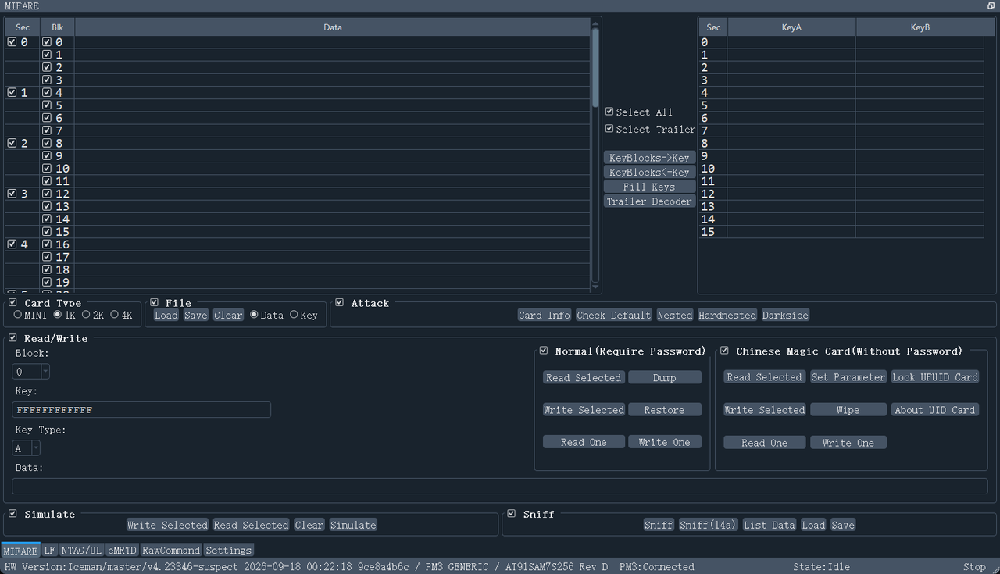
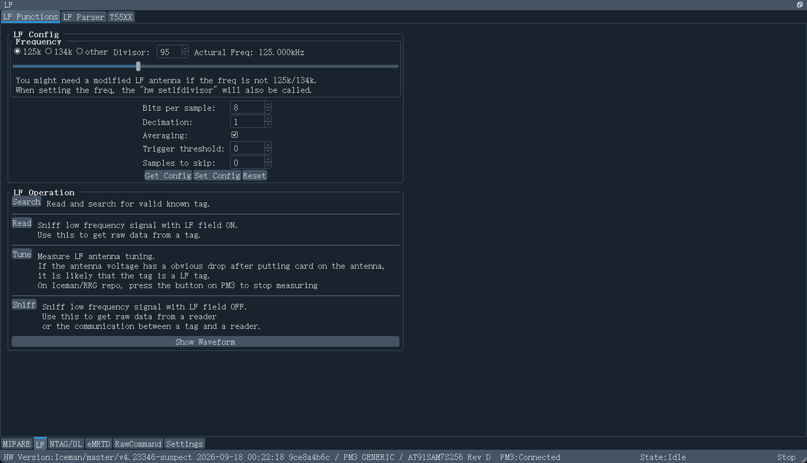
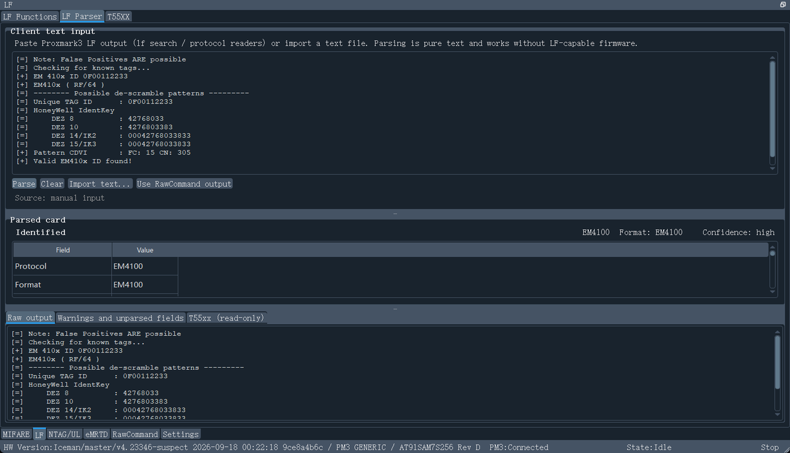
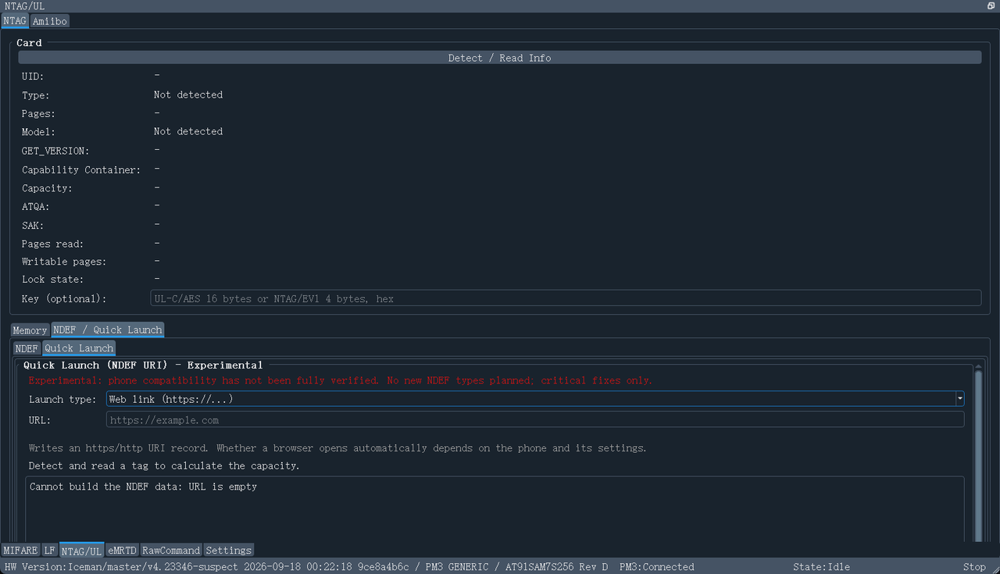
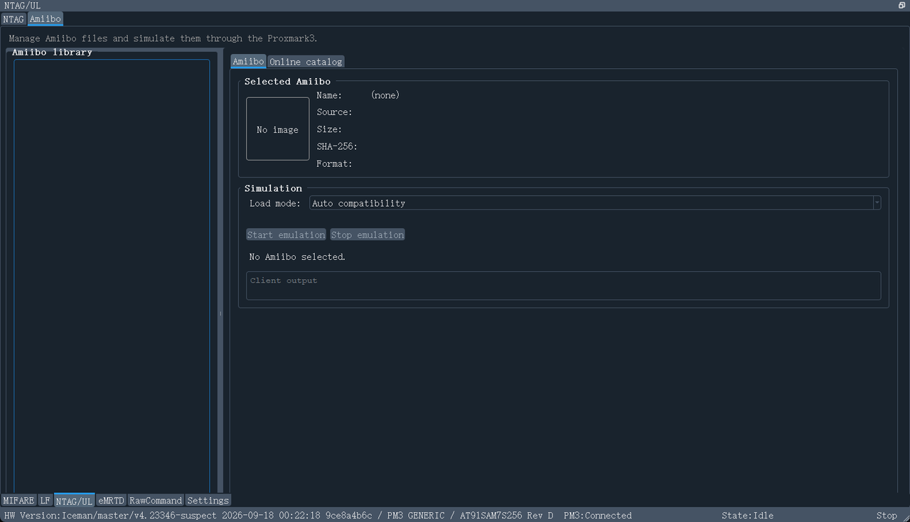
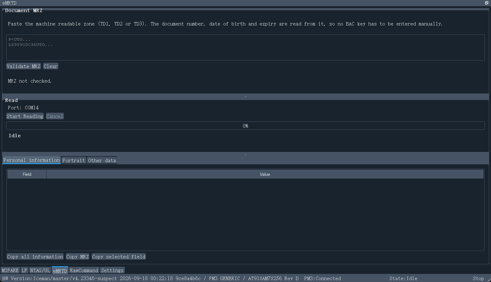

# Proxmark3GUI

**A Qt 5 desktop GUI for Proxmark3, maintained for the Iceman/RRG client.**

[](LICENSE)
[](BUILD_GUIDE.md)

Proxmark3GUI is a Windows-oriented Qt Widgets desktop application for practical Proxmark3 workflows. It is a maintained fork of [wh201906/Proxmark3GUI](https://github.com/wh201906/Proxmark3GUI) v0.2.8, extended for the **Iceman/RRG client v4.23346** with MIFARE, LF, T55XX, NTAG/Ultralight, Amiibo, eMRTD and async NTAG read/write workflows.

The GUI does **not** implement USB or serial protocol itself. Every device operation is performed by a separate `proxmark3.exe` client process. The GUI owns the client process, serializes commands, and parses its text output.

> **Verified compatibility baseline:** Iceman/RRG client `v4.23346` on Windows, with a Proxmark3 `PM3 GENERIC` / AT91SAM7S256 / 256 KB firmware.
> Other client versions, firmware builds and Proxmark3 hardware are **not verified** by this project.

---

## Screenshots

Screenshots are taken from the current application. They contain no personal documents, MRZ data or private card dumps.

| MIFARE | LF Functions |
|---|---|
|  |  |

| LF Parser | NDEF / Quick Launch |
|---|---|
|  |  |

| Amiibo library | eMRTD reader |
|---|---|
|  |  |

---

## Features

Feature groups follow the current navigation.

### MIFARE

- MIFARE Classic 1K/2K/4K sector and block tables.
- Read/write selected blocks or single blocks, dump and restore.
- Default-key check, Nested, StaticNested, Hardnested and Darkside workflows.
- Chinese Magic Card read/write/wipe/lock/set-parameter tools.
- MIFARE simulation and Trailer/Access Bits decoder.
- Trace Load/Save/List with v4.23346 buffer semantics; a GUI round-trip preserved the trace byte-for-byte.
- Destructive actions require confirmation.

Current hardware status: MIFARE Classic read/write/attack success paths are **not hardware-verified** on the available test card (HID SEOS/EMV). The commands and UI are present and client-integrated.

### LF

LF is the unified low-frequency entry with three sub-pages:

- **LF Functions** — config, search, read, tune, sniff and optional waveform viewer. Requires LF-capable firmware.
- **LF Parser** — parses Proxmark3 LF text output without RF hardware. Supports EM4100, HID Prox, Indala, AWID, FDX-B, T55XX and other registered formats.
- **T55XX** — Block 0 / option-block editor, detect/info/config, EM410x reader and clone. Marked **Experimental**; requires LF-capable firmware.

Current hardware status: the available 256 KB `PM3 GENERIC` firmware has **no LF support**. LF/T55XX radio operations are **not hardware-verified**. LF Parser is unit-tested against text fixtures and works without RF hardware.

### NTAG / Ultralight

- **Memory** — detect/read info, read all/selected/single page, editable page table, write selected/dirty/single page, read-back verification, erase and verify.
- Async read and write jobs keep the GUI responsive; cancel completes the current page operation before stopping.
- UID/vendor, static lock, CC, OTP, configuration and PWD/PACK pages are protected from normal writes.
- Unknown layouts are read-only.
- **NDEF / Quick Launch** — NDEF parsing/display and an experimental NDEF URI writer (phone compatibility not fully verified).
- **Amiibo** — import/save 540-byte NTAG215 images, library view, optional metadata catalog, write/read-back verification, `hf mfu eload` + `hf mfu sim -t 7` emulation. No commercial Amiibo binary data is bundled.

Current hardware status: NTAG215-compatible tag reads, single/multi-page writes and read-back verification were **hardware-verified** on a test tag. The erase snapshot/plan/cancel path was tested on 3 pages; a full 126-page erase was **not executed**. NTAG213/NTAG216 and Amiibo emulation with a game console were **not hardware-verified**.

### eMRTD

- MRZ input and validation for TD1/TD2/TD3 documents.
- BAC, secure messaging, EF.COM and DG1/DG2/DG11/DG12 parsing.
- Portrait display, zoom/fit, PNG/JPEG save and field/MRZ copy.
- Explicit serial-port hand-over between the GUI client and the Python reader.
- The eMRTD reader is a separate Python component; source builds require the runtime packaging step documented in [BUILD_GUIDE.md](BUILD_GUIDE.md).

Current hardware status: protocol flow and UI were tested with a FakeChip and synthetic documents. A real passport or Hong Kong/Macau permit was **not available**, so real-document reading is **not verified**.

### RawCommand

- Raw client terminal with history, clear and UTF-8 command input.
- Normal commands share the same FIFO queue and completion sentinel as module commands.
- Long/interactive commands can run detached and block the queue until stopped.

### Settings

- Client path, serial port, arguments, working directory and optional preload script.
- v4.23346 command configuration selection.
- Language, theme, fonts and window opacity.
- Persistent logging under `%LOCALAPPDATA%\Proxmark3GUI\logs\Proxmark3GUI.log`, with fallback locations if the profile is not writable.
- Dock layout and dark/light QSS themes.

---

## Compatibility and verification

Status definitions:

- **Unit tested** — covered by automated tests in `tests/`.
- **Build verified** — compiles and links in the documented environment.
- **Client integrated** — command/parameters checked against the target client; full success path not proven on hardware.
- **Hardware verified** — exercised successfully against the specified real device/tag.
- **Experimental** — implementation is present but the hardware/phone/console result is incomplete.
- **Not verified** — no compatible hardware or document was available.

| Area | Status | Notes |
|---|---|---|
| Windows build (Qt 5.15.19, MinGW-w64 GCC 16.2.0, qmake) | **Build verified** | Clean build, 0 warnings / 0 errors |
| Windows 10/11 startup and standalone dist | **Build verified** | Qt DLL deployment and non-ASCII path startup tested |
| Client v4.23346 connection / version / firmware parsing | **Hardware verified** | PM3 GENERIC, AT91SAM7S256, 256 KB |
| RawCommand FIFO and UTF-8 handling | **Hardware verified** | Serialized long-running commands |
| MIFARE Classic read/write/attacks | **Client integrated / Not verified** | Test card was not MIFARE Classic |
| MIFARE simulation | **Client integrated** | `-x` parameter verified; simulation not executed |
| Trace buffer Load → Save | **Hardware verified** | 3070-byte trace, SHA-256 identical |
| NTAG215 page read/write/read-back verify | **Hardware verified** | Test tag; single and multi-page writes |
| NTAG215 erase workflow | **Hardware verified (partial)** | Snapshot, plan and cancel tested on 3 pages; full erase not executed |
| NTAG213 / NTAG216 | **Not verified** | Layout protected and unit-tested only |
| Amiibo image import/write/verify | **Client integrated / Not verified** | No commercial Amiibo data bundled |
| Amiibo console emulation | **Experimental / Not verified** | No game console test |
| LF radio functions / T55XX | **Not verified** | Test firmware built without LF |
| LF Parser | **Unit tested** | 59 + 126 parser tests passing |
| eMRTD BAC / DG parsing | **Unit tested / Client integrated** | FakeChip and synthetic documents |
| Real passport / HK-Macau permit | **Not verified** | No document available |
| Linux / macOS | **Not verified** | Windows is the verified build/test platform |

Automated test baseline (2026-11-15):

```text
ntagmodel        67 passed
amiibodata       22 passed
lfparser         59 passed
lfparser_stage2 126 passed
```

The 256 KB test firmware is a specific device configuration. Its missing LF support must **not** be generalized to all Proxmark3 devices or firmware builds.

---

## Download and installation

### Windows x64 — v0.5.0

- [GitHub Release v0.4.1](https://github.com/VANsMAN-BBS/Proxmark3-GUI-NEW/releases/tag/v0.5.0)
- [Proxmark3-GUI-v0.5.0-win-x64.zip](https://github.com/VANsMAN-BBS/Proxmark3-GUI-NEW/releases/download/v0.5.0/Proxmark3-GUI-v0.5.0-win-x64.zip)
- [SHA256SUMS.txt](https://github.com/VANsMAN-BBS/Proxmark3-GUI-NEW/releases/download/v0.5.0/SHA256SUMS.txt)

```text
SHA-256  1E1CB2FC8C944F02004AC4063EDC7B29046DEF94CDB2D686C5EF06021F1DA005
Size     52,851,489 bytes
```

The ZIP contains the GUI, Qt 5.15 runtime, MinGW/MSYS2 runtime and the eMRTD
Python runtime. It does **not** contain the Proxmark3 client or firmware.

A complete setup has four separate parts:

1. **Proxmark3GUI** — this Qt desktop application.
2. **Proxmark3 client** — a compatible `proxmark3.exe` (Iceman/RRG v4.23346 baseline).
3. **Proxmark3 firmware** — installed on the device; features depend on the firmware build.
4. **eMRTD Python runtime** — bundled in the release ZIP; source builds use `scripts/package-emrtd-runtime.ps1`.

The GUI does **not** contain the Proxmark3 firmware or a complete client distribution.

---

## Quick start

1. Install a compatible Iceman/RRG `proxmark3.exe` and connect the Proxmark3 device.
2. Start Proxmark3GUI.
3. Set **Client Path** to your `proxmark3.exe`.
4. Select the device **Port**.
5. In **Settings → Client**, confirm:
   - Start arguments: `<port> -f`
   - Config file: `config_rrgv4.23346.json`
   - Working directory: your Proxmark3 client directory or its data directory
6. Click **Connect** and verify the client version, firmware and hardware in the status bar.
7. Start with a read-only action such as Detect or Read All before using any write/erase function.
8. Use LF/T55XX only if the installed firmware exposes LF support.

Expected status shape:

```text
HW Version: Iceman/master/v4.23346-suspect ... / PM3 GENERIC / AT91SAM7S256 ...
PM3: Connected
```

---

## Build from source

Verified environment: Windows 64-bit, Qt 5.15.19 (MSYS2 UCRT64), MinGW-w64 GCC 16.2.0, qmake, GNU Make 4.4.1.

```powershell
$env:PATH = "C:\msys64\ucrt64\bin;" + $env:PATH
mkdir build
cd build
qmake-qt5 ..\src\Proxmark3GUI.pro -spec win32-g++ CONFIG+=release
mingw32-make -j4
```

Output:

```text
build\release\Proxmark3GUI.exe
```

For Qt deployment, transitive MSYS2 DLLs, the eMRTD Python runtime and packaging details, see **[BUILD_GUIDE.md](BUILD_GUIDE.md)**.

Linux and macOS builds are not verified in this repository.

---

## Documentation

- [Build Guide](BUILD_GUIDE.md)
- [Workspace guide](WORKSPACE_GUIDE.md)
- [Changelog](CHANGELOG.md)
- [v0.4.1 release notes](docs/RELEASE_NOTES_v0.4.1.md)
- [Architecture](ARCHITECTURE_UPGRADE.md)
- [Test report](TEST_REPORT.md)
- [Hardware validation matrix](docs/HARDWARE_VALIDATION_MATRIX.md)
- [Iceman compatibility matrix](ICEMAN_COMPATIBILITY_MATRIX.md)
- [Amiibo compatibility](docs/AMIIBO_COMPATIBILITY.md)
- [eMRTD integration](docs/EMRTD_INTEGRATION.md)
- [eMRTD DG2 troubleshooting](docs/DG2_DIAGNOSIS.md)
- [LF Parser core](docs/LF_CORE/README.md)
- [LF reference notes](docs/LF_AUDIT/README.md)
- [Icon design](docs/ICON_DESIGN.md)

---

## Safety and limitations

- All card operations depend on the connected client **and** the installed firmware. A command present in the GUI can still fail on a specific device or tag.
- MIFARE Classic, LF, T55XX, Amiibo emulation and real eMRTD documents are not hardware-verified in this repository.
- Writing, restoring, erasing, locking or changing card configuration can be **irreversible**. Work only with tags and devices you own or are explicitly authorized to modify.
- Use read-only detection first and keep a known-good backup before any write.
- eMRTD/MRZ data is sensitive personal information. Do not publish dumps, portraits, MRZ strings or BAC-derived keys.
- The GUI does not implement RF protocols itself; successful operation requires a compatible `proxmark3.exe` and firmware.
- The tested 256 KB firmware lacks LF; other firmware/device combinations may behave differently.

---

## Credits and license

- Original project: [wh201906/Proxmark3GUI](https://github.com/wh201906/Proxmark3GUI)
- Proxmark3 client and firmware: [RfidResearchGroup/proxmark3](https://github.com/RfidResearchGroup/proxmark3)
- Dark theme resources: [ColinDuquesnoy/QDarkStyleSheet](https://github.com/ColinDuquesnoy/QDarkStyleSheet)
- Qt 5: [qt.io](https://www.qt.io/)

This project retains the original **GNU LGPL-2.1-or-later** license. See [LICENSE](LICENSE).

QDarkStyleSheet code is MIT-licensed and its images are CC-BY-4.0. The full notices are in [src/qdarkstyle/LICENSE.rst](src/qdarkstyle/LICENSE.rst).

The Proxmark3 client is GPLv3 and is used as a separate process. If you redistribute the client binary with the GUI, GPLv3 obligations apply.

---

## 中文介绍

**Proxmark3GUI** 是一个基于 Qt 5 Widgets 的 Proxmark3 桌面图形界面，面向 Iceman/RRG 客户端维护。本项目基于 [wh201906/Proxmark3GUI](https://github.com/wh201906/Proxmark3GUI) v0.2.8 继续开发，当前验证基线为 **Iceman/RRG v4.23346 + Windows + PM3 GENERIC 256 KB 固件**。

GUI 不自行实现 USB/串口协议，所有设备操作都交给独立的 `proxmark3.exe` 进程执行；GUI 负责进程管理、命令串行化、输出解析和界面交互。

### 功能概览

- **MIFARE**：1K/2K/4K 扇区/块表，读写、Dump/Restore，Nested/StaticNested/Hardnested/Darkside，Magic Card 操作，仿真、Trailer 解码和 Trace 加载/保存/列表。
- **LF**
  - **LF Functions**：配置、搜索、读取、调谐、嗅探和波形查看，需要支持 LF 的固件。
  - **LF Parser**：不依赖射频硬件，直接解析 Proxmark3 的 LF 文本输出，支持 EM4100、HID Prox、Indala、AWID、FDX-B、T55XX 等格式。
  - **T55XX**：Block 0/选项块编辑、Detect/Info/Config、EM410x 读取和克隆；标记为实验性。
- **NTAG / Ultralight**
  - **Memory**：识别、全片/选中/单页读取、编辑、写入、复读校验、清空和校验；读写异步化，支持取消。
  - **NDEF / Quick Launch**：NDEF 解析显示，以及实验性的 NDEF URI 写入。
  - **Amiibo**：导入/保存 540 字节 NTAG215 镜像、库管理、可选元数据目录、写入复读校验和 `hf mfu eload` + `sim` 模拟；不内置商业 Amiibo 数据。
- **eMRTD**：MRZ 校验、BAC、安全报文、DG1/DG2/DG11/DG12、头像显示与保存；真实证件未验证。
- **RawCommand**：原始命令终端、历史和长命令管理。
- **Settings**：客户端路径、端口、参数、工作目录、配置、语言、主题、字体、透明度和持久日志。

### 兼容性与验证状态

| 项目 | 状态 |
|---|---|
| Windows 构建（Qt 5.15.19 / MinGW GCC 16.2.0 / qmake） | **构建验证通过**，0 警告 / 0 错误 |
| Client v4.23346 连接、版本和固件解析 | **实机验证** |
| NTAG215 读取、写入、复读校验 | **实机验证**（测试标签） |
| NTAG215 清空流程 | **部分实机验证**（快照/计划/取消，3 页；未执行全 126 页清空） |
| MIFARE Classic 读写和攻击成功路径 | **未实机验证**（当前卡不是 Classic） |
| MIFARE 仿真 | **Client 集成**（参数已验证，未执行仿真） |
| Trace Buffer 加载→保存 | **实机验证**（3070 字节，SHA-256 一致） |
| LF / T55XX 射频功能 | **未实机验证**（测试固件无 LF） |
| LF Parser | **单元测试通过**（59 + 126 项） |
| eMRTD 协议流程 | **FakeChip / 单元测试通过**，真实证件未验证 |
| Amiibo 模拟与游戏机兼容性 | **实验性 / 未验证** |
| Linux / macOS | **未验证** |

自动化测试基线（2026-11-15）：

```text
ntagmodel        67 passed
amiibodata       22 passed
lfparser         59 passed
lfparser_stage2 126 passed
```

256 KB 测试固件没有 LF 支持，这一限制只适用于该测试固件，不能推导为所有 Proxmark3 设备。

### 下载与运行

### Windows x64 — v0.5.0

- [GitHub Release v0.4.1](https://github.com/VANsMAN-BBS/Proxmark3-GUI-NEW/releases/tag/v0.5.0)
- [Proxmark3-GUI-v0.5.0-win-x64.zip](https://github.com/VANsMAN-BBS/Proxmark3-GUI-NEW/releases/download/v0.5.0/Proxmark3-GUI-v0.5.0-win-x64.zip)
- [SHA256SUMS.txt](https://github.com/VANsMAN-BBS/Proxmark3-GUI-NEW/releases/download/v0.5.0/SHA256SUMS.txt)

```text
SHA-256  1E1CB2FC8C944F02004AC4063EDC7B29046DEF94CDB2D686C5EF06021F1DA005
大小     52,851,489 字节
```

ZIP 包含 GUI、Qt 5.15 运行时、MinGW/MSYS2 运行时和 eMRTD Python 运行时；
不包含 Proxmark3 客户端或固件。

完整使用需要分别准备：

1. 本 GUI（可直接下载上面的 ZIP）；
2. 兼容的 Iceman/RRG `proxmark3.exe`；
3. 设备上的 Proxmark3 固件；
4. eMRTD 页面所需 Python 运行时（发行 ZIP 已包含；源码构建使用 `scripts/package-emrtd-runtime.ps1`）。

GUI 不包含完整 Proxmark3 客户端或固件。

首次运行：

1. 启动 GUI，设置 **Client Path** 和 **Port**。
2. 启动参数使用 `<port> -f`，配置文件选择 `config_rrgv4.23346.json`。
3. 点击 **Connect**，确认客户端版本、固件和硬件。
4. 先执行只读检测/读取，再使用写入或清空功能。

### 构建

已验证环境：Windows 64-bit、Qt 5.15.19、MSYS2 UCRT64、MinGW-w64 GCC 16.2.0、qmake。

```powershell
$env:PATH = "C:\msys64\ucrt64\bin;" + $env:PATH
mkdir build
cd build
qmake-qt5 ..\src\Proxmark3GUI.pro -spec win32-g++ CONFIG+=release
mingw32-make -j4
```

详细依赖、Qt 部署、MSYS2 DLL 和 eMRTD 运行时打包见 [BUILD_GUIDE.md](BUILD_GUIDE.md)。

### 安全与限制

- 写入、恢复、清空、锁卡和修改配置可能不可逆，只能对自己拥有或获授权的标签和设备操作。
- 写入前先只读检测并保存可用的原始备份。
- eMRTD/MRZ、头像和 BAC 密钥属于敏感个人信息，不应公开或随截图分享。
- LF、T55XX、Amiibo 模拟和真实 eMRTD 证件尚未完成实机验证，不能保证在特定设备上工作。
- 当前 256 KB 测试固件不支持 LF；不同设备/固件能力可能不同。

### 文档与许可

- 构建：[BUILD_GUIDE.md](BUILD_GUIDE.md)
- 工作区指南：[WORKSPACE_GUIDE.md](WORKSPACE_GUIDE.md)
- 更新记录：[CHANGELOG.md](CHANGELOG.md)
- 发行说明：[docs/RELEASE_NOTES_v0.4.1.md](docs/RELEASE_NOTES_v0.4.1.md)
- 架构：[ARCHITECTURE_UPGRADE.md](ARCHITECTURE_UPGRADE.md)
- 测试报告：[TEST_REPORT.md](TEST_REPORT.md)
- 硬件验证矩阵：[docs/HARDWARE_VALIDATION_MATRIX.md](docs/HARDWARE_VALIDATION_MATRIX.md)
- Iceman 兼容性矩阵：[ICEMAN_COMPATIBILITY_MATRIX.md](ICEMAN_COMPATIBILITY_MATRIX.md)
- Amiibo 兼容性：[docs/AMIIBO_COMPATIBILITY.md](docs/AMIIBO_COMPATIBILITY.md)
- eMRTD：[docs/EMRTD_INTEGRATION.md](docs/EMRTD_INTEGRATION.md)
- eMRTD DG2 排查：[docs/DG2_DIAGNOSIS.md](docs/DG2_DIAGNOSIS.md)
- LF Parser：[docs/LF_CORE/README.md](docs/LF_CORE/README.md)
- LF 参考：[docs/LF_AUDIT/README.md](docs/LF_AUDIT/README.md)
- 图标设计：[docs/ICON_DESIGN.md](docs/ICON_DESIGN.md)

项目继续使用 **GNU LGPL-2.1-or-later**，详见 [LICENSE](LICENSE)。QDarkStyleSheet 的 MIT/CC-BY-4.0 声明见 [src/qdarkstyle/LICENSE.rst](src/qdarkstyle/LICENSE.rst)。Proxmark3 Client 为独立进程，采用 GPLv3；若随 GUI 一起分发客户端二进制，需遵守其 GPLv3 义务。
