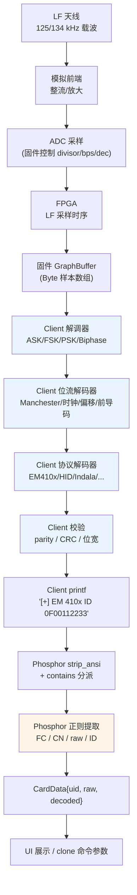

# LF 核心算法分析

**核心结论：Phosphor 没有实现任何 LF 信号处理算法。**
Manchester / FSK / PSK / 时钟恢复 / 前导码 / 校验位 / CRC / 位宽映射，全部在 **固件 + Iceman Client** 内部完成。Phosphor 只做"文本 → 结构化字段"的后处理。

本文件先给出归属判定表，再逐项说明，最后给出可移植性分类与伪代码。

---

## 1. 算法归属判定表

| 算法环节 | 实现位置 | 证据 | Phosphor 是否参与 |
|---|---|---|---|
| 原始采样（ADC → GraphBuffer） | **固件 + FPGA** | Client 需要 LF FPGA 镜像；`lf read` 的 `-s <samples>` 由设备采集 | 否 |
| 采样参数（divisor/bps/decimation/averaging/trigger/skip） | **固件**（`lf config` 设置到设备） | Client 帮助 `lf config` 明确"changes are temporary, reset after power cycle" | 否 |
| 波形绘制 | **Client**（`data plot`） | Client 帮助 | 否（主项目另有 WaveformWidget） |
| ASK 解调 | **Client** | `data rawdemod --am`、`lf em 410x demod` 等离线命令 | 否 |
| FSK 解调 | **Client** | `data rawdemod --fs`、`lf awid demod` | 否 |
| PSK 解调 | **Client** | `data rawdemod --p1/--p2`、`lf indala demod` | 否 |
| 时钟恢复 | **Client** | `data detectclock [--ask|--fsk|--nzr|--psk]`、`data autodemod` 输出 `decision ... clock 50.00` | 否 |
| Manchester 解码 | **Client** | `data rawdemod --am` 输出 `ASK/Manchester - clock N - decoded bitstream` | 否 |
| Biphase 解码 | **Client** | `data rawdemod --ab`、`data biphaserawdecode` | 否 |
| 前导码识别 | **Client** | 各协议 demod 内部（`lf em 410x demod` 描述 "Try to find EM 410x preamble"） | 否 |
| 帧同步 / 位对齐 | **Client** | demod 内部的 offset 搜索 | 否 |
| 行/列校验位 | **Client** | EM410x 解码器输出 `( ok )` / `( fail )`；`Wiegand: ... parity ( ok )` | 否 |
| CRC | **Client** | `CRC16............. ( %s )`、`CRC8...... 0x%02X` 等打印 | 否 |
| 卡号 / FC / CN 提取 | **Client**（打印）→ **Phosphor**（正则） | 见下 | **是（仅提取）** |
| 位宽/字段映射 | **Client**（打印）→ **Phosphor**（原样保存） | 见下 | **部分** |
| 多格式 ID 转换 | **Client**（编码器） | `lf hid clone -w` 由 Client 做 Wiegand 编码 | 否 |
| 克隆命令参数化 | **Phosphor** | `command_builder.rs` | **是** |
| 写入流程编排 | **Phosphor** | `write.rs` | **是** |
| 写入后校验 | **Phosphor**（比较字段）+ **Client**（重新解码） | `verify_match_detailed` | **是（比较逻辑）** |

**一句话：Phosphor 的"LF 算法"= 一个有序的字符串分派树 + 50 条正则 + 22 个命令模板 + 一个字段比较函数。**

---

## 2. 数据流图



蓝色 = 由 Client/固件完成（**不要重写**）；橙色 = Phosphor 唯一贡献（**需要移植**）。

---

## 3. 逐项分析

### 3.1 原始数据获取

- Client 命令：`lf read [-s <n>] [-@]`、`lf sniff [-s <n>]`。
- 数据落在 Client 的 **GraphBuffer**（内存），可 `data save` 导出为文本（每行一个 -127..127 的整数）或 `--wave` 导出 WAV。
- **Phosphor 完全不用**这两条命令，因此它拿不到任何波形。
- 主项目已经实现：`lf.cpp:31-52`（read/sniff）+ `lf.cpp:182-260`（`data save` + `WaveformDialog`）。

> 结论：波形获取是**主项目已有能力**，不需要移植。

### 3.2 时钟恢复

- Client 提供 `data detectclock [--ask|--fsk|--nzr|--psk]`，输出 `Auto-detected clock rate: N, Best Starting Position: M`（`[实测]`：对本审计的合成 GraphBuffer 返回 `128` / `81`）。
- `data autodemod` 会输出 `decision ... clock 50.00`、`margin ... dB`、`SNR ... dB`、`eye ...`。
- **Phosphor 不调用、不解析**这些命令。

### 3.3 Manchester 解码

- Client 的 `data rawdemod --am` 输出（`[实测]`）：
  ```
  [+] ASK/Manchester - clock 128 - decoded bitstream
  [=] -----------------------------------------------
  [+] DemodBuffer:
  [+] 1111111100001111110000100001000
  [+] ...
  [=] ASK modulation / Manchester encoding detected!
  ```
- **Phosphor 不解析 DemodBuffer**，也不用 `data rawdemod`。

### 3.4 FSK / PSK 解码

- FSK：`data rawdemod --fs`、`lf awid demod`。
- PSK：`data rawdemod --p1/--p2`、`lf indala demod`。
- **Phosphor 完全不涉及。**

### 3.5 帧同步 / 前导码

- EM410x 的 9 个 `1` 前导、HID 的 FSK 前导、Indala 的 PSK 前导等，全部由各协议 decoder 在 Client 内部完成。
- 证据：`lf em 410x demod` 的帮助原文 "Try to find EM 410x preamble, if found decode / descramble data"。
- **Phosphor 不做。**

### 3.6 校验位 / CRC

- Client 打印形如 `parity ( ok )`、`CRC: 20 - 20 (ok)`、`chksum 0x35 ( fail )`（见 Phosphor 测试夹具中的真实样本）。
- **Phosphor 不计算校验**，只是把这些文本忽略或原样留在 `raw` 里。

### 3.7 卡号 / FC / CN 提取（Phosphor 真正做的事）

以 HID 为例（`parse_hid`，`output_parser.rs:1306-1347`）：

```text
输入: 整段 lf search 文本
1. decoded["type"] = "HID Prox"
2. 若匹配 HID_FORMAT_RE → decoded["format"] = 命中文本（可能是 "26-bit"）
3. 若匹配 HID_FC_CN_RE → decoded["facility_code"], decoded["card_number"]
4. raw = HID_RAW_RE 或 STANDALONE_RAW_RE 的第一组 hex
5. uid  = "FC<fc>:CN<cn>"  若 FC/CN 存在
       = raw               否则
       = 失败返回 None     两者都无
6. 若 raw 非空 → decoded["raw"] = raw
```

`HID_FC_CN_RE` = `(?i)FC[:/\s]*(\d+)\s*[,;]?\s*CN[:/\s]*(\d+)`
→ 匹配 `FC: 65  CN: 29334`、`FC: 65, CN: 29334`、`FC/65/CN/29334` 等多写法。

### 3.8 位宽 / 字段映射

Phosphor **没有位宽模型**。它是"看到什么字段就存什么字段"：

| 卡型 | `CardData.uid` 的构造 | 说明 |
|---|---|---|
| EM4100 | 10 位 hex 字符串 | 无十进制转换 |
| HID | `FC65:CN29334` | 人造字符串，非 PM3 格式 |
| Indala | raw 或 ID | |
| IO Prox | `FC<dec>:CN<dec>` | **唯一做了 hex→dec 的卡型** |
| AWID | `FC<dec>:CN<dec>` | |
| FDX-B | `<country>:<national>` | |
| Paradox | `FC<dec>:CN<dec>` | |
| Viking | hex 字符串 | |
| Pyramid | `FC<dec>:CN<dec>` | |
| Keri | Internal ID 或 `FC<dec>:CN<dec>` | |
| NexWatch | raw（无则 id） | |
| Presco | `SC<site>:UC<user>` 或 hex | |
| Nedap | `ST<st>:CC<cc>:ID<id>` | |
| GProxII | `FC<dec>:CN<dec>` | |
| Gallagher | `RC<rc>:FC<fc>:CN<cn>:IL<il>` | |
| PAC | Card(hex) 或 raw | |
| Noralsy | CN 或 raw | |
| Jablotron | hex | |
| SecuraKey / Motorola / IDTECK | raw hex | |
| Visa2000 | 十进制 CN | |

> 这些 `uid` 字符串**不是 PM3 的 UID**，只是 Phosphor 内部用来做 UI 显示和校验比较的键。移植时不要照抄，应改为结构化的 `facilityCode/cardNumber/raw` 字段。

### 3.9 多格式 ID 转换

- 真正把 FC/CN 变成 Wiegand 位流的是 **Client**（`lf hid clone -w H10301 --fc … --cn …`，帮助中的 `Credential encoded successfully` 即由 Client 编码）。
- Phosphor 只负责"选哪个 `-w` 值"。
- 而且这个选择有缺陷（见 `LF_CARD_SUPPORT_MATRIX.md` §5.1）。

---

## 4. `parse_lf_search` 决策树伪代码

（等价描述，非源码复制；行号对应 `output_parser.rs`）

```text
function parse_lf_search(output):
    clean = strip_ansi(output)

    if "No known 125/134 kHz tags found" in clean:
        return None                                  # :419

    # ---- 第一阶段：按 contains 顺序分派（先匹配先返回） ----
    if "EM410x" or "EM 410x" in clean:
        m = /\bEM 410x ID\s*[-:]?\s*([0-9A-Fa-f]{10})/
        if m: return (EM4100, {uid:m1, raw:m1, decoded:{type,id}})

    if "HID Prox" or "HID Corporate" in clean:
        return parse_hid(clean)

    if "Indala" in clean:
        raw = /Indala.*?Raw[:/\s]*([0-9A-Fa-f]+)/ 
              or /^\[[+=]\]\s*raw[:/\s]+([0-9A-Fa-f]+)/m
        id  = /Indala.*?ID[:/\s]*([0-9A-Fa-f]+)/
        if raw: return (Indala, {uid: id or raw, raw, decoded})
        if id:  return (Indala, {uid: id, raw: id, decoded})
        # 两者都无 → 继续往下（可能最终返回 None）

    if "IO Prox" in clean:        return parse_ioprox(clean)
    if "AWID" in clean:           return parse_awid(clean)
    if "FDX-B"/"FDX B"/"FDXB":    return parse_fdxb(clean)
    if "Paradox" in clean:        return parse_paradox(clean)
    if "Keri"/"KERI" in clean:    return parse_keri(clean)
    if "Pyramid" in clean:        return parse_pyramid(clean)

    if "Gallagher"/"GALLAGHER":
        # 快路径：单行 4 字段
        # 慢路径：4 个独立正则（顺序无关）
        # 兜底：extract_first_hex_block → raw_fallback 标记
    if "Guardall"/"GProx"/"G-Prox": ...       # 同上三段式
    if "Nedap"/"NEDAP": ...                   # 同上三段式
    if "Presco":        return parse_presco(clean)
    if /\[\+\].*\b(PAC|Stanley)\b/:  return parse_pac(clean)
    if "Noralsy":       return parse_noralsy(clean)
    if "Jablotron": ...
    if "Securakey"/"SecuraKey"/"SECURAKEY": ...
    if "Visa2000": ...
    if "Motorola": ...
    if "IDTECK"/"Idteck": ...

    # ---- 第二阶段：非可克隆类型 ----
    if /\[\+\].*COTAG/:   return (COTAG,  {uid:"COTAG"})
    if /\[\+\].*EM4x50/:  return (EM4x50, {uid:"EM4x50"})
    if /\[\+\].*Hitag/:   return (Hitag,  {uid:"Hitag"})

    # ---- 第三阶段：NexWatch / Viking ----
    if "NexWatch"/"NXT":
        raw = /(?:NexWatch|NXT).*?Raw[:/\s]*([0-9A-Fa-f]+)/ or standalone
        id  = /(?:NexWatch|NXT)\s*ID[:/\s]*(\d+)/ or /88bit\s+id\s*:\s*(\d+)/
        if raw: return (NexWatch,{uid:raw, raw})
        if id:  return (NexWatch,{uid:id, raw:id})
        if hex: return (NexWatch,{uid:hex, raw:hex})

    if "Viking"/"viking": ...                 # ID / raw / generic hex

    # ---- 第四阶段：兜底 ----
    if /\[\+\]\s*Valid\s+(\S+)\s+.*?found/:
        type = map(lower(name)) in {"viking","nexwatch"} else return None
        raw  = extract_first_hex_block(clean) or ""
        return (type, {uid: raw or "unknown", raw})

    return None
```

### 4.1 这个决策树的结构性问题

1. **`contains` 分派先匹配先返回**。如果一段输出里同时出现多个协议名（例如 `lf search -u` 的附带信息、或卡型误判），会返回**第一个**命中的，不一定是正确的。
2. **`EM410x` 分支失败后不会继续**——它没有 `return parse_xxx`，而是 `if` 成功后 return；若正则失败则自然继续。这点是对的，但 Indala 分支失败后继续往下走会进入 `contains("IO Prox")` 等判断，可能在无关文本里误命中。
3. **兜底正则只认 viking/nexwatch**，其他卡型若详细正则失败就彻底丢失（Indala 缺陷即由此产生）。
4. **`extract_first_hex_block` 要求 ≥8 hex 字符**，会抓到时间戳、trace 编号等无关数字（概率低但存在）。

---

## 5. `verify_match_detailed` 伪代码

```text
function verify_match_detailed(source_type, source_decoded, clone_output):
    r = parse_lf_search(clone_output)
    if r is None: return (false, [0])
    (detected_type, clone_data) = r

    if source_type != detected_type: return (false, [0])

    fc_match  = compare source_decoded.facility_code vs clone_data.decoded.facility_code
                (both absent → true)
    cn_match  = compare card_number
    raw_match = compare raw (忽略大小写；任一方缺失 → true)
    id_match  = compare id

    if all: return (true, [])
    else:   return (false, [mismatch codes])
```

`mismatch codes` 的语义：`1=FC`、`2=CN`、`0=raw`、`3=id`（`output_parser.rs:1921-1933`）。

**问题**：
- `uid` 字符串比较（`verify_match`）对 `FC65:CN29334` 这类人造格式可行，但对大小写/前导零敏感（用 `eq_ignore_ascii_case` 避免大小写问题，但 `065` vs `65` 会失败）。
- 复读用 `lf search` 而不是协议专用 reader，注释已承认（`write.rs:465-467`）。

---

## 6. 可移植性分类

### 6.1 可以直接移植（纯数据/纯逻辑，与信号无关）

| 内容 | 形式 | 移植建议 |
|---|---|---|
| `strip_ansi` 等价物 | 正则 `\x1b\[[0-9;]*[mGKHJ]` | Qt 里可直接用 `QRegularExpression`，或用主项目已有 ANSI 剥离 |
| 22 条 clone 命令模板 | 字符串 + 参数 | 建议放进 `config/*.json` |
| 卡型→空白卡映射 | 表 | 放进数据模型 |
| 字段比较逻辑 | 纯函数 | 直接重写为 C++ |
| 校验/失败判定（`[!!]`、`fail`） | 字符串判断 | 直接重写，但建议加强为结构化错误 |

### 6.2 需要适配 Client 输出的解析逻辑（可移植，但必须重新采样）

| 内容 | 风险 |
|---|---|
| `parse_lf_search` 决策树 | 输出格式随 Client/固件版本变化 |
| 22 个字段正则 | Phosphor 基于 v4.20728；本项目是 v4.23346 |
| `parse_t5577_detect` | T55xx 打印格式相对稳定，但仍需实测 |
| `parse_hid` 的 format 捕获 | 已知缺陷（见矩阵 §5.1） |

### 6.3 必须依赖 PM3 实时采样（**不要**在 GUI 里重写）

| 内容 | 原因 |
|---|---|
| ASK/FSK/PSK 解调 | 需要原始波形 + 精确时钟；Client 已成熟 |
| Manchester/Biphase 解码 | 同上 |
| 时钟恢复/偏移搜索 | 同上 |
| 前导码/帧同步 | 同上 |
| CRC/校验位 | 协议实现细节，Client 已内建且随协议更新 |
| T55xx 编码（把 FC/CN 变成 block 数据） | Client 的 `*_clone` 命令已实现 |

> 若在 GUI 里重写这些，会得到"与 Client 不一致的第二套解码器"，且在固件升级时立刻失效。**明确不建议。**

### 6.4 已由 Client 实现、没有必要重复开发

- 所有 `lf <proto> reader` / `watch` / `demod` / `sim`。
- `data rawdemod` / `data autodemod` / `data detectclock` / `data biphaserawdecode`。
- `lf t55xx` 的 block 编解码（`lf t55xx write` 会自己算校验）。
- Wiegand 编码（`lf hid clone -w`）。

---

## 7. 若将来确实需要"自研解码"的边界

只有在满足以下**全部**条件时才考虑：

1. Client 不提供对应 demod 命令（例如某私有协议）；
2. 已在真实硬件上采集到稳定的 GraphBuffer 样本；
3. 能在离线环境（`data load` + 自研解码器）与 Client 结果逐位对齐；
4. 有回归语料库。

即便满足，也应作为**独立可选模块**，不进入 LF 主流程。

---

## 8. 与主项目现有算法的关系

| 主项目已有 | 位置 | 与本审计的关系 |
|---|---|---|
| `divisor2Freq` / `freq2Divisor` | `lf.cpp:151-159` | **Phosphor 没有**，应保留 |
| LF 配置解析（`hw status` → 6 个字段） | `lf.cpp:63-126` | **Phosphor 没有**，应保留 |
| GraphBuffer 文本解析 + 波形绘制 | `lf.cpp:227-259`、`waveformwidget.cpp` | **Phosphor 没有**，应保留 |
| T55xx block0 位域解码 | `t55xx.cpp:201-253` | **Phosphor 没有**，且比 Phosphor 强 |
| EM410x ID 正则 | `t55xx.cpp:496` | 与 Phosphor 的 `EM4100_ID_RE` 等价 |

---

## 9. 结论

1. **不要试图"把 Phosphor 的解码算法移植成 C++"——因为它没有解码算法。**
2. 要移植的是三层东西：**命令模板**、**文本解析规则**、**流程状态机**。
3. 解析规则必须以 **v4.23346 + 含 LF 固件** 的真实输出重新标定。Phosphor 的样本来自 v4.20728，且从未在真实硬件上验证。
4. 主项目已有的采样/调谐/波形/T55xx 位域能力**比 Phosphor 强**，应作为基础而不是被替换。
