# LF 移植路线图

**前提：** 本文件是**计划**，不是实施。是否启动由用户决定。
**基线：** Proxmark3GUI v0.4.1（`245b184`），LGPL-2.1-or-later，C++11 / Qt5 / qmake。

---

## 0. 启动前的硬门槛（Gate 0）

**在当前固件下，任何 LF 功能都无法在真实设备上验证。** 必须先决策固件路线：

| 选项 | 说明 | 本阶段状态 |
|---|---|---|
| G0-A | 换用含 LF 的 256 KB 冰人固件 | ❌ 禁止编译/刷写，且容量未知 |
| G0-B | 使用 512 KB 设备（RDV4 等） | ❌ 需要新硬件 |
| G0-C | 先做"纯软件 + 合成数据"版本，硬件验证延后 | ✅ 可立即开始 |
| G0-D | 不启动 LF-Core | ✅ 合法选项 |

**建议：采用 G0-C 启动 P0 的"纯软件"部分，同时并行决策 G0-A/B。**
在 G0 未解决前，**不得**把任何 LF 功能标记为"已支持"或"已验证"。

---

## 1. 总览

```mermaid
gantt
    title LF 移植建议顺序（人日，不含真实硬件联调）
    dateFormat  X
    axisFormat  %s
    section P0 基础
    能力探测            :p0a, 0, 3
    数据模型 + 解析器    :p0b, 1, 6
    LF 页识别区          :p0c, 4, 4
    EM4100/HID/AWID 展示 :p0d, 6, 3
    section P1 常见协议
    其余协议解析         :p1a, 9, 6
    克隆命令 + 风险门控   :p1b, 10, 5
    写后复验             :p1c, 14, 3
    section P2 T55xx
    detect/info/dump     :p2a, 17, 4
    read/write/wipe      :p2b, 19, 5
    密码流程（受控）      :p2c, 22, 2
    EM4305               :p2d, 22, 3
    section P3 高级
    协议专用 reader       :p3a, 26, 5
    离线解码实验          :p3b, 28, 5
    受控批量/模拟         :p3c, 31, 6
```



---

## 2. P0 — 基础能力（建议先做）

### 2.1 范围

| 项 | 内容 |
|---|---|
| LF 能力探测 | 三级探测 + UI 状态横幅 |
| 卡型数据模型 | `LfCardType` + `LfCardInfo` |
| `lf search` 解析 | 至少覆盖 EM4100 / HID Prox / AWID / Indala + "未识别" |
| LF 页识别区 | 展示卡型、UID、字段表、原始输出 |
| 保留既有能力 | `lf tune` / `lf read` / `lf sniff` / `lf config` / 波形 不动 |

### 2.2 交付物

```
src/module/lfcardinfo.h          新增
src/module/lfparser.h/.cpp       新增
src/module/lfcapability.h/.cpp   新增
src/module/lf.h/.cpp             扩展（识别区）
src/ui/mainwindow.ui             LF 页新增控件
config/config_rrgv4.23346.json   新增 "lf card" 解析规则
i18n/zh_CN.ts, en_US.ts          新增文案
```

### 2.3 工作量

| 任务 | 人日 |
|---|---|
| 数据模型 + 枚举 | 0.5 |
| 解析器框架 + 4 个卡型 | 2.5 |
| 能力探测（三级） | 1.5 |
| UI 识别区 + 状态横幅 | 2 |
| 单元测试（合成输出） | 1.5 |
| **合计** | **8** |

### 2.4 验收条件

- [ ] 给定一段合成的 `lf search` 输出，解析出正确卡型与字段（至少 20 个用例）。
- [ ] 给定 `No known 125/134 kHz tags found`，解析为"无卡"而不是错误。
- [ ] 给定 `unknown command:: 0x0228`，UI 显示"固件不支持 LF"。
- [ ] 现有 LF 页功能（tune/read/sniff/config/waveform）行为不变。
- [ ] 不新增任何第三方依赖。
- [ ] 新增文案全部进入 `zh_CN.ts` / `en_US.ts`。

### 2.5 风险

| 风险 | 缓解 |
|---|---|
| 没有真实输出可采集 | 用 Client 离线模式 + 合成 GraphBuffer 生成部分输出；其余以 Client 打印模板为准 |
| 正则过拟合 | 每个卡型至少 2 种输出变体用例 |
| UI 侵入既有页面 | 只追加控件，不重排既有布局 |

---

## 3. P1 — 常见协议完善

### 3.1 范围

- 其余 18 个卡型的解析（IOProx / Paradox / Keri / Pyramid / Viking / NexWatch / FDX-B / Presco / Nedap / GProxII / Gallagher / PAC / Noralsy / Jablotron / SecuraKey / Visa2000 / Motorola / IDTECK）。
- 克隆命令构造（22 条模板）。
- 风险门控（只读 / 写入 / 破坏性）。
- 写后复验（字段比较）。
- 字段手工修正（允许用户改 FC/CN 后再写）。

### 3.2 明确不做

- HID ProxII / Corporate 1000 的**结构化**克隆（除非先解决 Wiegand 格式映射）。
- 任何 `brute` / `dangerraw` / 密码穷举。

### 3.3 工作量

| 任务 | 人日 |
|---|---|
| 18 个解析器 + 测试 | 4 |
| `LfCommandBuilder` + 22 模板 | 2 |
| 风险门控 + 确认 UI | 2 |
| 复验逻辑 | 1 |
| 字段编辑 UI | 1.5 |
| **合计** | **10.5** |

### 3.4 验收条件

- [ ] 22 个卡型各有 ≥2 个解析用例通过。
- [ ] 每个 clone 命令都能在 UI 中**完整显示**后再执行。
- [ ] 写入前必须通过 `lf t55xx detect`（或明确的"跳过检测"确认）。
- [ ] 写入后自动 `lf search` 复验并显示结果。
- [ ] 命令注入测试：UID/字段含 `;`、换行、空格时被拒绝。
- [ ] 所有破坏性操作有二次确认 + 日志。

### 3.5 风险

| 风险 | 缓解 |
|---|---|
| 卡型输出格式随固件变化 | 配置化正则 + 版本化 JSON |
| 误写非目标卡 | 强制 detect + 显示命令 + 二次确认 |
| 复验误判 | 字段比较需容错前导零/大小写；失败要给出差异明细 |

---

## 4. P2 — T55xx 管理

### 4.1 范围

| 能力 | 命令 | 风险 |
|---|---|---|
| 芯片检测 | `lf t55xx detect` | 只读 |
| block0/info | `lf t55xx info` | 只读 |
| 全卡 dump | `lf t55xx dump` | 只读 |
| 单块读 | `lf t55xx read -b n` | 只读 |
| 单块写 | `lf t55xx write -b n -d hex` | 写 |
| 配置 | `lf t55xx config …` | 写（已有基础） |
| 擦除 | `lf t55xx wipe [-p]` | **破坏性** |
| 空白判断 | dump 后全零分析 | 只读 |
| EM4305 | `lf em 4x05 info/wipe/read` | 读/破坏性 |

### 4.2 合规限制

- **不实现** `lf t55xx chk` 的自动穷举 UI（只允许用户输入已知密码）。
- **不实现** `dangerraw`。
- **不实现** lock 位一键操作。
- 所有写操作默认展示 32 bit 数据 + 命令。

### 4.3 工作量

| 任务 | 人日 |
|---|---|
| dump/read 解析 + block 表 UI | 3 |
| write + 校验 | 2 |
| wipe + 密码流程（受控） | 2 |
| 空白判断算法 | 1 |
| EM4305 三命令 + UI | 2 |
| 测试 | 1.5 |
| **合计** | **11.5** |

### 4.4 验收条件

- [ ] dump 输出能正确解析为 block 数组并与 Client 的 `Block N: …` 对齐。
- [ ] block0 位域编辑与实际写出的 32 bit 完全一致（往返测试）。
- [ ] wipe 前必须 detect + 二次确认；wipe 后必须复检。
- [ ] 密码只接受 8 位 hex；错误密码不会导致"锁定"。
- [ ] 空白判断：全零 block → 空白；任一非零 → 显示非零块号。

---

## 5. P3 — 高级功能（谨慎）

| 功能 | 建议 | 理由 |
|---|---|---|
| 协议专用 reader（`lf hid reader` 等） | 可做，但需先采集真实输出 | 输出格式与 `lf search` 不同 |
| 离线解码实验（`data load` + `lf <proto> demod`） | 可做（本审计已验证可行） | 用于回归测试，不面向普通用户 |
| 模拟（`lf sim*`） | **暂不建议** | 需要持续占用设备，且容易被滥用 |
| 批量克隆 | **不建议** | 风险高、合规风险高 |
| 自行实现解码器 | **不建议** | 与 Client 重复且易失效 |
| 天线自动调谐曲线 | 可做（基于 `lf tune` 输出） | 有价值且只读 |

---

## 6. 可并行 / 必须串行

### 可并行

- 解析器开发（纯软件）与固件路线决策。
- UI 设计与解析器开发。
- T55xx 与协议解析（互不依赖）。

### 必须串行

- `LfCardInfo` → 解析器 → UI 展示。
- 命令构造器 → 风险门控 → 写入流程 → 复验。
- 能力探测 → 任何"真实设备"操作。

---

## 7. 无硬件 / 有硬件的分工

| 阶段 | 无真实 LF 硬件可完成 | 必须有真实 LF 硬件 |
|---|---|---|
| P0 解析 | ✅ 全部（合成输出） | 只是最终确认 |
| P0 能力探测 | ✅（可用"当前固件不支持"路径验证） | 验证"支持"分支 |
| P1 解析 | ✅ 全部 | 最终确认 |
| P1 写入 | ⚠️ 只能验证命令构造，不能验证写入 | ✅ 必须 |
| P2 T55xx 读 | ⚠️ 只能验证解析 | ✅ 必须 |
| P2 写入/擦除 | ❌ | ✅ 必须 |
| P3 | 部分 | 大部分 |

---

## 8. 里程碑与检查点

| 里程碑 | 内容 | 出口条件 |
|---|---|---|
| M0 | 审计完成（本阶段） | 12 份文档交付 |
| M1 | P0 代码完成 | 解析单测全绿 + UI 可展示合成卡 |
| M2 | P0 硬件确认 | 固件支持 LF 后，`lf search` 真实卡识别成功 |
| M3 | P1 代码完成 | 22 卡型解析 + 命令构造通过 |
| M4 | P1 硬件确认 | 至少 3 种卡写入并复验成功 |
| M5 | P2 代码完成 | dump/read/write/wipe 往返一致 |
| M6 | P2 硬件确认 | T5577 全流程成功 |
| M7 | 发布评估 | 文档、i18n、回归测试完成 |

---

## 9. 主要风险汇总

| 风险 | 等级 | 影响 | 缓解 |
|---|---|---|---|
| 固件无 LF，无法验证 | **高** | 整个 LF 功能"不可用" | Gate 0 先解决 |
| 256 KB 放不下 LF | 高 | 需换硬件 | 先做容量评估 |
| Client 输出格式漂移 | 中 | 解析失效 | 配置化 + 版本化 |
| 误写非目标卡 | **高** | 数据损坏 | detect + 确认 + 复验 |
| 解析错误导致写错数据 | 中 | 克隆失败 | 字段可见 + 手工修正 + 复验 |
| 破坏性操作 | 高 | 卡片报废 | 二次确认 + 日志 |
| 许可证污染 | 中 | 法律风险 | 独立重写（见许可证文档） |
| 长命令阻塞 UI | 中 | 体验差 | detached + 忙状态 |

---

## 10. 建议的下一步（等待批准）

1. **决策 Gate 0**（固件路线）。
2. 若批准：先做 P0 的"纯软件"部分（8 人日），不触碰现有业务逻辑。
3. 同时准备**真实输出采集方案**（需要一台 LF 可用的设备）。
4. 在 P0 验收后，再决定是否进入 P1。

**本阶段到此停止，不进入实现。**
