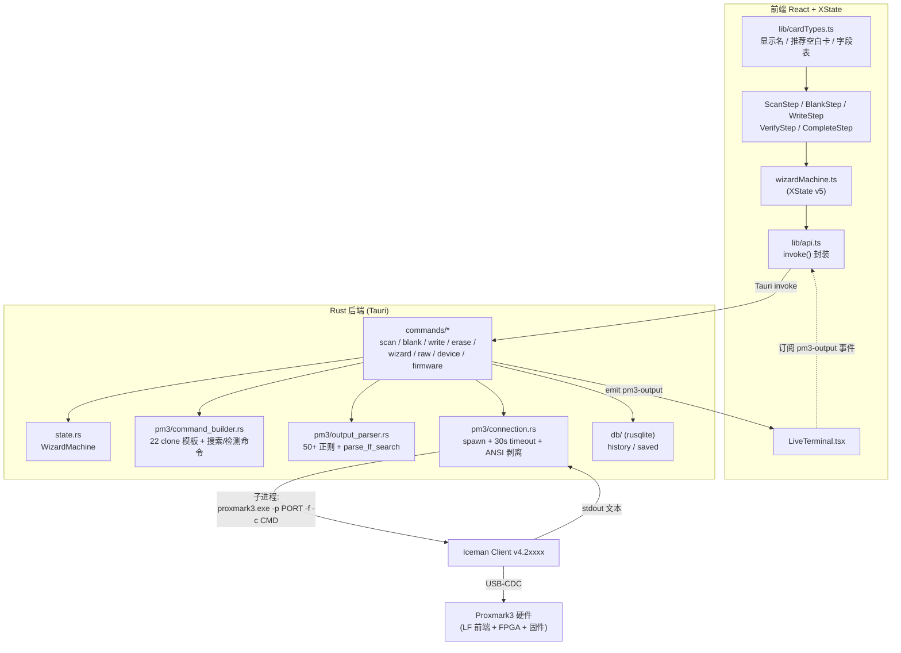
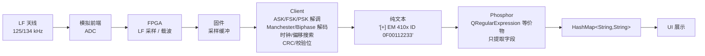

# Phosphor 架构审计

**对象：** `E:\Opencode_project\phosphor-master`（Phosphor 1.1.0，GPL-3.0）
**方法：** 逐文件阅读 + 沿真实调用链追踪（非 README 推断）
**规模：** Rust 25 文件 / 8,865 行 / 225 个 `#[test]`；前端 TS/TSX 6,479 行；`output_parser.rs` 单文件 4,082 行、184 个测试。

---

## 1. 技术栈与运行模型

```
Tauri v2 (Rust) ── 管理窗口 + IPC(command/event)
  ├─ 前端: React 19 + TypeScript + XState v5 + Tailwind v4 (Vite 7)
  └─ 后端: Rust 2021 + tokio + regex + serde + rusqlite
        └─ 每条 PM3 命令 = 启动一个 proxmark3.exe 子进程
              proxmark3.exe -p <PORT> -f -c "<CMD>"
```

**最重要的架构事实：Phosphor 不实现 PM3 串口/USB 协议，也不做信号处理。**
它把 Iceman Client 当作黑盒 CLI：每个操作 fork 一个 `proxmark3.exe`，用 `-c "<cmd>"` 执行一条命令，收集 stdout，然后用正则解析文本。

证据：`src-tauri/src/pm3/connection.rs:117`、`:309`
```rust
let args = ["-p", port, "-f", "-c", cmd];
```

由此产生三个直接影响移植的后果：

1. **每条命令都要重新打开串口、重新与设备握手**（子进程模式），LF 多步流程 = 多次开关端口。
2. **没有真正的取消能力**。`run_command()` 用 `.output()` 阻塞到进程退出；`connection.rs:187-198` 的注释明确承认"无法从外部 kill 子进程"。
3. **所有 LF 解码结果都已经是文本**，Phosphor 只能看到 Client 打印出来的字段，看不到波形。

---

## 2. 模块清单（按职责分类）

### 2.1 通用 PM3 通信基础设施（与 LF 无关，可被任何频段复用）

| 文件 | 行数 | 职责 | 关键符号 |
|---|---|---|---|
| `src-tauri/src/pm3/connection.rs` | 626 | 子进程启动、sidecar/PATH 回退、端口校验、命令注入过滤、30 s 超时、ANSI 剥离、流式输出、设备扫描 | `execute_pm3`、`run_command`、`run_command_streaming`、`spawn_pm3`、`read_stream_with_timeout`、`detect_device`、`try_sidecar_silent` |
| `src-tauri/src/pm3/version.rs` | 12 KB | 解析 `hw version` 输出（Client/OS/Bootrom/型号） | `parse_detailed_hw_version` |
| `src-tauri/src/pm3/output_parser.rs` | 4082 | **全部**文本解析（LF+HF+T5577+验证） | 见 §2.3 |
| `src-tauri/src/state.rs` | 518 | 后端向导状态机（纯 Rust，无 UI 依赖） | `WizardState`、`WizardAction`、`WizardMachine::transition` |
| `src-tauri/src/cards/types.rs` | 315 | 数据模型 | `CardType`、`BlankType`、`CardData`、`T5577Status`、`CardSummary`、`RecoveryAction` |
| `src-tauri/src/db/{mod,models}.rs` | 1.7 + 4.8 KB | SQLite：克隆历史、已保存卡 | `Database`、`CloneRecord`、`SavedCard` |
| `src-tauri/src/error.rs` | 561 B | 错误枚举 | `AppError` |

### 2.2 LF 专用模块

| 文件 | 行数 | LF 相关内容 |
|---|---|---|
| `src-tauri/src/pm3/command_builder.rs` | 956 | `build_lf_search()`(60)、`build_t5577_detect/chk/wipe`(68-84)、`build_em4305_*`(90-108)、22 个 `build_*_clone`(121-290)、`build_clone_command` 调度器(298-591) |
| `src-tauri/src/commands/scan.rs` | 200 | `scan_card`：先 `lf search`，失败再 `hf search` |
| `src-tauri/src/commands/blank.rs` | 433 | `detect_blank` → `detect_t5577` / `detect_em4305` |
| `src-tauri/src/commands/write.rs` | 549 | `write_t5577_flow`(164)、`write_em4305_flow`(328)、`verify_clone`(438) |
| `src-tauri/src/commands/erase.rs` | 128 | `detect_chip` / `wipe_chip`（T5577 / EM4305） |
| `output_parser.rs` 的 LF 段 | ~1,900 | 50+ LF 正则、`parse_lf_search`(415)、12 个专用子解析器(1306-1795)、`parse_t5577_detect`(1802)、`parse_t5577_chk`(1846)、`verify_match*`(1858-1939) |

### 2.3 纯 UI / 展示层

| 文件 | 说明 |
|---|---|
| `src/components/wizard/ScanStep.tsx` | 卡型展示、解码字段表、下一步按钮（14.7 KB） |
| `src/components/wizard/BlankStep.tsx` | 空白卡提示、检测、已有数据警告 |
| `src/components/wizard/WriteStep.tsx` | 写入进度 |
| `src/components/wizard/VerifyStep.tsx` | 校验结果 |
| `src/components/wizard/CompleteStep.tsx` / `ErrorStep.tsx` | 完成 / 错误恢复 |
| `src/lib/cardTypes.ts` | 卡型显示名、描述、推荐空白卡、字段列表（**纯元数据**） |
| `src/components/shared/LiveTerminal.tsx` | PM3 原始输出终端 |
| `src/machines/wizardMachine.ts` | XState 前端状态机（31 KB） |
| `src/hooks/WizardProvider.tsx` | React 上下文 + 事件订阅（15.6 KB） |

### 2.4 涉及真实硬件操作的模块

| 操作 | 命令 | 位置 |
|---|---|---|
| LF 识别 | `lf search` | `scan.rs:33` |
| T5577 检测 | `lf t55xx detect` | `blank.rs:61`、`write.rs:177`、`erase.rs:33` |
| T5577 密码搜索 | `lf t55xx chk` | `write.rs:196` |
| T5577 擦除 | `lf t55xx wipe [-p pw]` | `write.rs:239`、`erase.rs:96` |
| EM4305 信息 | `lf em 4x05 info` | `blank.rs:105`、`erase.rs:51` |
| EM4305 擦除 | `lf em 4x05 wipe` | `write.rs:356`、`erase.rs:98` |
| EM4305 读字 | `lf em 4x05 read -a 0` | `write.rs:364` |
| **写入** | 22 种 `lf <proto> clone …` | `write.rs:282`、`:390` |
| 复读校验 | `lf search` | `write.rs:468` |
| 固件刷写 | `proxmark3 --flash` | `commands/firmware.rs` |

> 注意：**Phosphor 从不调用 `lf read` / `lf sniff` / `lf tune` / `lf config` / `lf sim`。**
> 全仓库检索这些字符串：0 命中（`lf t55xx` 除外）。
> 也就是说 Phosphor **没有**天线调谐、没有原始采样、没有模拟功能。

---

## 3. 端到端调用链（以 LF 扫描为例）

```
[用户] 点 "SCAN"
  │
  ▼ src/components/wizard/ScanStep.tsx
[前端] wizardMachine 收到 { type: 'SCAN' }
  │   src/machines/wizardMachine.ts:503  scanningCard.invoke
  ▼ src/lib/api.ts  invoke('scan_card')
[IPC]  Tauri command
  │
  ▼ src-tauri/src/commands/scan.rs:10  scan_card()
     ├─ 锁 WizardMachine，校验当前必须是 DeviceConnected
     ├─ transition(StartScan) → WizardState::ScanningCard
     ▼
     connection::run_command(app, port, "lf search")
       ├─ 端口正则校验 (PORT_RE)
       ├─ 拒绝 ';' '\n' '\r'（防命令注入）
       ├─ 先试 sidecar（binaries/proxmark3），失败再试 PATH/常见路径
       ├─ tokio::time::timeout(30 s)
       └─ 退出码 0 → strip_ansi(stdout)
     ▼
     output_parser::parse_lf_search(output)
       ├─ strip_ansi
       ├─ 若含 "No known 125/134 kHz tags found" → None
       ├─ 按顺序做 contains() 分派：EM410x → HID → Indala → IO Prox → AWID
       │   → FDX-B → Paradox → Keri → Pyramid → Gallagher → GProx
       │   → Nedap → Presco → PAC → Noralsy → Jablotron → SecuraKey
       │   → Visa2000 → Motorola → IDTECK → COTAG/EM4x50/Hitag
       │   → NexWatch → Viking → 兜底 VALID_TAG_RE
       └─ 每种卡用 1–4 个正则提取字段，塞进 HashMap<String,String>
     ▼
     (CardType, CardData{uid, raw, decoded})
     ▼
     finish_scan → transition(CardFound{...}) → WizardState::CardIdentified
  │
  ▼ 返回 serde 序列化的 WizardState
[前端] XState 收到 CARD_FOUND → context.cardData
  │
  ▼ ScanStep.tsx 渲染：卡型、UID、decoded 字段表
```

### 3.1 写入链（T5577）

```
BlankStep 检测到空白卡 → 点 WRITE
  ▼ api.writeCloneWithData(port, cardType, uid, decoded, blankType)
▼ write.rs:32 write_clone_with_data
   ├─ 校验 decoded.len() ≤ 50、uid 字符集 [A-Za-z0-9:]、port 长度
   ├─ blank = blankType ?? cardType.recommended_blank()
   ├─ 若 blank==EM4305 且 !card_type.supports_em4305() → 直接拒绝
   ├─ transition(StartWrite) → WizardState::Writing
   ▼ write_t5577_flow
      step1 lf t55xx detect              → parse_t5577_detect
      step2 若 password_set: lf t55xx chk  → parse_t5577_chk（失败即中止）
      step3 若有密码: lf t55xx wipe -p <pw>
      step4 再次 lf t55xx detect 校验「已检测到且无密码」
      step5 build_clone_command() → lf <proto> clone …
      step6 transition(WriteFinished) → Verifying
   ▼ verify_clone
      lf search → verify_match_detailed(sourceType, decoded, output)
      ├─ 类型必须相同
      ├─ 逐字段比较 facility_code / card_number / raw / id
      └─ transition(VerificationResult{success, mismatched})
```

注意两个非显然的设计：

- **有密码才擦除**。无密码的 T5577 直接 `clone`（注释说明：避开弱天线下的额外写周期，并减少两次子进程/串口开关）。`write.rs:227-231`
- **擦除后必须复检**。因为"PM3 即使密码擦除失败也可能返回 0"。`write.rs:241-258`

---

## 4. 双状态机（XState ↔ Rust）

Phosphor 有两套状态机，通过 Tauri 往返保持同步：

| 层 | 文件 | 职责 |
|---|---|---|
| 后端 | `state.rs` `WizardMachine` | 唯一权威状态；每次 transition 校验合法性；命令入口先断言状态 |
| 前端 | `machines/wizardMachine.ts` | 驱动 UI、调用 `invoke`、处理 loading/error、控制组件切换 |

后端状态集（13 个）：`Idle` → `DetectingDevice` → `DeviceConnected` → `ScanningCard` → `CardIdentified` → `HfProcessing` → `HfDumpReady` → `WaitingForBlank` → `BlankDetected` → `Writing` → `Verifying` → `VerificationComplete` → `Complete`，外加任意状态可进的 `Error`。

关键设计点（对移植有价值）：

1. `Reset` / `Disconnect` / `ReportError` 在 `transition()` 开头特判，**任意状态都能进**（`state.rs:207-239`）。
2. `Retry` 只能从 `Error{recoverable:true}` 进 `Idle`（`state.rs:438`）。
3. `MarkComplete` 只能从 `VerificationComplete{success:true}` 进入，**校验失败无法"完成"**（`state.rs:429`）。
4. 设备信息（port/model/firmware）持久保存在 `WizardMachine` 结构体上，`BackToScan`/`SoftReset`/`CancelHfProcess` 用它重建 `DeviceConnected`，无需重新扫描设备。
5. `WriteProgress` 通过 Tauri `emit("write-progress", …)` 推给前端（`write.rs:519`）。

---

## 5. 完整架构图



### 5.1 关键数据流：为什么"解码"不在 Phosphor



**结论：Phosphor 在链路中的位置是"文本后处理"，不是"信号处理"。**
（详细归属见 `LF_ALGORITHM_ANALYSIS.md`）

---

## 6. 安全与健壮性机制（值得借鉴）

| 机制 | 位置 | 说明 |
|---|---|---|
| 端口格式白名单 | `connection.rs:68` | `^(COM[1-9]\d*|/dev/tty(ACM|USB)\d{1,2}|/dev/tty\.usbmodem\w+)$` |
| 命令分隔符过滤 | `connection.rs:90` | 拒绝 `;` `\n` `\r`（因为 PM3 CLI 的 `-c` 用 `;` 分隔多条命令） |
| 密码格式校验 | `command_builder.rs:15` | 必须恰好 8 位 hex |
| hex 输入校验 | `command_builder.rs:28` | 非空且纯 hex |
| UID 字符集校验 | `write.rs:53` | 仅 `[A-Za-z0-9:]`，长度 ≤ 200 |
| decoded 字段数量上限 | `write.rs:44` | ≤ 50，防 IPC 过大 |
| 卡型/空白卡兼容性守卫 | `write.rs:78` | EM4305 仅允许 11 种老卡型 |
| 写入后失败检测 | `write.rs:286` | 输出含 `[!!]` 或 `fail` 即报错 |
| 擦除后复检 | `write.rs:245` | 重新 detect，确认无密码 |
| 超时 | `connection.rs:40` | 30 s，硬上限 |

**局限（移植时必须改进）**：

- 30 s 全局超时对 `lf search`（弱耦合/坏卡可能更久）和 `lf t55xx chk`（穷举密码）不够灵活，且超时后**无法 kill 子进程**（仅靠 Tauri future drop）。
- 写入过程中**没有取消按钮**（`connection.rs:187-198` 明确说明）。
- 所有错误都退化成字符串，没有结构化错误码。
- `verify_clone` 复用 `lf search` 而非协议专用 reader，注释承认专用 reader 输出格式不兼容（`write.rs:465-467`）。

---

## 7. "Phosphor 比主项目更完善"的具体差异

| 能力 | Phosphor | 主项目现状 | 差异性质 |
|---|---|---|---|
| `lf search` 结果解析 | 22 卡型正则 + 决策树 + 184 测试 | **无解析**，只把原始输出打到 Raw 页 | 真实差距，值得移植（独立重写） |
| 卡型数据模型 | `CardType`/`CardData`/`decoded` map | 无 | 真实差距 |
| LF 写入向导 | 检测→擦除→写入→复验状态机 | 仅 T55xx 页的 EM410x 克隆按钮（带确认框） | 真实差距 |
| T5577 密码保护处理 | `chk` → `wipe -p` → 复检 | 无 | 真实差距 |
| T55xx block0 位域编辑 | **无** | **有**（调制/速率/extend/maxblock/各 flag 位） | 主项目更强 |
| `lf tune` 天线调谐 | **无** | **有**（滑块 + divisor + 频率换算） | 主项目更强 |
| `lf read/sniff` + 波形 | **无** | **有**（`data save` → WaveformWidget 绘图） | 主项目更强 |
| `lf config` 读取/设置 | **无** | **有**（`hw status` 解析 + `lf config` 设置） | 主项目更强 |

> 这张表决定了移植策略：**不要照搬 Phosphor 的"LF 页面"，而是把 Phosphor 的"解析层 + 向导流程"接到主项目已有的"采样/调谐层"上。**

---

## 8. 文件规模与复杂度参考

| 指标 | Phosphor | 主项目 |
|---|---|---|
| LF 相关代码 | ~2,900 行（parser 1,900 + builder 300 + write 550 + erase 130） | ~700 行（lf.cpp 261 + t55xx.cpp 524 + 配置） |
| 测试 | 225 个 Rust 单元测试（LF 约 90 个） | 无 C++ 单测（仅 `emrtd_pm3/tests` 的 Python 测试） |
| 自动化 UI 测试 | 无 | 无 |
| 真实硬件测试证据 | 无（仓库内无测试日志；`README` 声称可用） | 有 `docs/HARDWARE_VALIDATION_MATRIX.md`，但 LF 行明确写"未验证" |

> 这一点很关键：**Phosphor 的"22 卡型"没有任何真实硬件验证记录**。它只有"用真实输出样本做的正则回归测试"。这两者不是一回事。详见 `LF_CARD_SUPPORT_MATRIX.md` 的证据分级。
