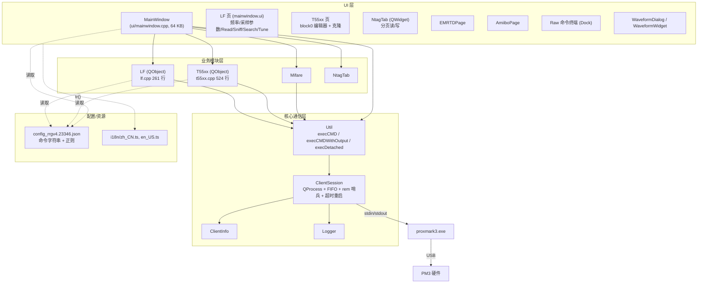
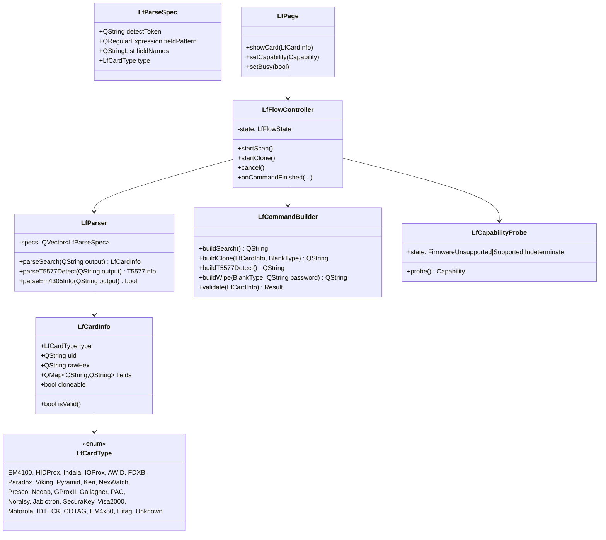

# Proxmark3GUI 架构适配性审计与 LF 集成设计

**基线：** v0.4.1 / `245b184` / `upgrade/v0.4.1-polish`
**约束：** 原生 C++11 + Qt 5.15 + qmake + Qt Widgets，**不引入 Rust / Tauri / React / XState**。

---

## 1. 主项目真实架构（实测，不是任务书假设）



### 1.1 关键事实

| 事实 | 证据 |
|---|---|
| 只有一个 QProcess | `ClientSession` 成员 `m_process` |
| 命令完成靠本地哨兵 `rem PM3GUI_<id>_<ms>` | `clientsession.cpp:97-102`、`:578` |
| FIFO 队列 | `m_queue` + `processQueue()` |
| 单命令超时 → **自动重启 Client** | `clientsession.cpp:614-641` |
| 长命令用 `detached` 通道（`lf tune` 等） | `executeDetached`、`lf.cpp:59` |
| 同步等待用嵌套 `QEventLoop`（排除用户输入） | `util.cpp:70-101` |
| 最短等待 15 s，`trigger.waitTime + 5000` | `util.cpp:67` |
| 没有 CommandQueue/CapabilityDetector/RiskPolicy 类 | 全仓库 grep = 0 |

---

## 2. 现有 LF 相关能力盘点

| 能力 | 状态 | 位置 |
|---|---|---|
| LF 页面 | 已有 | `mainwindow.ui` 的 `LF` 页 |
| `lf read` | 已有（发命令 + `data plot`） | `lf.cpp:31` |
| `lf sniff` | 已有 | `lf.cpp:39` |
| `lf search` | 已有（**只发命令**） | `lf.cpp:47` |
| `lf tune --divisor` | 已有（detached） | `lf.cpp:54` |
| `lf config` 读 | 已有（解析 `hw status`） | `lf.cpp:89` |
| `lf config` 写 | 已有 | `lf.cpp:128` |
| 频率↔divisor 换算 | 已有 | `lf.cpp:151` |
| GraphBuffer 导出 + 绘图 | 已有 | `lf.cpp:182`、`waveformwidget.cpp` |
| T55xx 检测 / 读 info / 配置 | 已有 | `t55xx.cpp:348/416/457` |
| T55xx block0 位域编辑 | 已有 | `t55xx.cpp:201/226` |
| EM410x 读 + 克隆 | 已有 | `t55xx.cpp:493/503` |
| **`lf search` 结果解析** | **无** | — |
| **LF 卡型模型** | **无** | — |
| **LF 写入向导** | **无** | — |
| **T5577 密码/擦除流程** | **无** | — |
| **LF 能力检测** | **无** | — |
| **EM4305 支持** | **无** | — |

---

## 3. 任务书 12 个问题的回答

### Q1. 当前项目是否已经有 LF 命令入口？

**有。** `LF` 页（`mainwindow.ui`）+ `src/module/lf.cpp` + `config_rrgv4.23346.json` 的 `"lf"` 节。
但它只到"发送命令 + 显示原始输出"为止，**没有结构化结果**。

### Q2. 是否有 LF 命令执行封装？

**部分有。**
- 有通用封装：`Util::execCMD` / `execCMDWithOutput` / `execDetached`。
- 有配置驱动的命令字符串：`config.rrgv4.23346.json` 的 `lf.read.cmd` 等。
- **没有**卡型级的命令构造器（对比 Phosphor 的 `build_clone_command`）。

### Q3. 是否有通用数据解析机制？

**没有统一的。**
- Mifare 用配置里的 `key pattern` + 索引解析（`config_rrgv4.23346.json`）。
- LF 用 `getLFConfig_helper` 逐字段匹配（`lf.cpp:63`）。
- T55xx 用各自内联正则（`t55xx.cpp:384-413`）。
- NtagTab 用 `parseInfo()` 内联正则。
- 没有任何可复用的「卡型解析器」抽象。

### Q4. 是否存在可复用的 CardInfo 数据模型？

**不存在。**
- `core/clientinfo.h` 只是**客户端/设备**信息，不是卡片。
- `NtagTab` 用散落的 `QString m_type` + 表控件。
- 没有任何 `CardInfo { type, uid, fields… }` 结构。

→ **必须新建**（这是 LF 移植的第一块基石）。

### Q5. 是否可以复用 HF 页面的部分 UI 控件？

**可以，且应当复用：**

| 控件 | 复用方式 |
|---|---|
| `WaveformDialog` / `WaveformWidget` | LF 采样波形直接复用 |
| Raw 终端 Dock | 所有 LF 命令输出落这里 |
| `Util::gotoRawTab()` | 保持现有习惯 |
| Dock 化页面框架 | `dockInit()` 自动把所有 `funcTab` 页变成 Dock |
| `QMessageBox` 确认模式 | 写入/擦除确认 |
| `Logger` | 命令审计日志 |

### Q6. LF 是否应该独立成为一级导航页面？

**应该。** 理由：

1. 现有 LF 页已经是独立 Dock 页，用户预期一致。
2. LF 与 HF 的硬件、命令、风险完全不同，混在一起会增加误操作。
3. 但**建议在 LF 页内部再分两个子区**：
   - **识别/读取区**（只读）
   - **写入区**（默认折叠/禁用，需显式展开）

### Q7. 是否应该使用 LF Wizard？

**建议"独立页 + 可选向导"，而不是纯向导。**

Phosphor 是纯向导（必须走完检测→空白→写入→验证）。这对"一次克隆"很顺，但：

- 无法只"看看这张卡是什么"；
- 无法只"读一下 T5577 的 block"；
- 无法只"调天线"。

主项目已有大量"工具型"操作（tune/read/config/T55xx 编辑），强行向导化会退化。

**推荐结构：**

```
LF 页（一级）
├─ 状态横幅：固件 LF 支持状态
├─ 识别卡（只读）
│   ├─ [Search]  → 卡型 / UID / 字段表 / 原始输出
│   └─ [详细读取] → 协议专用 reader（可选，P1）
├─ 天线与采样（只读/低风险）
│   ├─ 频率/divisor、bps、decimation、averaging、trigger、skip
│   ├─ [Get] [Set] [Reset]
│   └─ [Tune] [Read] [Sniff] [波形]
├─ T55xx（芯片管理，中高风险）
│   ├─ [Detect] [Info] [Dump]
│   ├─ block 表 + block0 位域编辑器
│   └─ [Wipe]（危险，二次确认）
└─ 克隆（写入，危险）
    ├─ 目标卡型（自动带入识别结果）
    ├─ 字段编辑（可手工修正）
    ├─ 空白卡检测
    ├─ [Clone] → 进度 → [Verify]
    └─ （可选）"下一步"式向导覆盖上述步骤
```

### Q8. 是否需要新的后台任务管理器？

**需要一个"LF 作业"抽象，但不需要新线程/新进程管理器。**

理由：
- `ClientSession` 已经管理唯一 QProcess 和队列；
- 真正缺的是"长任务 + 进度 + 可取消 + 状态机"这一层；
- 不应再引入第二个进程管理器（会破坏"始终只有一个 client"的既有约束）。

**建议新增 `LfJobRunner`（QObject，单例或 MainWindow 成员）：**

```cpp
class LfJob : public QObject {
    Q_OBJECT
public:
    enum Kind { ReadOnly, Write, Erase, Simulate };
    QString id;
    Kind kind;
    QString title;
    std::function<void(LfJob*)> body;   // 顺序执行的步骤
    ...
signals:
    void progress(int percent, const QString& step);
    void finished(bool ok, const QString& detail);
    void cancelled();
};
```

`LfJobRunner` 内部用 `ClientSession`（FIFO 或 detached），**不新建 QProcess**。

### Q9. 是否能够复用现有 CommandQueue？

**能，就是 `ClientSession` 的 FIFO。**
但要注意：

- 队列是**串行**的，长命令（`lf search` 30 s）会阻塞后续所有命令；
- `lf tune`/`lf read`/`lf sniff` 必须走 `executeDetached`，否则永远等不到哨兵；
- 一个 detached 命令活动期间，`executeCommand` 会被拒绝（`clientsession.cpp:528-534`）——这是**正确**的保护，应保留。

### Q10. 如何避免 LF 长时间采样阻塞其他操作？

四条规则：

1. **长命令一律 detached**：`lf tune`、`lf read -@`、`lf sniff`、`lf sim`、`lf <proto> watch`。
2. **短命令用 `execCMDWithOutput`，但显式给足超时**：`lf search` 建议 30 s（当前 `Util` 最低 15 s，需允许 `ReturnTrigger(30000)`）。
3. **同一时刻只允许一个 LF 作业**：`LfJobRunner` 内部互斥。
4. **UI 必须反映"设备忙"**：`ClientSession::busyChanged` / `detachedChanged` 已有信号，LF 页据此禁用按钮。

### Q11. 如何正确处理 Stop 和 Cancel？

现有 `on_stopButton_clicked()`（`mainwindow.cpp:442`）：

```cpp
if (!pm3state) on_PM3_disconnectButton_clicked();
else           pm3->restartClient();
```

即 **Stop = 重启 Client 进程**。这是当前唯一可靠的"硬取消"。

**LF 作业必须按这个语义设计：**

| 场景 | 正确做法 |
|---|---|
| 用户点 Stop（detached 命令运行中） | `restartClient()`，然后**把 LF 状态机复位到 Idle**，不假设设备状态 |
| 用户点 Cancel（多步作业中，如 clone 第 3 步） | 不能只停止等待；必须 `restartClient()`，因为子命令可能仍在设备上执行 |
| 超时 | `ClientSession` 已自动重启；LF 层只需处理 `commandFinished(timedOut=true)` |
| 写入过程中取消 | **必须提示风险**："卡片可能处于未完成状态，请勿移开" |

**不要**尝试"发送 Ctrl-C"或"发送 `rem`"来取消——PM3 CLI 不支持。

### Q12. 如何区分只读命令和写入命令？

当前项目**没有统一机制**，只有零散的 `QMessageBox`。

**建议引入命令元数据 + 统一 RiskGate：**

```cpp
enum class LfRisk { ReadOnly, LowWrite, Destructive };

struct LfCommandSpec {
    QString pattern;      // "lf %1 clone ..."
    LfRisk risk;
    bool requiresCard;
    int  timeoutMs;
    QString confirmText;  // 仅 Destructive 需要
};
```

规则：

| 风险级别 | 命令 | 行为 |
|---|---|---|
| `ReadOnly` | `lf search`、`lf t55xx detect/info/dump`、`lf read`、`lf tune`、`lf em 4x05 info` | 直接执行 |
| `LowWrite` | 所有 `* clone`、`lf t55xx config`、`lf t55xx write` | 显示将发送的命令 + 数据，用户确认 |
| `Destructive` | `lf t55xx wipe`、`lf em 4x05 wipe`、`lf sim*` | 二次确认 + 明确"不可恢复"措辞 + 记录日志 |

并在 UI 上使用颜色/图标区分（不依赖颜色单独传达，需配文字）。

---

## 4. 建议新增的模块（不实施，仅设计）



### 4.1 各模块职责

| 模块 | 建议文件 | 说明 |
|---|---|---|
| `LfCardType` | `src/module/lfcardinfo.h` | 枚举 + 显示名 + 是否可克隆 + 推荐空白卡 |
| `LfCardInfo` | 同上 | 结构化卡数据（替代 Phosphor 的 `HashMap`） |
| `LfParser` | `src/module/lfparser.{h,cpp}` | 纯函数，**可用合成输出做单元测试** |
| `LfParseSpec` | 同上 | 数据驱动的解析规则（可从 JSON 加载） |
| `LfCommandBuilder` | `src/module/lfcommands.{h,cpp}` | 纯函数，输入校验 + 命令拼接 |
| `LfCapabilityProbe` | `src/module/lfcapability.{h,cpp}` | 三级探测，结果缓存到 ClientInfo 扩展 |
| `LfFlowController` | `src/module/lfflow.{h,cpp}` | 显式状态机（见 §5） |
| `LfPage` | 扩展现有 `LF` 类 | 新增卡片信息区、按钮、状态横幅 |
| `T55xxController` | 扩展现有 `T55xx` | 增加 dump/read/wipe/密码流程 |

---

## 5. XState → Qt5 映射方案

Phosphor 的前端状态机（`machines/wizardMachine.ts`）有 17 个状态、30+ 事件。
**不要引入 `QStateMachine`**——主项目现有代码全是"枚举 + switch"的显式状态管理（`MainWindow::setState`、`T55xx::updatingFields`），引入 QStateMachine 会增加一层不熟悉的抽象，且难以与 `Util` 的同步等待配合。

### 5.1 推荐：显式枚举 + 转移表

```cpp
enum class LfFlowState {
    Idle,
    ProbingCapability,
    Scanning,
    CardIdentified,
    WaitingForBlank,
    BlankReady,
    Writing,
    Verifying,
    Done,
    Error
};
```

转移表（与 Phosphor 对齐，但按 LF 场景裁剪）：

| 当前 | 事件 | 下一状态 | 动作 |
|---|---|---|---|
| Idle | StartScan | ProbingCapability | 若未探测过 → `lf search` |
| ProbingCapability | CapabilityOk | Scanning | |
| ProbingCapability | CapabilityUnsupported | Error | 显示"固件无 LF" |
| Scanning | CardFound | CardIdentified | 填充 `LfCardInfo` |
| Scanning | NoCard | Error(retry) | |
| CardIdentified | ProceedToWrite | WaitingForBlank | 计算推荐空白卡 |
| CardIdentified | BackToScan | Scanning | |
| WaitingForBlank | BlankDetected | BlankReady | `lf t55xx detect` + 空白判断 |
| BlankReady | StartWrite | Writing | 构造 clone 命令 |
| Writing | WriteFinished | Verifying | |
| Writing | WriteFailed | Error | |
| Verifying | VerifyOk | Done | |
| Verifying | VerifyMismatch | Error | |
| Error | Retry | Idle / 上一稳定状态 | 视 `recoverable` |
| 任意 | Reset / Disconnect / Stop | Idle | **强制复位** |

### 5.2 从 Phosphor 借什么、不借什么

| Phosphor 设计 | 建议 |
|---|---|
| 后端 FSM 是唯一权威，前端只镜像 | **借**：`LfFlowController` 持权威状态，UI 只读 |
| `ReportError` 任意状态可进 | **借** |
| `Retry` 只能从可恢复错误进 | **借** |
| 校验失败不能"完成" | **借** |
| 设备信息持久保存，用于回退 | **借**（`ClientInfo` 已够用） |
| 把"芯片管理"和"协议克隆"绑在一个 FSM | **不借**（见 T55XX 文档） |
| 双状态机（Rust + XState） | **不借**：Qt 单进程单状态机足够 |
| `HfProcessing` 等 HF 状态混入同一个 FSM | **不借**：LF/HF 各自独立 |

---

## 6. 界面设计建议（含风险呈现）

### 6.1 顶部状态横幅

```
┌──────────────────────────────────────────────────────────┐
│ ⚠ 当前固件不支持 LF（lf search → unknown command 0x0228）  │
│   LF 功能仅可离线演练，不会与设备交互。                    │
└──────────────────────────────────────────────────────────┘
```

状态来源：`LfCapabilityProbe`。三种文案：

| 状态 | 文案 |
|---|---|
| Supported | `✓ LF 可用（固件 vX，客户端 vY）` |
| FirmwareUnsupported | `⚠ 当前固件未编译 LF 模块` |
| Indeterminate | `? LF 能力未知（上次探测超时）` |

### 6.2 卡片信息区

```
卡型：EM4100                    置信：高（lf search）
UID ：0F00112233
原始：0F00112233
字段：id = 0F00112233
[复制] [导出 JSON] [查看原始输出]
```

### 6.3 写入区（默认折叠）

```
▼ 写入（危险操作）
  目标：T5577
  命令：lf em 410x clone --id 0F00112233
  [ ] 我已确认卡片为空白
  [写入] [取消]
```

- 命令**必须**可见（与主项目 `NtagTab`/`T55xx` 的现有做法一致）。
- 写入前自动 `detect`，失败则不允许继续。
- 写入后自动 `search` 复验，并在 UI 明确"复验通过/失败"。

### 6.4 风险与合规提示

- 不做"一键克隆"到未知卡片。
- 不做批量克隆。
- 不做密码穷举。
- 所有写入日志进 `Logger`，可追溯。

---

## 7. 国际化与配置

| 事项 | 做法 |
|---|---|
| 新增 UI 文案 | 全部 `tr()`，并更新 `i18n/zh_CN.ts` + `i18n/en_US.ts`（`lupdate`） |
| 卡型显示名 | 用 `tr()` 或放在 JSON（JSON 不做翻译时，用 `LfCardType::displayName()` + `QCoreApplication::translate`） |
| 命令模板 | 放 `config/config_rrgv4.23346.json` 的 `"lf card"` 节 |
| 多 Client 版本 | 现有机制是"用户手动选配置文件"（`mainwindow.cpp:1311-1334`），LF 沿用即可；**不要**新增自动版本探测框架（`ARCHITECTURE_UPGRADE.md` 明确约束） |
| 外部配置 | 支持 `(ext)` 外部 JSON（已有机制） |

---

## 8. 依赖关系与构建影响

| 项 | 影响 |
|---|---|
| 新增源文件 | 需改 `src/Proxmark3GUI.pro` 的 `SOURCES`/`HEADERS`（**本阶段不做**） |
| 新增依赖 | **无需**。`QRegularExpression`、`QJsonDocument`、`QMap`、`QStateMachine`(可选) 均已在 Qt5 内 |
| 构建时间 | 新增 ~6 文件，影响可忽略 |
| 发布包体积 | 不增加（纯代码） |
| 现有功能 | 只新增，不改动既有 LF/T55xx 逻辑（第一阶段） |

---

## 9. 建议的实施顺序（与路线图一致）

1. `LfCardInfo` + `LfCardType`（纯数据）
2. `LfParser` + 单元测试（合成输出）
3. `LfCapabilityProbe`
4. LF 页"识别"区接线
5. `LfCommandBuilder` + `LfFlowController`（写入向导）
6. T55xx 扩展（dump/read/wipe/密码）
7. 真实硬件联调（**前提：固件先支持 LF**）

---

## 10. 结论

| 问题 | 结论 |
|---|---|
| 现有架构能否承载 LF？ | **能**。`ClientSession` + `Util` 足以支撑，不需要新通信层。 |
| 最大缺口是什么？ | **数据模型 + 解析层 + 能力探测**，不是通信。 |
| 是否需要重构现有 LF 页？ | 不需要重构，**在其上扩展**。 |
| 是否需要引入 Phosphor 的技术栈？ | **完全不需要**。 |
| 最风险的决策点？ | 把"写入"和"识别"放在同一页面且没有风险门控。建议默认折叠 + 命令可见 + 二次确认。 |
