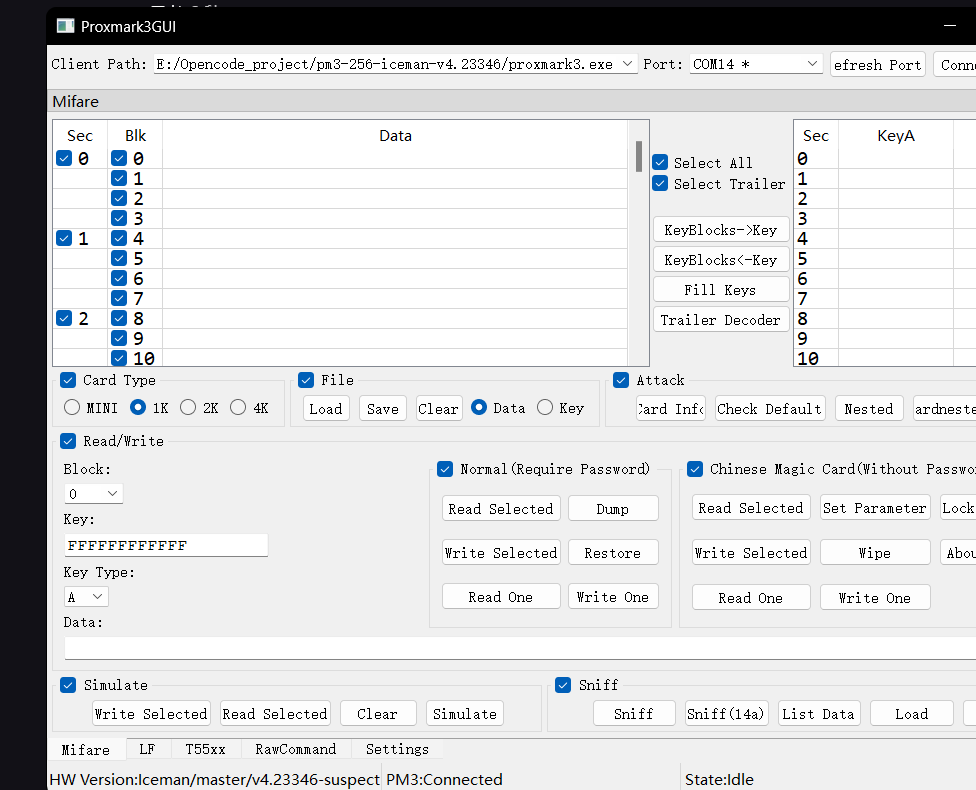

# Stage 0 Report — Qt 5.15 / qmake 基线与旧版构建

**日期：** 2026-11-10  
**分支：** `upgrade/iceman-v4.23346`  
**基线提交：** `964c60b`（标签 `baseline-v0.2.8`）

---

## 1. 阶段目标

在修改业务源码前，完成：

1. 检查实际 Git 状态、项目目录与构建入口。
2. 配置 Qt 5.15.x + qmake + 匹配的编译器。
3. 编译**未修改**的原始 v0.2.8 工程。
4. 启动 GUI，确认主要页面可见。
5. 用指定 `proxmark3.exe`（v4.23346）验证基础连接与版本读取。
6. 记录基线构建结果和运行问题。

---

## 2. Git 状态

```text
main                    964c60b chore: import pristine Proxmark3GUI v0.2.8 baseline
* upgrade/iceman-v4.23346 976d641 docs: add Stage 1 audit report
```

- 原目录不是 Git 仓库；基线由 Stage 1 审计时建立。
- 未修改 `main` 基线，未覆盖 `baseline-v0.2.8`。
- 本阶段未修改原始业务源码。

---

## 3. Qt / 编译器环境

### 3.1 初始检查结果

| 项目 | 结果 |
|---|---|
| Qt 5.15.x | 未安装 |
| qmake | 不存在 |
| MSVC | 不存在 |
| MinGW Qt | 不存在 |
| QtSerialPort | 不存在 |
| Python | 3.12.10（用于安装工具） |
| Git | MSYS2 Git 2.56.0 |
| 设备 | 真实 Proxmark3：`USB\VID_9AC4&PID_4B8F\ICEMAN`，`COM14` |

### 3.2 安装方案与决策

首先尝试 `aqtinstall` 安装官方 Qt 5.15.2 `win64_mingw81`。下载到的 Qt 包为 **Enterprise** 构建，`qmake` 要求 `licheck.exe` 许可证检查：

```text
Error: Qt license file was not found!
Project ERROR: License check failed! Giving up ...
```

**未绕过许可证检查**，改用 MSYS2 提供的开源 Qt5：

| 组件 | 版本 |
|---|---|
| Qt | **5.15.19+kde+r96-1**（`QT_EDITION = OpenSource`） |
| qmake | Qt 5.15.19 / QMake 3.1 |
| QtSerialPort | 5.15.19-1 |
| Qt5 Tools（windeployqt 等） | 5.15.19-2 |
| 编译器 | MinGW-w64 GCC **16.2.0**（UCRT64） |
| make | GNU Make 4.4.1（`mingw32-make`） |
| GDB | 18.1（用于启动诊断） |
| 平台 | Windows 64-bit（UCRT64） |

安装路径：

```text
C:\msys64\ucrt64\bin\qmake-qt5.exe
C:\msys64\ucrt64\bin\mingw32-make.exe
C:\msys64\ucrt64\bin\g++.exe
C:\msys64\ucrt64\share\qt5\...
```

> 说明：项目要求“Qt 5.15.x”。5.15.19 是 MSYS2 对 Qt 5.15 LTS 的开源补丁版本，满足该约束；未迁移 Qt6，未迁移 CMake。

### 3.3 修复的 MSYS2 数据库问题

MSYS2 `pacman` 原有两条重复本地数据库记录：

```text
gcc-libs-15.3.0-1  / gcc-libs-16.2.0-1
msys2-runtime-3.6.10-5 / msys2-runtime-3.6.11-4
```

已将旧版本目录备份到：

```text
C:\Users\van\AppData\Local\Temp\opencode\pacman-db-backup\
```

随后移除旧记录，保留当前安装版本：

```text
gcc-libs 16.2.0-1
msys2-runtime 3.6.11-4
```

未修改系统 PATH，未替换全局编译器。

---

## 4. 构建入口与命令

工程入口：

```text
src/Proxmark3GUI.pro
```

实际使用的构建命令：

```powershell
$env:PATH = "C:\msys64\ucrt64\bin;" + $env:PATH
mkdir build-stage0
cd build-stage0
qmake-qt5 ..\src\Proxmark3GUI.pro -spec win32-g++ CONFIG+=release
mingw32-make -j4
```

产物：

```text
build-stage0\release\Proxmark3GUI.exe
```

---

## 5. 基线构建结果

| 验收项 | 结果 | 说明 |
|---|---|---|
| B0-1 qmake 正确读取工程 | **通过** | 生成 Makefile；仅有 resource `.o` 预检查警告 |
| B0-2 完整编译/链接 | **通过** | 生成 `Proxmark3GUI.exe`，851,968 bytes |
| B0-3 GUI 启动、页面显示 | **通过** | 主窗口正常；Mifare / LF / T55xx / RawCommand / Settings 五个页面可见 |
| B0-4 调用 v4.23346 Client 并接收基础输出 | **通过** | 真实 COM14 连接成功；状态栏显示 `Iceman/master/v4.23346-suspect` |
| B0-5 记录基线问题 | **通过** | 见第 7 节 |

### 5.1 编译警告

构建成功，但存在以下警告（未阻塞）：

- `QButtonGroup::buttonToggled(int,bool)` 已弃用，建议 `idToggled`。
- `QByteArray::operator+=(const QString&)` 已弃用。
- `mainwindow.ui` 中 `label_17` 重名，uic 自动重命名为 `label_171`。
- 运行时 `connectSlotsByName` 提示若干 `on_*` 槽没有匹配信号（项目原有写法）。

### 5.2 GUI 启动

未修改的 v0.2.8 主窗口正常显示，截图：



界面保留了原有布局：

- 顶部 Client Path / Port / Refresh / Connect / Disconnect
- Mifare / LF / T55xx / RawCommand / Settings 五个功能页
- 底部状态栏 `HW Version` / `PM3` / `State` / `Stop`

### 5.3 Client 集成验证

环境：

- Client：`E:\Opencode_project\pm3-256-iceman-v4.23346\proxmark3.exe`
- 设备：COM14（VID `0x9AC4` / PID `0x4B8F`，序列号 `ICEMAN`）
- 固件：`PM3 GENERIC`，AT91SAM7S256，256K flash

通过 GUI 点击 Connect 后，状态栏显示：

```text
HW Version: Iceman/master/v4.23346-suspect
PM3: Connected
State: Idle
```

随后通过 GUI 点击 Disconnect，未执行任何写卡、擦除、刷写或模拟操作。

### 5.4 真实客户端输出证据

直接运行指定 Client（只读命令）：

```text
> proxmark3.exe COM14 --incognito -c "hw version"
[+] Using UART port COM14
[+] Communicating with PM3 over USB-CDC
[+] Max frame size: 624 bytes
[+] Emulator memory: 8192 bytes
...
 [ Model ]
  Firmware.................. PM3 GENERIC
 [ ARM ]
  Bootrom.... Iceman/master/v4.23346-suspect ...
  OS......... Iceman/master/v4.23346-suspect ...
  Compiler... GCC 13.2.1 20231009
...
```

**确认：** GUI 连接判定依赖的 `OS.........` 大写形式在 v4.23346 中仍存在；旧版 `os:` 小写形式不是可靠依据，但当前正则的 `OS\.+` 分支可以匹配。

---

## 6. 命令完成哨兵验证（Stage 1 预研）

为了替代旧版“固定等待/文本触发”，验证了客户端本地 `rem` 命令作为完成哨兵的可行性。

输入：

```text
hw version
rem PM3GUI_DONE_1
```

实际输出末尾：

```text
[usb|script] pm3 --> rem PM3GUI_DONE_1
[+] 2026-11-10T13:13:40Z remark: PM3GUI_DONE_1
```

结论：

- `rem <token>` 会在命令处理完后输出 `remark: <token>`。
- 可作为“上一条命令已返回”的稳定哨兵。
- 哨兵是 Client 本地命令，不访问设备，适合 v4.23346。
- 对于会等待用户输入/长时间运行/交互式命令（sniff、tune、sim 等），不能简单追加哨兵，应使用单独的 detached 模式。

该机制将在 Stage 1 实现。

---

## 7. 基线已知问题

1. **独立运行缺少传递依赖 DLL**
   - 直接双击 `release\Proxmark3GUI.exe` 会以 `0xC0000135`（DLL not found）退出。
   - 需要 `C:\msys64\ucrt64\bin` 在 PATH 中，或复制 `libicuin78.dll`、`libicuuc78.dll`、`libpcre2-16-0.dll`、`libdouble-conversion.dll` 等传递依赖。
   - `windeployqt` 只复制了 Qt 主 DLL、平台插件和编译器运行时，未复制这些 MSYS2 依赖。
   - 最终交付需要补充完整依赖打包（Stage 6）。
2. **旧版连接判定**
   - 仍以 `[=]` 判断 Iceman、以 `OS....` 判断连接成功。
   - 不解析 Client 版本、固件版本、型号。
3. **旧版命令完成机制**
   - 固定超时 + 文本匹配；存在误判/截断。
4. **旧版断开检测**
   - `QSerialPortInfo::isBusy()` 轮询；对 TCP/BT 无效。
5. **旧版输出处理**
   - 无 ANSI/CR/增量 UTF-8 处理。
6. **运行时警告**
   - `connectSlotsByName` 无匹配信号（不影响本次基线，但属于代码质量问题）。

---

## 8. 未做/未验证

- 未做任何写卡、擦除、锁卡、模拟、恢复、刷写。
- 未验证 MIFARE 读写的实际结果（留到 Stage 2）。
- 未验证 Trace、LF、T55xx、NTAG 的实际硬件行为。
- 未建立独立发布目录（当前依赖 MSYS2 PATH）。

---

## 9. 下一阶段计划

进入 **Stage 1：底层 Client 通信层整理**：

- 引入 `ClientSession`（Core 层），统一进程生命周期、命令队列、超时、退出状态和连接状态。
- 使用 `rem <token>` 哨兵替代固定文本触发（对普通命令）。
- 增加增量 UTF-8、ANSI、CR 处理。
- 移除对 `QSerialPortInfo::isBusy()` 的断开依赖，改用 `QProcess::finished/errorOccurred`。
- 保留 `Util::execCMD` / `execCMDWithOutput` 兼容接口，逐步迁移业务模块。
- 完成后重新编译，并验证 MIFARE/LF/Raw 现有入口仍可工作。

---

**Stage 0 结论：通过。** 基线可构建、可启动，并能通过 GUI 调用指定 v4.23346 Client 读取真实设备版本。已进入 Stage 1。
